# Checkpoint-bound Reevaluation patch receipts (experimental, opt-in)

This implements the ordinary Growth consumption part of the 2026-10-20
publication durability audit. Production activation remains disabled. The
default additive sharded training export still needs the audit's independent
generation-publication repair; this implementation rejects that mode unless
training export is skipped. The four workers remain independent processes.

Sources reviewed before editing:

- Operator `REPORT.md`, `crash_boundary_matrix.csv`, `source_inventory.json`
  under `morpion_publication_durability_review_2026-10-20/`.
- Audited protected main: `50fb67a42577e195bc565f4d03e38d919640d08a`.
- PR #75 streaming Reevaluation: `79693ce2dc59c6d6ccb951951c9ba75fa69057f3`.
- Exact implementation base, PR #78:
  `b0980ab41cb1ebf178d4ef26d49e82dd5d57ca76`, branch
  `fix/morpion-durable-reevaluation-publication`. Its producer and patch/cursor
  schemas are unchanged. Released `algorhino-anemone==0.2.26` remains the
  dependency; no Anemone changes or warm Growth activation are required.

The audit placed receipts after ownership and immutable generation publication.
This change includes a narrow Growth lease and private checkpoint/flat-export
attempts needed to review receipts safely. It does not substitute for the
remaining ownership, sharded publication, retention, Dataset or Training PRs.
The request's single authoritative run-state commit takes precedence over the
audit's proposed separate `growth_commit` sidecar. No such sidecar is introduced.

## API and activation boundary

```python
run_pipeline_growth_stage(
    args, runner, max_cycles=1, checkpoint_bound_receipts=True
)
```

The keyword defaults to `False`; no CLI, launcher, orchestrator or production
worker passes `True`. This is an experimental Python API for isolated review.
Do not enable it in real workspaces from this PR alone.

Activation requires an explicit, quiescent, existing baseline with a readable
run state and checkpoint, no legacy pending patch, no generation manifest ahead
of that state, `future_only` evaluation, and flat or skipped training export.
The adapter must provide `save_checkpoint` and `discard_uncommitted_runtime`.
Ordinary receipts reject derived workspaces and `derived_sequential` invocation.
Baseline adoption syncs and hashes the existing checkpoint, then durably records
an empty receipt ledger. It cannot reconstruct patches lost by legacy eager
deletion. Operators must reconcile legacy ambiguity before adoption.

Additional APIs:

- `save_bootstrap_run_state(state, path, *, durable=False)` preserves the old
  format and exact serializer. `durable=True` delegates to the existing derived
  `atomic_json`: unique same-directory temporary, flush, file fsync, replace,
  parent-directory fsync. Receipt-marked state refuses a non-durable save.
- `apply_pending_reevaluation_patch_to_runner(..., patch_snapshot=None)` can
  consume an already captured typed patch without reopening another identity.
  Receipt mode passes `delete_after_apply=False`. Eager deletion rejects a
  receipt-marked run. The legacy unmarked default retains its existing behavior.
- `AnemoneMorpionSearchRunner.discard_uncommitted_runtime()` releases the live
  runtime, selected bundle and provisional apply metrics, and resets runtime
  eviction state. It does not alter evaluator mathematics. Future warm reuse
  must honor this cold-boundary hook; warm reuse remains disabled here.
- Existing `derived.provenance.sync_checkpoint` now also fsyncs a monolithic
  root file and its directory. Directory checkpoints retain recursive file and
  directory syncing. Derived drain refuses ordinary receipt-marked state.

## Ownership and persistence assumptions

Every updated ordinary Growth entrypoint, including default legacy invocations,
holds a nonblocking exclusive `flock` on the stable
`pipeline/.growth_patch_consumer.lock` for its whole invocation: state load,
restore, application, checkpoint, commit and acknowledgement. The lock is never
unlinked, expires only with the descriptor/process, and has no TTL takeover.
A competing Growth invocation fails before application. The internal
`GrowthPatchReceiptSession` must only be used under that lease.

Supported scope is a local POSIX filesystem with working file/directory fsync,
atomic same-directory replace, PR #78's create-only hard-link publication, and
cooperative kernel locks. The storage stack must honor completed fsync ordering.
Unsupported sync errors propagate. No best-effort durability fallback is used.
Transaction inputs must be inside the run root without symlinks. Directory
identities hash sorted relative file names, sizes and exact SHA-256 file bytes;
file identities hash exact bytes. No scientific payload format changes.

Quiesce all old consumers and run-state writers before adoption. Mixed old/new
binaries, manual mailbox replacement/unlink, deletion of the lock inode,
uncooperative external writers, network filesystems and multi-host fencing are
outside the proof. One independent Reevaluation producer may run concurrently.
Replica producers still need the audit's cursor/ownership work: create-only
publication alone cannot serialize a multi-producer cursor.

## Commit protocol and exact commit point

1. Under the Growth lease, parse protocol state and validate its exact committed
   checkpoint hash. Cold restore that pointer. Never scan/fall back to an older
   checkpoint, tree export or fresh root while retaining newer receipts.
2. Capture complete pending bytes once, parse them, and hash those bytes. Match
   the ID against the cumulative committed receipt ledger. A matching ID/hash
   skips application; a reused ID with changed bytes fails closed.
3. For a new patch, require a nonmissing source tree generation at or before the
   committed Growth generation. Older sources are valid asynchronous inputs;
   future sources are rejected. Match evaluator generation/name/bundle path
   against the model selected at runtime restore, and hash the bundle bytes.
4. Invoke the unchanged application hook once, with the captured rows in their
   original order, alpha, missing-node handling and metadata. Retain the final
   patch file. Any partial application/exception discards the runtime.
5. Force a save attempt for a successfully applied patch. Write the checkpoint
   under `search_checkpoints/receipt_attempts/<uuid>/<original generation basename>`
   (the actual configured checkpoint directory is preserved). Flat exports use
   `tree_exports/receipt_attempts/<uuid>/generation_XXXXXX.json`. Codec suffixes
   and payload formats remain unchanged. Each cycle/retry has a new UUID.
6. Sync all checkpoint files/shards, directories and newly created ancestors
   through the existing work root. Sync the required flat export and original
   model bundle too. Recheck patch and selected model identities. An existing
   manifest for the uncommitted generation is an explicit reconciliation error.
7. Construct one run-state object containing the new checkpoint pointer/hash,
   generation, cumulative receipt ledger and ordinary scientific metadata.
   Atomically durably replace `run_state.json` using `atomic_json`.
   **The commit point is successful fsync of the run-state parent directory
   after that replacement**, with all dependencies already durable.
8. Publish the generation discovery manifest only after this commit. On restart,
   repair a missing manifest from the latest committed state. A conflicting
   manifest fails closed; existing Dataset/Training status changes are preserved.
   Logs and manifests are projections, never application commit evidence.
9. Reload actual persisted state, validate its checkpoint identity, and sync the
   observed complete state. Find a receipt for the current mailbox's exact
   ID/hash, and verify the original model bundle still has its recorded hash.
10. Wait until the producer cursor names that exact patch ID, tree generation
    and evaluator generation/name/bundle. Sync cursor bytes and directory entries,
    then reread the cursor. A missing/lagging cursor leaves the patch pending.
    Cursor content is never advanced or repaired by Growth.
11. Recheck pending identity, unlink that exact pending publication, and fsync
    `pipeline/`. Single-consumer ownership and the unchanged create-only producer
    prevent replacement between check and unlink. A new patch published after
    unlink survives the old acknowledgement.

Checkpoint completion without step 7 is uncommitted output. Neither an in-memory
application, a log record nor a manifest acknowledges a patch. A post-replace
exception is uncertain: the new complete state may already exist. Do not roll
it back or infer that the patch is unapplied. Restart reads the actual state,
validates/syncs its dependencies and state before acknowledgement. The same rule
applies to a post-unlink error: the receipt remains valid whether the old pending
name is absent or reappears after host recovery.

```mermaid
stateDiagram-v2
    [*] --> Pending
    Pending --> VolatileApplied: verify ID/hash/model; apply
    VolatileApplied --> PrivateCheckpoint: write + sync dependencies
    PrivateCheckpoint --> Committed: durable run_state checkpoint + receipt
    Committed --> CursorConfirmed: verify + sync producer cursor
    CursorConfirmed --> Acknowledged: identity recheck; unlink + directory fsync
    VolatileApplied --> Pending: crash; restore old head
    PrivateCheckpoint --> Pending: crash before commit; ignore orphan attempt
    Committed --> Committed: restart; skip application
    CursorConfirmed --> Committed: interrupted acknowledgement
    Acknowledged --> Committed: pending name reappears; receipt still deduplicates
```



## Receipt format and invariants

The additive `metadata.checkpoint_bound_reevaluation_v1` object has
`schema_version: 1`, `generation`, `checkpoint_path`, `checkpoint_sha256` and a
`receipts` list. Each receipt stores:

```text
patch_id, content_sha256, tree_generation,
evaluator_generation, evaluator_name, model_bundle_path, model_sha256,
checkpoint_path, checkpoint_sha256, committed_generation,
rows_requested, rows_applied, blend_alpha
```

`tree_generation` always names the original patch source, not the resulting
Growth generation. Counts distinguish requested rows from applied present rows.
Alpha records the existing effective runtime setting; it never forces alpha 1.
Head receipts must identify the same checkpoint as the run-state head. Duplicate
ledger IDs, unknown schemas, impossible counts/generations, malformed identities,
missing/corrupt state or changed checkpoint contents fail closed. No recovery
default fabricates scientific values or skips a missing artifact.

Every descendant checkpoint carries all earlier receipts, so replay of an older
ID cannot blend again. This PR deliberately disables Growth retention/pruning in
receipt mode. It retains authoritative heads, receipt model inputs and orphan
attempts until a separate pin/retention policy is reviewed. Storage use grows;
do not delete receipts, referenced bundles or checkpoints as a rollback shortcut.
An active pointer may legitimately advance after a committed application;
acknowledgement verifies the receipt's original bundle, rather than applying
the patch with the newly selected model. Replacing that original bundle fails.

## Before/after crash matrix

“After” assumes the supported ownership/storage scope above. Legacy mode remains
unchanged. A replay from an old checkpoint can repeat a physical apply call;
only one set of effects enters the committed checkpoint lineage.

| Case / crash boundary | Previous ordinary behavior | Opt-in recovery |
| --- | --- | --- |
| A Before application | Pending remains | Pending remains; no receipt |
| B After apply, before checkpoint | Eager deletion loses volatile effects | Old head + pending; cold replay once into next commit |
| C During checkpoint write | Canonical output can be partial | Private orphan ignored; old head + pending |
| D Complete checkpoint, before state | Patch may be gone; fallback ambiguity | Old head authoritative; retry into a new private attempt |
| E State committed, before deletion | No durable identity deduplication | Matching receipt skips apply; retry acknowledgement |
| F During unlink / directory fsync | No receipt proving effects | Absent or reappeared name is safe; receipt deduplicates |
| G Restart after acknowledgement | No application ledger | Restore committed head; no reapply |
| H New patch after old acknowledgement | Path-only delete can target a replacement | Current ID/hash must have its own receipt; old receipt cannot delete it |
| I Changed ID content / original model bytes | No durable hash checks | Fail closed; pending retained |
| J Zero Growth / save threshold not reached | Patch can be deleted without a save | Patch forces checkpoint attempt and next generation |
| K RAM refusal / diagnostic stop | Applied patch may already be deleted | Old head, no new receipt, pending retained, runtime discarded |
| L Future source / wrong evaluator model | Unvalidated ordinary application | Reject before mutation; older source generations remain valid |
| M Alpha below 1 | Reapplication can blend twice | Exact cold restore + cumulative receipt; committed blend occurs once |
| N Interrupted run-state publication | Final JSON can be partial | Before replace: old JSON; after replace: complete new JSON, validated and resynced on restart |
| O Independent producer/consumer | Consumer may delete before cursor write | Pending retained until matching cursor is durable; new post-unlink publication survives |

## No-save behavior and scientific limits

A new patch forces a checkpoint even with zero new nodes, an exhausted branch
budget or unmet regular save thresholds. It advances generation publication
cadence relative to the unsafe legacy path. This is a behavioral change, not a
claim of scientific equivalence to losing an applied patch. It can change which
generations Dataset/Training observe. That is why activation remains opt-in.

RAM refusals and diagnostic stops still prevent saving. They commit only ordinary
no-save counters on the old head, retain the pending patch without a receipt and
discard volatile state. A later cycle restores that old checkpoint before replay.
Without a new patch, regular no-save and budget rules retain their old decisions;
receipt mode always starts from the authoritative cold checkpoint.

## Deterministic validation

All new tests use temporary two-node synthetic workspaces; none accesses gen38,
historical/derived workspaces, training jobs or distributed workers.

- `test_morpion_checkpoint_patch_receipts.py`: exact alpha-0.5 values (2 -> 6,
  4 -> 8), exact application counts, requested/applied row counts, hash/model/source
  provenance, monolithic and sharded checkpoint syncing, zero Growth and all RAM
  refusal paths, diagnostic stops, missing/corrupt state/checkpoint, applicability,
  model replacement, duplicate/conflicting IDs, private flat export parity,
  cumulative receipts, partial application, orphaned partial state temporaries,
  byte parity of old/durable run-state serialization, and downgrade guards.
- The same file fails each fsync call in a traced complete transaction and
  restarts from actual persisted evidence. It also uses `os._exit` subprocesses
  before/after application, during/after checkpoint writing, before/after state
  replace, before/after manifest repair, before acknowledgement, before/after
  unlink and after acknowledgement. No cleanup runs in the crashed child.
- `test_morpion_patch_receipt_concurrency.py`: a live Growth lock cannot be
  stolen, process death releases it, an independent producer pauses between
  patch/cursor publication, and a new patch published during the previous ack's
  post-unlink interval survives untouched.
- Existing legacy/PR #75 indexed Reevaluation, PR #78 publication, Growth,
  derived continuation, checkpoint parity and real adapter blending tests remain
  regression gates. Normal installed-package CI is required on the exact PR head.

Subprocess exit tests establish process-crash recovery, not physical power-loss
simulation. Filesystem durability depends on the documented fsync contract.

## Remaining prerequisites, rollout and rollback

Production activation stops here. The recommended next independent PR is the
audit's immutable generation publication and retention work: repair additive
sharded export/index retry, publish immutable dependencies, pin the committed
checkpoint and pending source generations, and fence every generation writer.
General ownership/shared-metadata serialization remains a dependency too.

In particular, if the producer dies after patch publication and before cursor
commit, this consumer safely retains the committed patch and waits; it cannot
infer missing producer progress. A separately reviewed patch/cursor recovery
transaction is needed for automatic liveness. Replica producer cursor races,
mutable Training bundles and promotion, Dataset/Training completion, shared
manifest update races and auxiliary JSON writers also remain unresolved. This
PR does not claim end-to-end exactly-once processing by the four-worker pipeline.

Before any receipt adoption, ordinary code reversion is format-compatible. After
adoption, keep receipt-aware cold restore and acknowledgement, or quiesce all
workers and establish an explicitly reconciled new baseline. Do not run an old
eager-delete consumer or silently strip metadata. Complete orphan attempts and
partial temporaries are ignored, not automatically deleted. No existing PR is
merged or enabled by this implementation.
