# Durable sharded generation publication (experimental)

This adds complete, immutable generation publication around the **existing
scientific sharded v1 writer**, stacked exactly on PR #79,
`7313ecfad36667ab2a8dd1bbd4b894aa682a7e9b`. Production activation remains off.
Growth, Dataset, Training and Reevaluation remain independent processes.

Read before implementation: `morpion_checkpoint_bound_patch_receipts.md` and the
operator audit `REPORT.md` under
`/home/pompote/oldata/victor/morpion_publication_durability_review_2026-10-20/`.
The audit's mutable-index retry failure is reproducible: a legacy failed export
can advance `node_index.json` past the committed checkpoint; retrying that
generation then omits required creation records. Atomic replacement of the
generation JSON alone cannot repair that transaction.

## Scope, API and compatibility

```python
run_pipeline_growth_stage(
    args,
    runner,
    max_cycles=1,
    checkpoint_bound_receipts=True,
    durable_generation_publication=True,
)
```

Both keywords default to false. No CLI, launcher or production worker enables
them. The new option requires PR #79's receipt option, its cold restore and
existing-baseline checks, `future_only`, and artifact-pipeline mode. It permits
ordinary `sharded`, `both`, `flat` and skipped exports. Once marked, a workspace
refuses Growth calls that omit either flag. Derived mode remains separate.

Publication uses a **new namespace and additive protocol**,
`generation_publications_v1/` and `metadata.durable_generation_publication_v1`.
The `v1` suffix here versions publication, not a new scientific representation.
Scientific root/generation/shard `format_kind` and `format_version` remain
unchanged. Scientific v2 headers are explicitly rejected throughout adoption;
there is no partial v2 integration and no dependency on its implementation branch.

Legacy unmarked v1 writing and reading retain their existing behavior. Creation
generation, ancestry/state references, update rows, float decoding, row order,
root identity and the existing v1 merge rules are preserved. In particular,
this does not make v1's effective/target-value fallback equal to the flat
export's semantics. Each representation is compared against its own original
writer. No evaluator, blend, selection, target or checkpoint codec changes.

New helpers are `DurableGenerationPublication` (prepare, begin_cycle, freeze,
publish, validate, retain), `generation_read_pin`,
`prune_uncommitted_generation_artifacts(paths)`, and
`publish_directory_if_absent`. The internal session must run under the Growth
lease. The public collector obtains that same lease. PR #79's ownership helper
is reexported at its original module path, using the identical lock filename.

## Complete file inventory

For a saved generation G, the original additive v1 writer writes these five
logical artifacts, including empty new-node shards:

| Artifact | Legacy behavior | Capsule behavior |
| --- | --- | --- |
| `node_shards/generation_G.json` | New nodes, direct write | Private new shard; earlier shards linked from committed history |
| `update_shards/generation_G.json` | All current updates, direct write | Private new shard; earlier shards linked |
| `generation_G.json` | Per-generation counts, paths and root | Private complete generation manifest |
| `manifest.json` | Mutable catalog/latest-generation pointer | Private inode per capsule; only selected committed prefix |
| `node_index.json` | Mutable creation-generation cache | Rebuilt private inode from authoritative creation shards, then updated by original writer |

Each unique attempt additionally contains:

```text
generation_publications_v1/
  staging/<uuid>/                 # incomplete; never discovery
  objects/<uuid>/                # complete immutable capsule; not necessarily committed
    .publication_attempt_v1.json  # owned attempt identity
    .generation_publication_v1.json
    bootstrap_config.json        # exact accepted config snapshot
    checkpoint/<original generation basename and codec suffix>/...
    tree_exports_sharded/        # v1 catalog, index, generation and all referenced shards
    tree_exports/                # flat JSON when selected, including both mode
    models/<hash(origin, content identity)>/...  # exact bundle bytes
  trash/<uuid>/                  # quarantined, proven uncommitted attempts only
  pins/<uuid>.lock               # stable inode; never unlinked
run_state.json                   # sole authoritative commit
pipeline/generation_G/manifest.json  # repairable discovery/status projection
pipeline/.growth_patch_consumer.lock # existing stable exclusive Growth lease
```

A file checkpoint has no trailing directory; a sharded checkpoint includes all
its files and subdirectories. Model bundles may also be files or directories.
The seal records every regular file except itself: relative path, exact size
and SHA-256. It also records protocol/id/generation/parent/baseline, config
identity, original model identities and frozen paths, and selected sharded path.
The attempt marker and config are inventory dependencies too. Symlinks and
escaping/missing inputs are rejected. Hashing uses bounded buffers.

Growth still emits history/events, latest status/diagnostics, performance data,
optional profiling and latest Linoo selection data through existing paths.
These are projections or diagnostics, not generation/receipt commit evidence.
Dataset artifacts, Training outputs, active-model selection, producer cursor
and the singleton pending patch retain their separate protocols. This PR does
not turn them into one transaction. Frozen selected model bytes and the receipt
model identities are dependencies of the Growth capsule.

## Commit protocol

1. Hold PR #79's nonblocking exclusive `flock` on
   `pipeline/.growth_patch_consumer.lock` for the entire Growth invocation.
   Load actual run state and validate its committed checkpoint and head capsule.
   Do not choose a generation by scanning filenames or timestamps.
2. Adopt only an explicit quiescent baseline with no pending patch. Copy the
   original checkpoint and selected v1 history into a unique private capsule.
   Filter any ahead legacy catalog to the selected committed generation and
   rebuild the private index from its creation shards. Never change the original
   legacy files. Pin exact models referenced by existing receipts. Publish and
   durably record the baseline capsule without changing original checkpoint/tree
   pointers or PR #79 receipt identities. Original legacy dependencies stay pinned.
3. For each cycle create a fresh UUID staging directory. Freeze the accepted
   bootstrap config and the exact selected model before loading runtime model
   bytes. Keep the original logical model path/hash/generation/name in scientific
   and receipt metadata. Reuse already committed identical model bytes with
   hard links; otherwise copy and check the expected content identity.
4. Cold restore the committed checkpoint. Capture and apply a new patch using
   the unchanged PR #79 protocol; retain its final mailbox name. Existing exact
   committed IDs skip application. Unsaved/failed application remains volatile.
5. Write the checkpoint under this attempt, with the original basename/codec.
   Seed the v1 writer solely from the latest **committed** sharded capsule.
   Link immutable historical shards/manifests, create private catalog/index
   inodes, rebuild the index, and invoke the original writer. Never seed from
   an abandoned attempt. Flat/both output also stays private.
6. Validate the entire selected v1 history: headers, source generations,
   creation/update counts, exact reconstructed index, references and merged
   node count. Write the complete inventory seal. Flush/fsync all files, all
   subdirectories and new ancestors through the work root.
7. Move the whole staging directory to `objects/<uuid>` with Linux
   `renameat2(RENAME_NOREPLACE)`. Require success; there is no replacement,
   check-then-rename or direct-final-write fallback. Fsync destination parent,
   source parent, publication namespace and work root. The capsule is now
   complete and durable, but it is **not a committed generation**.
8. Relocate checkpoint/tree pointers to that capsule. Construct PR #79's
   checkpoint identity and cumulative receipts against the final checkpoint.
   Append the capsule record to run-state metadata. Write/flush/fsync a unique
   same-directory temporary `run_state.json`; atomically replace the pointer;
   fsync its parent. **Successful parent fsync is the generation commit point.**
9. Validate the committed head. Publish/repair the discovery manifest using a
   unique temporary, file fsync, atomic replace and parent fsync. Subsequent
   updates to a marked manifest use that durable serializer too. Status writes
   remain projections; they cannot commit or acknowledge a patch.
10. Before acknowledgement, reload actual state and validate the committed
    checkpoint and every head-capsule dependency. Resolve receipt models from
    their exact frozen bytes. Sync observed state, require and sync the matching
    producer cursor, recheck mailbox identity, unlink and fsync `pipeline/`.
    Growth never advances or repairs the producer cursor.
11. Under the same Growth lease, synchronize actual state again before orphan
    collection. Quarantine only owned uncommitted attempts, with an exclusive
    nonblocking per-capsule pin. Never count-prune committed roots.

Skipped export creates no scientific tree or discovery manifest. A later export
seeds from the last committed sharded source, preserving original generation
gaps. A no-save cycle commits no capsule or new receipt; private staging becomes
an orphan. PR #79's forced save for a new patch and RAM/diagnostic refusal
semantics are unchanged.

```mermaid
stateDiagram-v2
    [*] --> OldCommitted
    OldCommitted --> PrivateAttempt: lease; freeze; apply; write
    PrivateAttempt --> Sealed: validate; hash; fsync files and directories
    Sealed --> CompleteUncommitted: atomic no-replace directory move; fsync namespace
    CompleteUncommitted --> NewCommitted: durable run_state checkpoint + receipts + capsule root
    NewCommitted --> Discoverable: publish or repair manifest
    Discoverable --> Acknowledged: matching cursor; exact unlink; directory fsync
    PrivateAttempt --> OldCommitted: crash; ignore orphan; cold retry
    Sealed --> OldCommitted: crash; cold retry
    CompleteUncommitted --> OldCommitted: state still old; collect orphan
    NewCommitted --> NewCommitted: restart; validate and skip receipt application
    Acknowledged --> NewCommitted: mailbox reappears; receipt deduplicates
```



## Recovery invariants and before/after crash matrix

Atomic visibility, durable persistence and logical deduplication are separate:
the directory move publishes complete dependencies; fsync establishes their
durability; the state commit binds receipt effects to a checkpoint. Neither a
complete capsule nor a generation manifest substitutes for that commit.

Run-state roots are append-only, with one unique positive generation per UUID,
contiguous parent/generation ancestry from an explicit baseline, and a head
matching the top-level generation/checkpoint/tree pointers. Every committed
capsule is retained. The reader checks exact inventory bytes. A changed/missing
dependency fails closed before acknowledgement; no fallback to older scientific
state while keeping newer receipts is permitted.

| Crash boundary | Before this PR (ordinary sharded path) | New protocol and recovery |
| --- | --- | --- |
| Before/during shard writes | Final shard may be partial; patch may already be deleted | Partial private attempt only; old state and pending patch retained; cold retry |
| After shards, before generation/catalog | Orphans may be reused or overwritten | Complete private shards still uncommitted; seed retry from committed capsule |
| During/after catalog, before index | Visible catalog may describe incomplete transaction | Catalog and index are private; old committed generation remains readable |
| After index, before publication | Ahead cache can suppress creation records on retry | Abandoned index ignored; reconstruct new private index from committed creation shards |
| During file or directory fsync | No complete durable-generation ordering | Error propagates; no state commit/ack; old dependencies retained |
| Before directory move | Final artifacts may already be visible individually | No new complete capsule; old state authoritative |
| After move, before namespace fsync | No equivalent boundary | Complete capsule may exist; never infer commitment from its presence |
| After capsule durability, before state replace | Checkpoint/export/manifest need not agree | Complete uncommitted capsule is ignored and collectible |
| State replaced, before parent fsync | Old direct state can be partial; persistence uncertain | Complete old or new state may survive; inspect actual state, validate and sync it before use/ack |
| After state commit, before/during manifest | No authoritative recovery ordering | New generation committed; repair missing manifest from state; temporary partial JSON stays private |
| During manifest recovery | Discovery could be partial or disagree | Atomic durable projection; conflict stops recovery; committed data retained |
| Before receipt acknowledgement | Eager deletion could lose volatile effects | Committed ID/hash skips reapplication; wait for exact durable producer cursor |
| After unlink, before pipeline fsync | No checkpoint-bound deduplication | Pending name may be absent/reappear; committed receipt prevents repeat effects |
| During quarantine/pruning | Count retention can remove dependencies | All committed roots pinned; partially removed orphan stays quarantined with ownership evidence |
| After acknowledgement/pruning | No retained complete generation closure | New patch survives old ack; all committed capsules and receipt dependencies retained |

An exception after a directory move, state replace or unlink does **not** mean
the operation did not happen. Recovery reads actual state. If complete new state
is observed after an interrupted fsync, dependencies were already synchronized;
recovery syncs that observed state before acknowledgement or retention. If old
state survives, discard volatile runtime and apply the retained patch against
the old checkpoint. Tests use alpha 0.5 so repeat blending changes values and is
detectable. Repeated volatile work after a crash is permitted; repeated
**committed** effects are not.

## Readers, ownership and retention

Both the full v1 loader and PR #75 indexed reader acquire a shared lifetime pin
for managed capsule paths, require membership in committed run-state roots,
validate every inventory dependency and sync the observed state. A raw complete
but uncommitted capsule path is rejected. Dataset's flat-loading entrypoint is
pinned too. Discovery validates its checkpoint/tree pointers against the same
committed record. An older capsule remains readable while a writer commits a
new capsule. SQLite indexes are disposable caches outside capsules.

Hard-link creation/removal changes inode ctime without changing payload bytes.
Managed indexed readers therefore verify expected committed hashes and size/
mtime stability instead of the legacy ctime heuristic. Unmanaged readers keep
their original mutation checks. Cooperative checkpoint, flat and v1 serializers
reject writes below a sealed capsule, protecting shared immutable inodes.

The stable Growth lease serializes updated ordinary artifact-pipeline Growth
writers and the public collector. There is no TTL takeover. Kernel process
exit releases it. Dataset/Training/Reevaluation readers keep running; no central
orchestrator or server is introduced. Per-capsule lock inodes are never removed.

Retention deliberately retains **all committed generations indefinitely**:
checkpoints, all export dependencies, exact frozen models/configs and cumulative
receipt evidence. It also protects original legacy checkpoint/export/model
prefixes, baseline pointers, active-model pointer, cursor, pending mailbox and
original receipt dependencies. Legacy count-based prune refuses activated run
roots and sealed capsules. External manual deletion is outside this protocol.

Only UUID directories with our valid owned-attempt marker, absent from actual
committed roots, are eligible for cleanup. Obtain exclusive nonblocking pin,
atomically move to owned trash, delete payload children, fsync, delete the marker
last, fsync and remove the empty directory. Interrupted deletion preserves the
marker until payload removal completes. Empty markerless trash can finish;
unknown or ambiguous nonempty entries stay for reconciliation. A live reader
pin prevents deletion. Unlinked hard links never delete retained inode contents.

No bounded committed-generation garbage collector is supplied. Retirement would
need durable completion of every asynchronous consumer plus closure over source
generations, active/candidate models and receipt checkpoints. A stage-claim TTL
is not that evidence. Existing downstream claims remain separate from the
nonexpiring Growth/pin locks used here.

## Tests and measured costs

The three `test_morpion_generation_publication*.py` files contain **61 generated
fixture cases**, with 19 subprocess `os._exit` crash boundaries, 10 injected
fsync failures, partial shard and manifest writes, manifest recovery, pruning,
receipt acknowledgement, independent readers and competing Growth writers.
They assert exact checkpoint/scientific payload parity, source generation,
row ordering, unchanged committed prefixes, orphan-index retry correctness,
legacy adoption with existing receipts, cursor waiting, model pin recovery,
seal/version failures and non-idempotent blend results across restart.

A focused run including those tests plus existing receipt, sharded exporter,
streaming reader, pipeline Growth, checkpoint parity and derived-continuation
regressions passed **242 tests** (16 Dataset-related cases deselected to avoid
their configured global leaderboard path in the local research environment).
An additional double-crash recovery test interrupts manifest repair after an
already committed generation, then verifies recovery without reapplication.
Repository Ruff and targeted strict mypy/Pyright/Pylint pass. Normal hosted CI
is the installed-package/full-suite and static-ratchet gate for the draft PR.

These tests exercise process death and syscall errors on a real temporary local
filesystem. They do not simulate a storage controller losing acknowledged
writes; power-loss guarantees depend on the fsync assumptions below.

`scripts/measure_morpion_generation_publication.py` compares a legacy control
with durable publication, in separate fresh subprocesses. It uses only generated
fixtures: actual v1 exports, scalar checkpoints and tiny synthetic model bytes,
baseline generation 1 plus three saved generations. Both final scientific
export-directory and checkpoint SHA-256 identities must match. Full measurements
are in [morpion_generation_publication_costs.json](morpion_generation_publication_costs.json).

| Nodes | Mode | Application bytes written (three saves) | Ratio | Peak RSS MiB | Final allocated bytes (unique inodes) | Apparent file bytes |
| ---: | --- | ---: | ---: | ---: | ---: | ---: |
| 1,000 | Legacy | 1,299,616 | 1.000 | 277.01 | 1,986,560 | 1,866,506 |
| 1,000 | Durable | 1,458,524 | 1.122 | 279.09 | 3,031,040 | 5,565,625 |
| 10,000 | Legacy | 13,017,613 | 1.000 | 299.72 | 18,841,600 | 18,714,500 |
| 10,000 | Durable | 13,743,522 | 1.056 | 304.13 | 26,148,864 | 55,164,608 |

Application bytes use `/proc/self/io` wchar, not physical device write
amplification. Allocated bytes count `st_blocks` once per device/inode; they do
not resolve CoW extents or storage journaling. RSS includes roughly 270 MiB of
Python/library imports. The legacy control is fixture publication, not a real
Growth benchmark; tiny scalar checkpoints/models do not estimate their real
production costs. Fixture steady-save elapsed times were 0.15/1.31 seconds
(1k legacy/durable) and 0.78/3.71 seconds (10k), without production extrapolation.

Historical shard bytes and identical frozen models share inodes. Catalog/index
and checkpoint bytes are private for every committed generation. Baseline
adoption copies legacy data once. Retaining a complete linked prefix and seal
for each generation costs O(G²) directory/inventory entries over long histories;
validation rereads historical dependencies and adds fsync calls even when linked
payloads need no new data writes. The existing materializing scientific v1
writer/validator remains O(nodes) RAM. This is a correctness change, not a
streaming/performance rewrite. Disk grows without a committed-retirement policy.

## Filesystem assumptions, rollback and activation blockers

Supported here: Linux libc exposing `renameat2`, a single local filesystem
supporting `RENAME_NOREPLACE`, hard links, cooperative `flock`, file fsync and
directory fsync, with storage honoring completed fsync ordering. Errors such as
EXDEV, ENOSYS, EINVAL or unsupported directory sync fail the transaction. No
best-effort fallback is used. The run root must already exist. NFS/object mounts,
multi-host fencing, arbitrary external mutation and deleted lock inodes are
outside the proof.

Do not enable this in production from this PR. Remaining activation blockers:

- Explicit operator reconciliation/adoption and tested storage capability,
  capacity and durability policy for the real filesystem. No automatic gen38
  restoration or historical migration is supplied.
- Quiesce old binaries, single-process bootstrap entrypoints and manual writers
  before adoption. Only cooperative updated artifact-pipeline Growth calls and
  this collector share the lease. General writer ownership/fencing still needs
  the audit's separate work; older code cannot honor new metadata guards.
- Producer crash after patch publication but before cursor commit still waits
  safely; producer cursor repair and multiple-producer cursor ownership remain
  separate. Replica producers are not made safe by generation publication.
- Dataset/Training completion, active-model pointer publication, shared status
  read/modify/write races and global config writers retain their separate
  durability work. Frozen Growth inputs do not complete those protocols.
- Bounded retirement with all asynchronous consumer/receipt dependencies, plus
  representative isolated cost validation, is still needed before sustained use.
  Scientific v2 remains a separate implementation and compatibility review.

Before adoption, rollback means removing this draft branch and retaining the
legacy workspace unchanged. After adoption, stop writers and retain all marked
state/capsules; downgrading Growth flags is refused. Do not strip metadata,
roll back to an older checkpoint, delete receipts or prune dependencies. A
legacy rollback requires a separately reconciled workspace and operator plan.
An interrupted adoption with old state leaves only an uncommitted complete
capsule; a retry adopts from original pointers and can later collect the orphan.

This establishes generation dependency closure for the opt-in PR #79 receipt
protocol. It does not claim end-to-end exactly-once recovery for all four workers.
