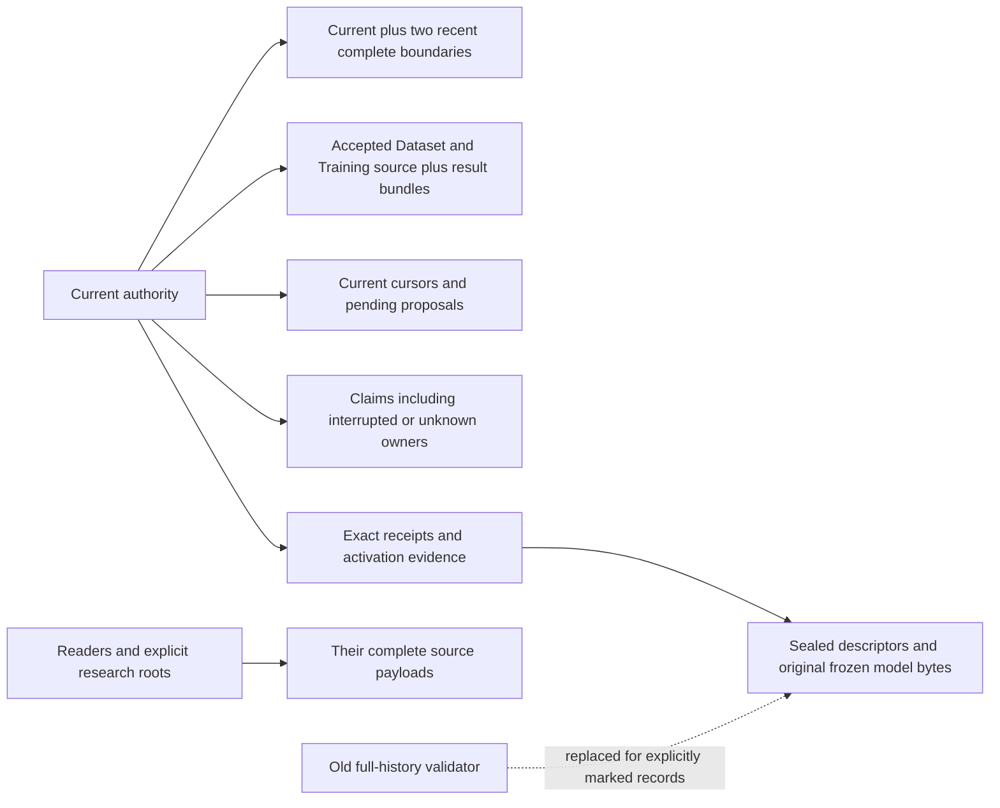

# Morpion: bounded payload history and efficient sustained search

> Historical generated outputs are available through the [evidence archive](evidence-archive.md); original paths in reproduction commands refer to restored or newly generated outputs.

This work adds explicit retirement of dependency-free historical checkpoint and
scientific payloads, using the existing run-state authority and capsule pins.
It improves measured four-worker Growth throughput by choosing the existing
32-step batch control. It does not implement automatic production cleanup,
intentional rollback, warm runtime reuse, or a new storage/scheduling authority.

The branch is `feat/morpion-bounded-history`, worktree
`/home/pompote/oldata/victor/morpion-scratch/s27/w`. All raw experiment artifacts,
private environments, scripts and retained copies live under `s27` on ext4.
Original research histories remain intact. Physical retirement is confined to
explicitly generated disposable histories or independent copies owned by this task.
No gen38 operation, merge, remote publication, release or production activation
was performed. Model activations below belong only to new private experiments.

## Executable and reviewable commits

Base: `1946c601237b899fc59f7c4d570818fad2bf8c9c`.
Frozen final executable: `7b7a5b91d523e0bf54064e2d4a44b372b0d57ae3`.
Final wheel SHA-256:
`fbf87568e9efb05fd960d60c08f87eb97f81ec09369a93b544f9397405a5798a`.
The wheel and sdist are retained under `s27/d`; package version remains 0.2.4.
The sdist SHA-256 is
`fc85a889393266f6ac2613abb2e3e28a8ddb4ecdc41f6edbbf66645cf59d2a67`.
The final test-only fixture correction and reports do not change executable package bytes.
Final CI records the test-tree commit separately from the frozen installed executable.

| Commit | Change |
| --- | --- |
| `dd5d542db1953aa7ffccbdcfc9c2402f4eda8efc` | Exact accepted Dataset/Training completion releases only its admitted claim UUID |
| `e1eb9667ebd255766ef4cfc382411d0ed7d5fe25` | Retirement marker admission, existing analyzer operation, reader fences and process-death tests |
| `916284574a595ebc383f8dfa8e5f31bbb0a6a996` | Matched 4/16/32 comparison and existing recipe default of 32 |
| `0d89bb0809b4d5da6deed6fa26cf078f63edfa13` | Account only for the two payload classes actually authorized for removal |
| `3ca9a1f49769b096714d4dc48c0c2904a65e6cd4` | Fixed-graph 100-generation study and bounded research proposal/resource observation |
| `7b7a5b91d523e0bf54064e2d4a44b372b0d57ae3` | NEW proposal admission refuses a durably retired scientific source; exact ACK remains valid |
| `d17e5ded465edcbd0de3d23ae0589cc393af0492` | Restore the operational test fixture’s leaderboard override before later tests |
| `c8da94e28bc50b04b496e92ad02fc9776efa1db0` | Isolate the same override in scientific launcher tests before final FULL |
| `4e7ff9d1af3661e2929a1cbec26dbd084e0a5e98` | Inject the existing acknowledgement crash at the shared release implementation |

Cumulative production delta from base, counting the existing retention script:
**302 additions, 50 removals, net +252 lines**. Package source contributes
119 additions / 31 removals / net +88; the existing analyzer script contributes
183 / 19 / net +164. No production module, scheduler, database or checkpoint
format was added. Research recipes, tests and evidence are separate from this count.

Anemone remains exactly
`37e48c40ceff430e373fd07bd00fcf41359bafda`, wheel SHA-256
`4ab0ffc88b17fb500a3729991fc4fa5c8f43d2b70be875f68a6d2d52ffe47d2f`.
All 517 packaged Chipiron files (478 Python plus 39 assets) and all 290 packaged
Anemone files (289 Python plus its type marker) compare across Git archive, wheel
and installed package. All 517 Chipiron package files also match the sdist,
independently of version strings. The matched batching
study used the separately identified installed base wheel; the 100-generation study
used the identified retirement package B; neither is attributed to the final package.
Python is 3.13.5, Torch 2.14.0+cpu, Coral 0.1.15, Atomheart 0.2.11, Valanga 0.2.5,
zstandard 0.25.0 / libzstd 1.5.7, ijson 3.6.0 and psutil 7.2.2. Exact distribution
file hashes and native library identities are retained with the evidence.

## Dependency closure and claim lifetime

Before this change, ordinary whole-history validation required every committed
capsule's complete payload. Even the six conditional G2/G4/G6/G9/G11/G13 candidates
in the prior 16-generation experiment had **zero authorized deletion**. Exact
receipt facts, complete scientific inputs and this validator requirement had to be
distinguished before any physical cleanup could be admitted.



Only the final edge changes a historical proof into permission to omit its old
complete tree. Search state still contains the full DAG, Values/certainty,
selector, both RNGs and evaluator provenance. Scientific input still contains
canonical states, ordered edges, Values, creation generations and provenance.
Research retention is explicit and independent of runtime completion.

| Reference class | Lifetime/action |
| --- | --- |
| Current head and two preceding boundaries | Complete checkpoint/science, correct frozen models, offline audits; public recovery still current-head only |
| Accepted Dataset and Training | Complete scientific source, accepted rows/status and every candidate model retained |
| Pending patch, producer/accepted cursor | Complete referenced source retained |
| Active reader pin | Prevent exclusive retirement until reader releases |
| Exact old receipt | Exact UUID, byte digest, accepted cursor digest, sealed descriptor/checkpoint identity and original model bytes; no unrelated complete tree solely for ACK |
| Activation evidence | Request and candidate/previous-model bindings retained; no implicit activation |
| Exact accepted claim UUID | Verified successful retry may release that exact UUID under existing Growth ownership |
| Replacement, interrupted, expired or unknown claim | Retained; timeout, missing PID and supervisor shutdown do not prove the claim's retry right ended |
| Explicit research root | Retained for this operation; callers must repeat their root set |
| Unknown controls, missing stable pins, unresolved staging, external inode ownership | Fail closed |

The reference classes are not interchangeable. Accepted Dataset derivation has a
live **scientific snapshot** dependency (class 1); its sealed source identity and
accepted-result digest are proof dependencies (class 2). The existing accepted-input
admission also validates a complete capsule, including its checkpoint (class 3).
This implementation conservatively keeps that whole generation. It does not claim
that Dataset itself consumes the old search checkpoint, or authorize checkpoint-only
retirement of an accepted scientific source. That needs payload-class-specific
source admission and reader contracts beyond this marker's two-prefix retirement.
The original experiments and explicit `--retain` roots are research evidence
(class 4). Unknown owner/retry rights or unrecognized ownership remain fail-closed
(class 5). The six old conditional candidates have no such live scientific input
root, so their two payload classes can be retired together.

Whole-process-group shutdown proves that group's quiescence, but the existing
claim does not durably bind its retry right to that supervisor identity. Arbitrary
claim revocation would therefore invent a lifetime. The exact completion correction
covers a crash after accepted-result commit and before ordinary claim cleanup;
it validates the accepted result before removing only its recorded UUID. A later
claim is never released by an earlier success. Accepted source lifetime remains
independent of claim removal. Original G7 Dataset/G12 Training and older ambiguous
claims remain unchanged. See [claim rules](bounded_history/lifetime.md).

## Retirement authorization and recovery

The existing generation record may carry
`retired_payload_v1: <exact descriptor SHA-256>`, admitted only for publication 3
with evaluator contract 1, outside the last three records, and without accepted
Dataset or Training references. This is a small field in existing authority,
not another journal. Default scientific readers refuse a retired record even if
physical cleanup has not begun. Exact committed ACK uses historical identity;
a NEW UUID or stale producer cannot inherit the receipt's permissions.

The explicit analyzer operation takes existing Growth ownership, validates the
head and every relevant dependency, and holds exclusive stable candidate pins.
It durably replaces and fsyncs run state **before** unlinking the exact sealed
`checkpoint/` and `scientific_snapshot/` inventories, then fsyncs each changed
directory. It retains descriptors, configs, attempt markers, all frozen models,
results, receipts, cursors and pin inodes. Unknown files/symlinks fail closed.
Every surviving byte remains validated during partial cleanup. Idempotent retry
first syncs adopted authority and then finishes only authorized inventory removals.
The generic orphan collector is unchanged.

A reader acquires its existing shared pin and re-adopts authority before input
admission. A crash before authorization leaves complete history. A crash around
atomic replacement leaves either admissible authority with all old payload bytes.
After durable authorization, arbitrary partial cleanup is permitted and recoverable.
Missing unmarked/current/required bytes and changed models still fail closed.
See [full admission and fsync sequence](bounded_history/retirement.md).

The genuine nine-generation test history includes positive M1→M2→M3 learning,
old M1/M2 receipts and M3 pending work. It retires G2/G3/G5/G6 only in copies,
preserves accepted source G1/G4 and recent G7/G8/G9, checks complete checkpoint
and scientific byte equality, exact ACKs, activation ACKs and actual pending
consumption with identical subsequent Growth. A separate real retired-source test
proves exact ACK succeeds while a new proposal on that source is refused.

There are **23 actual SIGKILL seams**: before authority replacement; after
replacement before parent-directory sync; after durable authorization; and before
and after each of ten payload file unlinks. Recovery and repeated cleanup are
checked at every seam. Tests also exercise reader pins, explicit roots, expired
unknown claims, accepted inputs, missing pins, current/model corruption, malformed
markers, old noncommitted UUIDs and correct ordinary head-only recovery. No fault
case weakens the scientific assertion to accept missing required data.

## Batching and warm-runtime decision

[The controlled matched comparison](bounded_history/batching.md) uses three
serial 360-second real four-worker sessions, each independently copied from the
same 10,005-node / 11,014-edge legal G1. Configuration, model, installed base
executable, 2-second pause and 240-second bounded ownership wait were held fixed.
No CI or other benchmark overlapped these cases.

| Steps per invocation | Durable nodes added | Durable steps | Nodes/s | Accepted Dataset / Training | Completed Growth ownership s |
| --- | ---: | ---: | ---: | ---: | ---: |
| 4 | 699 | 20 | 1.937 | 3 / 2 | 289.52 |
| 16 | 1,616 | 48 | 4.478 | 2 / 1 | 271.78 |
| 32 | 3,324 | 96 | 9.189 | 1 / 1 | 318.99 |

32 steps gives an observed **4.74×** durable-node rate versus four. Its completed
ownership windows were 99.90–113.19 seconds. Dataset accepted at 214.6 seconds,
Training at 333.2 seconds, with genuine positive samples. This increases learning
latency; it establishes neither FIFO fairness nor a latency bound at larger sizes.
One matched case per option is evidence for this decision, not a confidence interval.
Native CPU/RSS, lock contention, restores, exports, checkpoint/scientific bytes,
acceptance identities and staging/scratch are retained in the comparison artifacts.

Warm reuse is deliberately not implemented. At 32 steps, three completed restores
cost about 89.8 seconds out of 319 seconds of ownership. The existing batching
control already removes much repeated infrastructure work. Safe reuse would need
to validate the complete authority, accepted Dataset/Training metadata even without
head advance, evaluator/epoch/config, producer cursor and pending work before
reusing the graph; current commit intentionally releases pins and discards runtime.
There is no speculative reuse across a model transition and no new transactional
cache. Remaining restore/export costs stay visible in the longer run.

## One hundred generations and remaining metadata cost

[The paired fixed-graph study](bounded_history/metadata.md) has 100 valid committed
generations per arm and 99 actual seven-row neural receipts. It keeps a fixed legal
123-node graph and performs zero Growth steps: this is a metadata experiment,
not 100 generations of search or learning. Both arms run serially without CI;
all paired complete payload, selector and both RNG hashes match at seven milestones.

At G100 the rolling arm retains exactly G98/G99/G100 complete and all 99 receipts.
Actual allocation including directories falls from 14,491,648 to 6,553,600 bytes;
entry inodes fall from 3,044 to 1,298. It physically removes 970 payload files and
776 directories. Retirement markers add authority traffic: current authority is
370,481 versus 380,181 bytes; aggregate authority JSON written is 18,767,263 versus
23,214,888 bytes. Metadata owned heap is 518,243 versus 528,487 bytes.

Warm-process/filesystem cold-runtime recovery at G100 is about 0.260 seconds in
both arms; oldest exact receipt ACK is about 0.049 / 0.042 seconds. Argument traces
show zero historical complete-payload validations in recovery or ACK. An explicit
archive audit validates 99 historical complete payloads in the full arm, versus two
complete plus 97 retained-evidence validations in the rolling arm. This fixed-model
study does not measure worst-case old-era model descriptor scans.

New sealed descriptors remain 9,054–9,066 bytes in both arms; G100 is 9,066.
The G100 authority writes 370,481 logical bytes in the full arm, versus 759,862
in the rolling arm including its extra retirement replacement. Whole-process
per-generation physical write counters at G100 are 1,609,728 / 2,002,944 bytes;
aggregates are 141,733,888 / 146,243,584. These counters also include proposal,
checkpoint, science and reader/index work, and exclude subsequent observer-report
writes and separate sample probes. They are not checkpoint-only traffic.
[Every generation’s descriptor/authority/I/O measurements](https://github.com/victorgabillon/chipiron/blob/d8c94d6c07dd072e6e25620ea194861644fa42e5/docs/research/bounded_history/evidence/metadata-publication.json)
are retained. Metadata heap uses a recursive `sys.getsizeof` count, once per
reachable object identity; it is separate from process RSS/native allocations.

Publication/receipt metadata remains O(G+R), and cumulative authority rewriting
remains O(G²). The measured authority is below 0.4 MB, so a broad authority rewrite
is not justified here. A future compact active-root/evidence contract must retain
exact retries and authenticated provenance; a generation watermark is insufficient.


## Actual retirement of the prior 16-generation history, in a copy

An independent `copytree` of `s26/s10/workspace` has no file inodes shared with
the protected source. The analyzer proves G2/G4/G6/G9/G11/G13 unnecessary under
the new lifetime contract; before the explicit transaction they remain conditional
and unauthorized. The transaction then authorizes exactly those six and physically
removes **240 payload files and 48 directories** in the owned copy.

| Disposable-copy allocation | Before | After |
| --- | ---: | ---: |
| Allocated regular-file bytes | 39,739,392 | 27,918,336 |
| Allocation including directories | 40,943,616 | 28,925,952 |
| File names / unique file inodes | 1,031 | 791 |
| Directories | 294 | 246 |
| Distinct file/directory inodes | 1,325 | 1,037 |

Actual reclaimed file blocks are **11,821,056 bytes**; including directories,
**12,017,664 bytes**. These are measurements of the disposable copy, not space
reclaimed from the protected original; `copytree` changes internal hardlink sharing.

| Generation group | Before protocol admission | After explicit copy retirement | Reference class |
| --- | --- | --- | --- |
| G2/4/6/9/11/13 | Complete payload required by full-history validation | Descriptors/config/models and exact completion evidence; payload removed | Historical proof plus old validator, no live source root |
| G1/3/5/8/10/12 | Complete accepted inputs/results | Complete accepted inputs/results | Live scientific source; full-capsule input contract also retained |
| G7 | Complete source and unresolved Dataset claim | Same | Possibly interrupted owner; fail closed regardless of age |
| G14/15/16 | Complete recent boundaries | Same, decoded independently | Current plus two previous search/science states |

Complete generations retained are G1/G3/G5/G7/G8/G10/G12/G14/G15/G16:
G1/3/5/8/10/12 have accepted Dataset inputs; G1/3/5/8/10 also retain all ten trained
candidate bundles across five accepted Trainings. G7 has the unresolved Dataset
claim. G12's incomplete Training claim is preserved independently of its accepted
Dataset. G14/15/16 are the three recent complete boundaries. All exact receipts,
model bytes, activation evidence and every nonpayload file survive. The current
accepted cursor/pending roots and model proof classification are recorded in the
[dependency projection](https://github.com/victorgabillon/chipiron/blob/d8c94d6c07dd072e6e25620ea194861644fa42e5/docs/research/bounded_history/evidence/copy16-dependencies.json).

G14 decodes with its actual M2 model
`2b48e2ca6048f7ad8574a873f789c93576785d512c607befc0dd806730d4befd`;
G15/G16 use M3
`5b82bfb48626b83b8d959e9a6b725bcecb7e3234d19ed0fc09a9532df0bb6bc0`.
All three complete payload, selector, search/rollout RNG and scientific file hashes
match before/after. Accepted results and both historical activation ACKs validate;
repeat cleanup removes nothing. Every other file hash is unchanged, and run-state
JSON differs only by the six admitted flags. The original source inventory is
unchanged. [Exact measurements and witnesses](https://github.com/victorgabillon/chipiron/blob/d8c94d6c07dd072e6e25620ea194861644fa42e5/docs/research/bounded_history/evidence/copy16.json).

The first offline audit probe tried to project a historical head while retaining
retirement markers relative to today's head, and correctly hit the recent-boundary
admission fence. Its copy and failure log are preserved. The corrected probe audits
each actual sealed record with its exact model pin through the lower checkpoint
loader, without projecting or changing authority. No production fence was relaxed.
No new scientific generation is published from this old-code historical copy;
actual continuation uses a fresh history produced by the frozen final executable.

## Host suspend and timing admission

The kernel journal confirms one host s2idle interval, 18:05:32–20:48:40 local
time on 2026-10-26. It occurred during the read-only M2 independent audit and
the repaired PR run. CLOCK_BOOTTIME minus CLOCK_MONOTONIC subsequently measured
9,784.20 seconds. The audit completed successfully: GNU time records 10,841.52
seconds of civil elapsed time, 1,038.32 user CPU seconds and 1.32 system CPU seconds.
Its raw wall value is retained and is **not** an uninterrupted compute benchmark.
No throughput claim uses that audit elapsed value.

The existing recipe's predeclared experiment/call/session limits use monotonic
seconds, which exclude system suspend on Linux; no limit or executable was changed.
Thus the run's civil span can exceed its nominal monotonic budget when the host
sleeps. A strict suspend-inclusive deadline needs a separately explicit BOOTTIME
or external wall-clock policy. This is a limitation for unattended operation.
Pytest's elapsed figures likewise describe its active monotonic span.
The matched batching and paired metadata studies ended before suspend. The M1
worker session ended before it, and M2's session began after resume.
Kernel evidence, exact clocks and raw audit resources are retained in
`e/host-suspend.json` and the final evidence manifest.

## Genuine longer four-worker experiment

The frozen final wheel completed all 15 recipe calls in a new legal search,
starting at **10,005 nodes / 11,014 DAG edges** and ending at **20,493 / 23,332**,
with 12 committed generations. The durable selector advances from 282 to 570: **288 committed steps**, adding 10,488 nodes and 12,318 edges.
There are four accepted Datasets and three accepted Trainings; two trained
candidates were explicitly activated, M1→M2→M3. No serial Training fallback was used.
The original new history remains complete and has no retirement flags.

| Four-worker session | Native elapsed s | Durable nodes added | Nodes/s | Positive learning for that session’s evaluator |
| --- | ---: | ---: | ---: | --- |
| M1 | 601.17 | 4,330 | 7.203 | D1/T1; D3 also accepted |
| M2 | 601.38 | 4,941 | 8.216 | D6/T6; D8 also accepted |

M3 continuation adds another 1,217 nodes in 163.12 seconds. These engineering
rates overlap final CI and some copy probes; they are not the controlled A/B
comparison. The 20k final size results from explicit time/step budgets, not an
unrestricted size target or a linear capacity forecast.

M1 Dataset accepted at 229.36 seconds and Training at 350.54 seconds, 121.18 seconds
later. In M2, its own D6 accepted at 244.57 seconds and T6 at 384.36 seconds,
139.79 seconds later. T3 also completed 115.96 seconds into M2’s session, but its
scientific source is **M1**; it is not counted as the M2 learning cycle. It remains
an accepted, unactivated Training result. Publication/learning was not indefinitely
starved in either finite window; no FIFO or larger-scale latency guarantee follows.

Eight completed worker Growth ownership windows total **986.99 seconds**, ranging
102.82–150.26 seconds. Final M3 Growth holds ownership for another 159.93 seconds.
Worker logs contain ten restore attempts totaling 346.66 seconds and nine completed
computation attempts totaling 393.79 seconds, including work abandoned at shutdown.
Their log node/step sums are not durable progress. Committed authority and selector
counts above are the progress denominator. Sampled useful-phase CPU covers five
observed complete phases: 234.41 CPU seconds versus 234.61 log elapsed seconds.
This observer attached late in M1; it does not infer earlier phase CPU.

Both four-worker supervisors confirm all owned process groups stopped and remove
their private reader cache after quiescence. Material activation runs only afterward.
M2/M3 full refreshes take 425.07 / 568.86 seconds. Both independent audits verify
the actual evaluator predictions, a separate max/PV/certainty backup calculation,
a separate full refresh, complete checkpoint/RNG equality, scientific byte
re-export, compact-index equivalence, accepted rows reconstructed from source and
every accepted candidate. M3’s audit takes 1,491.12 seconds and peaks at 1,013.13 MiB
RSS. M2’s suspend-affected raw elapsed is treated separately above.

The final current-model seven-row Reevaluation is real pending work. Routine
recovery verifies the final head and accepted identities; copy experiments below
consume that exact pending work and independently predict another Growth step.
Full [operational evidence](https://github.com/victorgabillon/chipiron/blob/d8c94d6c07dd072e6e25620ea194861644fa42e5/docs/research/bounded_history/evidence/operational.json) retains all
actual commands, budgets, native resources, per-session acceptance references,
source evaluator identities and immutable audit reports.

### Accepted inputs and exact activated models

All four Datasets contain 128 actual rows. Each accepted Training has two genuine
one-epoch candidates, each with 96 training and 32 validation samples. All six
accepted candidate bundles and metrics are retained, including inactive T3.

| Dataset source generation | Exact accepted Dataset attempt UUID | Accepted row SHA-256 | Accepted Training attempt UUID |
| --- | --- | --- | --- |
| G1 | `d1b514a50e9e4861af065f02bac9a926` | `04aeeec6943e9080124e4f3925ae14c6ae6ccdb7fc69870e7c80dc7c602edab5` | `2c8d297d7a424a95bd94fa66f6ee3f80` |
| G3 | `2c5832514189485babfcf2030b9db94c` | `9d9e37b7a19dce7cb89643cb921639207f492e941e187e34930e85702cf2ea54` | `61b1792188744542aeff8e9788de4940` |
| G6 | `77e134c03bb14cd2a2e6dc4600ac9109` | `ffa1f1f186503ce01622fc78a9899c5c15b8d13ef056e3be03eb3c12d7620ca9` | `b50423ff66c340fc85daf3d1da2f47f2` |
| G8 | `0b71951300e44ec6a2c882f2828807b2` | `8cb7da2d0b9dba07b98a18467dd130d495564badfdf851dee773b4bf9a0c06c7` | None |

| Evaluator era | Input | Exact frozen bundle SHA-256 |
| --- | --- | --- |
| M1 | Explicit constant-42 seed, not trained | `fa030564a592bbc10ec4eb9ea432b924b4007d43149905e9d1b85aa12ac75123` |
| M2 | T1, linear_b | `33a8c417c505802242dd239e56dbf675e7a9692e061efbe5151b9a1d758fa265` |
| M3 | T6, linear_b | `7ebf4864abc9c43d8880a0c048eab10f359c0dff5bd39ca2ef7c9ec3c1f9f3ad` |

The JSON evidence includes each Dataset descriptor SHA, exact source seal, row
bytes, each Training descriptor SHA and every candidate’s bundle and `param.pt`
SHA. M2/M3 name evaluator eras; their actual Training generations are G1/G6.
No initialized bundle is counted as learned and no accepted Training implicitly
changes the active evaluator.

### Certified terminal evidence

The existing decoder and Morpion dynamics independently replay all **11 unique
recorded terminal sequences** under variant 5T, verify that they are terminal,
and check moves and total points. The best recorded terminal has **63 moves /
99 total points**. At the independently audited pre-continuation M3 boundary
(G11, 19,276 nodes), science contains 12 terminal nodes, 21 nonterminal FORCED
nodes and 6,700 frontier ESTIMATE leaves. These counts refer to that boundary,
not the later final Growth. Terminal entries and their fingerprints are retained
in the evidence; estimates are never promoted into certified records.
No world-record or search-strength improvement is claimed.

### Independent decision witnesses

Four separate cold processes run eight actual runtime steps from immutable boundaries
before/after each audited activation: G5→G6 (14,335 nodes) and G10→G11
(19,276 nodes). Each pair starts with equal search and rollout RNG states and
the same graph size. **Both eight-step decision sequences differ** after the model
refresh. Nothing is published by these probes. This demonstrates a model effect
on selection, not a strength improvement. [Complete witnesses](https://github.com/victorgabillon/chipiron/blob/d8c94d6c07dd072e6e25620ea194861644fa42e5/docs/research/bounded_history/evidence/decisions-long.json).

## Resource and filesystem observations

The host is a 24-logical-CPU / 12-core Ryzen AI 9 HX PRO 370 with 92,405,284,864
bytes of RAM; task storage is ext4 on `/dev/nvme0n1p4`. BLAS/OpenMP threads are
limited to one. [Host evidence](https://github.com/victorgabillon/chipiron/blob/d8c94d6c07dd072e6e25620ea194861644fa42e5/docs/research/bounded_history/evidence/host.json). Desktop work
was present; the controlled comparisons excluded this task’s CI/other benchmarks.

Limits were written before initialization: two 600-second sessions, 32 steps per
Growth invocation, 2-second pause, 360-second bounded worker ownership wait,
10,800 monotonic seconds per experiment / 3,600 per call, 8 GiB command-descendant
union RSS, 8 GiB minimum available host RAM, 20 GiB minimum free disk, 2 GiB
workspace file allocation and 1 GiB reader scratch. Sampling is every 200 ms plus
observer cost. No resource threshold was raised during the run.

| Observed main-run measure | Value |
| --- | ---: |
| Peak sampled worker/command union RSS | 1,280.71 MiB |
| Minimum sampled available RAM | 62.78 GiB |
| Minimum sampled available disk | 44.53 GiB |
| Peak workspace file allocation | 67.62 MiB |
| Peak staging file allocation | 33.46 MiB |
| Peak reader scratch file allocation | 14.52 MiB |
| Final unique regular-file allocation | 44,376,064 bytes |
| Final allocation including directories | 45,285,376 bytes |
| Current checkpoint / science logical bytes | 2,814,513 / 1,454,159 |
| Current checkpoint / science bytes per node | 137.34 / 70.96 |
| File names / unique file inodes | 928 / 884 |
| Directories / distinct file-directory inodes | 222 / 1106 |

Current-boundary files allocate 4,575,232 bytes; files exclusive to older
committed capsules allocate 32,317,440 bytes. Current/historical shared model
file blocks total 32,768 bytes (already inside the current total); files outside
those capsule classes allocate 7,483,392 bytes. Some are initial/research or
uncommitted-attempt artifacts; this number is not permission to delete them.
All-class allocation reconciles to 44,376,064 bytes. Per-generation file/dir/inode
counts are retained separately and are not summed as disjoint model allocations.

| Sampled CPU seconds by actual worker group | M1 | M2 |
| --- | ---: | ---: |
| Growth | 526.63 | 542.62 |
| Dataset | 123.50 | 146.18 |
| Training | 148.20 | 115.59 |
| Reevaluation | 265.73 | 282.22 |

Native child totals are 1,077.06 / 1,099.76 CPU seconds. Sampled per-PID sums can
miss short-lived processes; summed RSS counts shared pages more than once, and
the observing parent is outside the command-descendant RSS sum. These are not PSS
or exact graph-owned memory measurements. Standalone graph/serialization probes
below distinguish those quantities.

Worker logs record 25 Growth, four Dataset and five Reevaluation indexed-reader
opens; none logs `index_reused=true`. This is an observation of these real calls,
not a claim that the separately tested reusable-index API cannot hit a cache.
The largest final current-source index is 15,224,832 bytes, with reported build
high-water logical file bytes of 15,229,704 (including temporary SQLite siblings). Index rebuilding remains a measured cost;
this task adds no cache manager or weaker source validation. The matched batching
cases complete 5/3/3 checkpoint/science publications after copied genesis, writing
5,745,002 / 3,672,808 / 4,057,068 logical checkpoint bytes respectively.

[Per-role/session evidence](https://github.com/victorgabillon/chipiron/blob/d8c94d6c07dd072e6e25620ea194861644fa42e5/docs/research/bounded_history/evidence/long-session-detail.json)
and [per-generation allocation/inodes](https://github.com/victorgabillon/chipiron/blob/d8c94d6c07dd072e6e25620ea194861644fa42e5/docs/research/bounded_history/evidence/long-file-inodes.json)
retain the full measurements. Filesystem `st_blocks` accounting excludes global
inode-table/journal overhead; live staging and scratch peaks are samples, not
continuous exact maxima. Capacity is not projected linearly from these figures.

## Final regression and identity validation

| Tier | Actual selected / outcome | Pytest elapsed s |
| --- | --- | ---: |
| FAST | 178 passed | 108.59 |
| PR | 2,827 passed, 2 expected CUDA skips | 1,227.06 |
| Final FULL | 2,991 passed, 2 expected CUDA skips | 1,903.47 |

The preserved suite covers format-3 continuation and streaming serialization,
compressed scientific snapshots and compact indexes, exact Value/certainty
(including FORCED(35) versus ESTIMATE(42)), canonical states and creation origins,
DAG edge order, Linoo and both RNGs, model-era provenance, exact accepted inputs,
Reevaluation cursors/receipts, explicit activation, stale-worker and corruption
refusal, and whole-group shutdown. Unsupported confidence policies remain disabled.

All **2,952 original FULL identities** remain selected; the 41 added cases are
also executed. There are no missing/duplicate execution identities or execution
errors. Both skips explicitly say `CUDA unavailable`, matching the CPU installation.
Strict static analysis is 206 findings versus the unchanged reviewed 209 baseline:
zero new, three removed. Ruff passes and all 776 Python files pass format check.
Wheel/sdist builds, installed-distribution contracts and pinned toolchain checks pass.
[Exact CI identity evidence](https://github.com/victorgabillon/chipiron/blob/d8c94d6c07dd072e6e25620ea194861644fa42e5/docs/research/bounded_history/evidence/ci.json).

Two failures were found and corrected without changing the frozen production wheel.
The initial PR found an existing operational fixture leaving its task-private
leaderboard environment override in a reused worker. The fixture now restores it;
a matching guard protects the scientific-launcher tests. The focused serial
sequences pass 11 and nine tests. The first FULL exposed the old Training ACK
fault hook still targeting a module attribute removed by shared claim cleanup.
It now injects at the actual shared release implementation, preserving the same
abrupt process exit and accepted-result/recovery assertions. The complete affected
Dataset/Training and process-death matrix then passes **88 tests**.

The first FULL's complete evidence is retained: 2,990 passed, two skipped and that
one obsolete-hook failure. The second, complete FULL is green; this is not a
cherry-picked failed-case retry. FAST/PR use test tree `d17e5ded`; final FULL uses
`4e7ff9d1` including the guards and corrected injection. Every tier and the genuine
experiment use identical production package bytes from `7b7a5b91`. The test-only
commits and all original failed logs, metrics, coverage and temporary artifacts
remain available. Later report/evidence-only changes do not trigger another FULL.

## Retirement and actual continuation of the new 20k history

Independent full and retirement copies are made only after the genuine experiment
ends. The unchanged generic orphan collector is checked separately in each copy;
it removes **zero** attempts, changes no authority, and contributes zero to the
reclamation numbers below. No claim is revoked.

The analyzer selects **G2/G4/G5/G7/G9**. Before the explicit transaction these are
conditional, unauthorized payloads. After durable marker authorization, exactly
**254 payload files and 40 empty directories** are physically removed. Complete
sources G1/G3/G6/G8 remain, along with recent G10/G11/G12; the original pending
M3 proposal still references complete G12. Current accepted cursor G8 is also an
accepted Dataset source. No unknown claim appears in this new history’s closure;
the older ambiguous claims remain independently protected in the earlier copy/tests.

| Owned 20k-copy allocation, immediately around retirement | Before | After |
| --- | ---: | ---: |
| Regular-file blocks | 44,634,112 | 31,170,560 |
| Allocation including directories | 45,543,424 | 31,916,032 |
| File names / unique file inodes | 928 | 674 |
| Directories | 222 | 182 |
| Distinct file-directory inodes | 1,150 | 856 |

Actual reclaimed file blocks are **13,463,552 bytes**; including directories,
**13,627,392 bytes**. `copytree` separates internal model hardlinks, so these are
the copy’s measured allocations, not reclaimed original workspace bytes. The
protected old experiment and the new original run have zero committed deletion.
The task retains originals, baseline arms and research copies; these paired
savings are not a claim that total task disk usage decreased by their sum.

Before subsequent Growth, current complete payload, model binding, selector,
search/rollout RNG and all scientific file bytes match before/after retirement.
Authority differs only by the five admitted markers; every other file byte is
unchanged. All **four** exact captured historical M1/M2 receipt bytes acknowledge
without altering authority or rewinding cursors; both historical activation ACKs
validate. Every raw proposal SHA matches its receipt’s content SHA.

Both full/retired copies then consume the same original pending M3 proposal and
perform one real Growth step, with exactly equal complete checkpoint, selector,
RNG and scientific files. A separate fresh process predicts another step from
the retired copy; actual Growth matches its entire payload and all three scientific
files byte-for-byte. The retired copy then computes a NEW current-model seven-row
Reevaluation, actually consumes it through Growth, and passes routine recovery and
whole-archive evidence validation at G15. These extra copy generations are test
evidence, not added to the original experiment’s progress. The original main
workspace’s complete file inventory remains unchanged throughout.

[Complete retirement/continuation witnesses](https://github.com/victorgabillon/chipiron/blob/d8c94d6c07dd072e6e25620ea194861644fa42e5/docs/research/bounded_history/evidence/final-copy.json)
retain exact hashes, receipt UUIDs, models, removed paths, authority identities and
separate no-op orphan accounting. The same protocol is exercised in the genuine
nine-generation fixture and every authorization/unlink SIGKILL case described above.

### Resident graph and serialization auxiliary RAM

The standalone serialization probe cold-opens the original G12 graph in an owned
copy, then starts `tracemalloc` **after** restore. The existing streaming writer
serializes 20,493 nodes into 67 files: 2,814,513 logical / 2,981,888 allocated bytes.
New traced Python allocation peaks at **10,136,172 bytes (9.67 MiB)** and settles
at 552,063 bytes. RSS is 448,131,072 bytes after restore and 448,339,968 after save;
native whole-process peak is 452,845,568 bytes. No second graph or full-payload
list oracle is constructed in this measurement. Its 9.61-second traced write
is instrumented cost, not uninstrumented throughput; the 81.44-second cold-open
timer includes evaluator resolution and certificate checks. Python tracing misses
native allocations, and the RSS delta is not an exact auxiliary-memory measure.

A separate existing CLI profiler takes one real step in another copy (20,493→
20,536 nodes). At `after_growth`, exclusive recursive graph accounting totals
**92.51 MiB**, versus **398.47 MiB process RSS**. Largest owned components are
unopened links 30.21 MiB, evaluation runtime states 19.10, checkpoint payload roots
12.79, parent links 7.84 and Linoo selector state 5.42. All exclusive partitions
are uncapped; the standalone `node_evaluations` and `runtime_root` traversals hit
the depth-64 limit. The walk is bounded by 2,000,000 objects / 25,000 context nodes,
with `complete_map=false`. It is ownership accounting for traversed objects,
not exact isolated resident graph RSS. The residual includes imports, native
allocation, allocator retention/shared pages and untraversed objects; it is not
evidence of a leak. Native whole-process peak during profiling is 483,292 KiB.

Both standalone probes have a 900-second timeout. Raw native resources, exact
component byte counts and limits are in [resource evidence](https://github.com/victorgabillon/chipiron/blob/d8c94d6c07dd072e6e25620ea194861644fa42e5/docs/research/bounded_history/evidence/resource-probes.json).
Their source copies and output checkpoints remain retained.

## Protected worktrees and historical bytes

Before any task test, the inventory records **1,346,575 file identities**,
159,657,604,790 logical bytes and 1,296,812 distinct inode hashes across the
historical Morpion run root, `~/.local/share/chipiron`, and all prior
`morpion-scratch` contents. Only this task’s absolute `s27` root is excluded.
The final full rescan, after all tests and science/resource probes, reports
**zero changed file identities**. SHA-256, size, mtime and ctime are compared;
file symlinks retain their exact link target. The original old16 and new20k
source inventories also pass their direct whole-file comparisons.

All **49 pre-existing Chipiron/Anemone worktrees** retain the same HEAD,
porcelain status and tracked binary diff. Existing dirty state is preserved,
not normalized. Directory symlinks are not traversed, `__pycache__` directories
are excluded, and access times are not compared. Outside the byte-inventoried
roots, the worktree check covers Git state rather than arbitrary ignored or
untracked file content. This is not a whole-HOME claim.

The full before-manifest and exact after-log remain private raw evidence;
[manifest hash and complete scope/result](https://github.com/victorgabillon/chipiron/blob/d8c94d6c07dd072e6e25620ea194861644fa42e5/docs/research/bounded_history/evidence/preservation.json)
are committed. No historical model, record, experiment, worktree content or
production activation was reconstructed or overwritten to make the comparison pass.


## Reproduce, stop, restart and review

Use the retained source/wheel identities, private `s27/v`, and `s27/env.sh`.
The environment routes cache, SQLite temporary files, output, MLflow and leaderboard
into this task's root, disables bytecode, and fixes hash seed and BLAS/OpenMP threads.
These are local Linux/ext4 experiments, not remote deployments.

A fresh run with the frozen final package uses exclusive new destinations:

```bash
cd /home/pompote/oldata/victor/morpion-scratch/s27/w
source ../env.sh
export PYTHONPATH=.
"$PYTHON_BIN" -m docs.research.operational_bootstrap.prepare ../repro-inputs
"$PYTHON_BIN" -m docs.research.operational_bootstrap.reproduce \
  ../repro-run ../repro-inputs --nodes 10000 --cluster-seconds 600 \
  --growth-steps 32 --growth-pause 2 --ownership-wait 360 \
  --max-seconds 10800 --call-max-seconds 3600
```

The existing monitor writes budgets before initialization, observes resources at
200 ms cadence, preserves all output, and stops on a correctness/resource failure.
The recipe explicitly prepares and activates trained candidates only after each
whole worker session stops and positive accepted Training is established. It never
substitutes serial Training for a missing concurrent result. Independent full audits
follow both material model changes; ordinary continuation gets routine recovery.

For bounded restart of an existing **owned** workspace, use the same executable,
its original config/control, current run-state head and current frozen evaluator.
Do not initialize it again, remove pipeline state, copy an old cursor forward, or
change model/scoring defaults. Verify first using `--verify --validation-level routine`
on that experiment root. Then run the existing headless supervisor with
`MORPION_WORK_DIR` pointing exactly to the owned workspace,
`MORPION_SCIENTIFIC=1`, `MORPION_USE_INSTALLED_PACKAGES=1`,
`MORPION_CLUSTER_HEADLESS=1`, `MORPION_CLUSTER_MAX_SECONDS=600`,
`MORPION_CLUSTER_STOP_GRACE_SECONDS=15`, `MORPION_GROWTH_WORKER_MAX_CYCLES=1`,
`GROWTH_SLEEP_SECONDS=2`, `MORPION_WORKER_OWNERSHIP_WAIT_SECONDS=360`,
`MORPION_REEVALUATION_MAX_NODES_PER_PATCH=7` and the same private `PYTHON_BIN`.
Keep external resource monitoring active; the shell supervisor alone supplies a
time/process-group boundary, not the recipe's full resource monitor. TERM/INT the
specific foreground supervisor for early stop, wait for its confirmation that all
owned groups stopped, and retain unresolved claims/proposals/staging for diagnosis.
Do not send signals to unrelated groups or revoke claims based only on termination.

Read-only eligibility inspection is:

```bash
"$PYTHON_BIN" scripts/report_morpion_rolling_recovery.py \
  ../copy16/workspace --retirement-plan
```

Actual cleanup in this task was only on its disposable copies. For a new copy,
inspect its plan, pass every required `--retain G` research root each time, and select
only the plan's dependency-free generations with repeated `--retire G` flags.
The operation refuses unknown ownership, active readers or required sources; do not
remove a blocker to make a generation eligible. The actual `copy16.py`,
`final-copy.py`, metadata driver and recorded command arrays preserve exact operations.
Earlier matched measurements require their separately archived installed base/B
wheels and exact recipes; do not attribute them to today's final wheel or upgrade
an environment while workers are using it.

CI uses `CHIPIRON_TEST_INSTALLED=1 PYTHONPATH=. make test-fast`, `make test-pr`,
and `make test-full` with `PYTHON="$PYTHON_BIN"`, fresh private `--basetemp` and
JUnit/metrics destinations. `s27/ci-final.sh` preserves the exact invocation sequence.
The first FULL exposed the obsolete acknowledgement injection target; its complete
failed evidence is retained. `s27/ci-repaired-full.sh` runs the final complete FULL
after the focused affected matrix, without changing production package bytes.
Later report/evidence edits need no rerun.
Wheel/sdist builds, installed-distribution smoke, exact source/wheel/installed
comparison, Ruff, format check and strict static ratchet are separately retained.

Open the worktree graphically with:

```bash
code /home/pompote/oldata/victor/morpion-scratch/s27/w
```

In VS Code's Source Control Graph, select base `1946c601` and compare it with
`feat/morpion-bounded-history`; inspect each coherent commit from the table above.
Review the six existing bootstrap modules, the existing retention script and the
new retirement tests separately from research recipes and JSON evidence. For a
side-by-side per-file comparison, use VS Code as a difftool:

```bash
git -c diff.tool=codex-vscode \
  -c 'difftool.codex-vscode.cmd=code --wait --diff "$LOCAL" "$REMOTE"' \
  difftool --no-prompt 1946c601 feat/morpion-bounded-history -- \
  src/chipiron/environments/morpion/bootstrap/generation_publication_io.py
```

The final report is `docs/research/morpion_bounded_history.md`; compact evidence is
under `docs/research/bounded_history/evidence`. Large raw logs, full test metrics,
exact inventories, wheels and original/copy workspaces are retained under `s27`.
They are review evidence, never runtime authority or another provenance registry.
The [static raw-evidence manifest](https://github.com/victorgabillon/chipiron/blob/d8c94d6c07dd072e6e25620ea194861644fa42e5/docs/research/bounded_history/evidence/raw-evidence-manifest.json)
records their exact file identities and retained experiment inventories.

## Readiness decision

**A — Further finite, monitored experiments: YES**, using the frozen executable,
explicit positive-sample activation, immutable scientific configuration, private
outputs, bounded ownership/session/call budgets and the existing resource monitor.
Current recovery remains head-only. Preserve unknown claims and unresolved evidence;
quiesce all owned groups before material activation, upgrades or copy cleanup.
A suspend-inclusive civil deadline needs an explicit timebase policy in addition
to the existing monotonic budget.

**B — Long-running experiments with bounded historical storage: PARTIAL, not a
general readiness claim.** Dependency-free complete tree/scientific payloads now
have an explicit, crash-safe retirement contract, and the fixed-graph 100-generation
arm keeps only three complete boundaries. Real learning histories still retain
accepted Dataset/Training sources and unresolved attempt roots. Repeating continuous
learning can therefore accumulate complete historical trees indefinitely. The
missing contracts are:

- Payload-class-specific admission if an accepted scientific source is to keep
  its snapshot while retiring only its old search checkpoint. The present operation
  conservatively retains both under the existing complete-input contract.
- An authenticated end of accepted-source retry/reconstruction lifetime, or a
  separately proved self-contained accepted-input evidence representation that
  preserves the current independent Dataset/Training checks.
- Exact claim-attempt binding to supervisor lifetime and a durable fenced end of
  retry rights after proven quiescence. Existing claims cannot acquire that proof
  retroactively. A timeout, PID absence or bare supervisor exit is insufficient.
- At materially larger history sizes, a measured compact active-root/evidence
  representation preserving every exact receipt and required model binding.
  Current metadata is small at G100, so that rewrite is not implemented here.

Small exact receipts, descriptors and required models legitimately remain. This
work bounds unnecessary complete payload history; it does not claim constant total
bytes or permission to discard research evidence. Cleanup is explicit, not an
unattended production policy.

**C — A genuinely unattended world-record attempt: NO.** In addition to the source
and interrupted-attempt contracts above, record-scale capacity and search quality
remain unmeasured. Cold restore, index rebuilding, full model refresh and independent
audit costs remain material. Equal-RNG decision changes demonstrate a model effect,
not stronger search. Certified terminal replay is kept separate from frontier
estimates and from a world-record claim. Resource headroom at this finite scale
cannot establish safe capacity by linear extrapolation.
