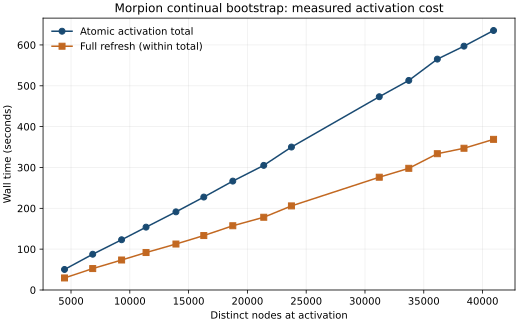

# Continual Morpion 5T bootstrap

Date: 27 October 2026. This report accompanies the local branch
`feat/morpion-continual-learning`. The full 200,000-node experiment is **not
launched by this task**. Measurements and validation below use retained evidence.

## Source and workspace

The implementation starts at Chipiron
`f21fc096d411dbee061e47ca1a2d54a5f0a67c35`, with installed Anemone
`82b169faa47a38a25a5f51497afa442076598d02`. The final executable source is
`fb444210084fd16beb5b6632255831e434a3cbd0`. Its seven local implementation/fix
commits follow the requested foundation; later report-only commits do not change
the executable package identity.

The normal checkout had overlapping uncommitted research changes. After the
historical comparison, the user explicitly authorized one new worktree from
f21fc096, preserving all existing checkouts:

```
/home/pompote/oldata/victor/morpion-scratch/continual-learning-20261027/worktree
```

Evidence and private Python 3.13 environment live in its parent; fresh experiments
live under `/home/pompote/oldata/victor/morpion-scratch/cl27`. Evidence root is
`/home/pompote/oldata/victor/morpion-scratch/continual-learning-20261027`; evidence
filenames below are relative to that root. Python 3.13.5 and
Torch 2.14.0+cpu are used. Scientific dependency packages were privately copied
from the validated `s28/c2` environment; that environment and every historical
experiment remain read-only. Python 3.14 migration checkouts were not used.

Installed verification compares Git, wheel and installed bytes for all 482
Chipiron Python files, and Git/installed bytes for all 289 Anemone Python files;
extra Python files are rejected. Coral (23 files), Atomheart (45), Valanga (12)
and Parsley (8) match the validated environment. The monitor also pins all six
producer package fingerprints, Python and Torch versions, configuration identity
and the supervisor script on resume.

## Historical comparison and reuse

The preflight matrix was delivered before editing code. The detailed read-only
inventory is `PREFLIGHT.md` in the evidence root; `historical-input-identities.json` records 487
inspected historical config/state/history/pipeline inputs. This inventory is not
a hash of every historical weight and checkpoint.

| Mechanism | Summer evidence | Current implementation and action |
| --- | --- | --- |
| Existing bootstrap | Independent Growth, Dataset, Training, Reevaluation workers with crash/restart loops | Reuse all four workers and existing headless supervisor |
| Candidate families | Eight linear/MLP candidates; later run adds entity-token transformer | Reuse the explicit existing nine-candidate preset |
| Previous weights | June 19 `243c9999` and June 30 `1edc2eed` loaded prior models for diagnostics; trainer constructed fresh networks | Load each candidate's latest accepted parent before any optimizer step |
| Training authority | Per-generation model directories and statuses | Extend existing immutable bundles, sealed proposals and accepted receipts |
| Selection | Validation loss with training-loss fallback/forced choice | Finite same-round held-out losses, stable membership, incumbent comparator |
| Promotion | Direct active-pointer projection changes | Existing atomic request/receipt activation only |
| Refresh | Bounded cursor patches, default 10k window; `future_only` allowed | Complete refresh within atomic activation on every actual model change |
| Dataset | Snapshot extraction and target policies | Existing immutable accepted scientific Dataset and selected-value certainty contract |
| Search limit | Branch budget | Distinct DAG-node budget at complete expansion boundaries |
| Safety | RAM guard and worker restart scripts | Existing sampler/supervisor with explicit cumulative resource budgets |

`big_run_01` persisted 721,732 nodes/generation 431 and 127 done Training
manifests. The later `generic_linoo_fresh_with_bigrun_models_v1` persisted
242,680 nodes/generation 38, with done Training manifests at 37 and 38. Both
inspected active projections still named copied `mlp_41` generation 430, including
manual-restore metadata. The later selections were transformer and mlp_20. These
facts do not prove activation or complete refresh of those selections. The old
reevaluation cursors reported model 135/zero full passes and model 430/three
passes respectively. Both branch limits were 1.2m; final Growth settings were
0 steps and 10 steps; save cadence 10 seconds or 1.2 tree factor; RAM floors
2,400 and 1,200 MiB; validation fraction 0.2, seed 0.

The prior 4.56× matched Growth speedup, 2.74× complete four-worker speedup,
51,023 nodes, 3,002 Chipiron tests and 1,583 Anemone tests are prior performance
evidence, not results of this task. The state-free selector, feature subset
optimization, disposable SQLite index, lazy checkpoint restore, streaming
serialization and compressed scientific storage are retained.

## Candidate configuration

Preparation writes one explicit `bootstrap_config.json`; the existing family
preset is `canonical_linear_mlp_entity_transformer_small`. The retained reference
configuration is `/home/pompote/oldata/victor/morpion-scratch/cl27/scale50/bootstrap_config.json`;
its nine-candidate evaluator section is the same one used by the full recipe.

| Stable identity | Existing architecture/features | Training each eligible round |
| --- | --- | --- |
| linear_5 | Linear, handcrafted_5_core | 5 epochs, batch 64, Adam LR .001 |
| linear_10 | Linear, handcrafted_10_core | Same |
| linear_20 | Linear, handcrafted_20_core | Same |
| linear_41 | Linear, handcrafted_41 | Same |
| mlp_5 | MLP hidden (5,10,10), handcrafted_5_core | Same |
| mlp_10 | MLP hidden (10,10,10), handcrafted_10_core | Same |
| mlp_20 | MLP hidden (20,10,10), handcrafted_20_core | Same |
| mlp_41 | MLP hidden (41,10,10), handcrafted_41 | Same |
| entity_token_transformer_small | d64, 4 heads, 2 layers, FF256, dropout0, value-token pooling, max1536 tokens, no output tanh | 5 epochs, batch8, Adam LR .001 |

No new architecture is added. No historical weights or tree are adopted. Genesis
is the original 36-point Greek cross, one root, and a separate zero-valued
moves-only linear bundle. Its prediction is an ESTIMATE, never a proof. Candidate
initialization uses normal architecture initialization with independent recorded
seeds; candidates are not zeroed. Autonomous workers skip the untouched genesis
for learning, and begin after Growth publishes scientific generation 2.

## Accepted continuity, retries and optimizer policy

New preparations default to `continue_from_previous_accepted_weights` and
`continue_adam`. Legacy experiments retain their existing opt-in behavior.
`fresh_from_scratch` is an explicit scientific comparison option;
`reset_each_round` explicitly resets optimizer state while retaining weights.

The existing receipt ledger resolves the latest accepted parent **per candidate**,
including inactive/losing candidates. Admission captures all parents, exact
Dataset identity, incumbent, effective configuration, round number and skipped
scientific/accepted-Dataset generations. Acceptance rechecks current heads under
existing Growth ownership. A stale attempt cannot fork a lineage or skip an
accepted intermediate update. Idempotent accepted retries do not train again;
private UUID attempts never reuse incomplete bundles.

Both eager and streaming trainers verify the parent's entire bundle and param.pt
SHA-256, candidate name, architecture, feature schema, output target contract and
actual named-tensor digest. Missing, changed, incompatible or ambiguous expected
parents fail closed. W1's actual final tensor identity must equal W2's actual
starting identity, and W2's final identity must equal W3's start.

The first round retains its exact normal initial model in `initial/`. Subsequent
bundles retain that initial identity and seed. Each ordinary accepted bundle
contains `optimizer.pt`; Adam moment tensors and counters are loaded before
training, with its digest checked. Provenance records actual optimizer calls,
cumulative calls, Adam steps, examples seen, final tensors, parent bundle/weights,
initial identity and seeds. The existing model registry/format and Training
acceptance machinery are extended; no additional registry/database is created.

Random-state continuity is separate: each candidate/round is deterministically
reseeded from SHA-256(base seed, candidate name, scientific generation). Python,
NumPy, Torch CPU and available CUDA states are captured. Shuffling uses the
existing validation-seed-plus-epoch schedule. Cross-round RNG continuation is
not claimed. LR is the configured constant; there is no new LR scheduler.

Independent tests inspect real tensors **before the first optimizer update** and
compare inherited Adam exp_avg/exp_avg_sq and step counters. They would fail if a
fresh `build_morpion_regressor()` result reached training or moments were lost.
Both trainer paths, explicit reset, corruption, missing parents, incompatible
architecture and wrong candidate are exercised.

## Dataset, held-out selection and cadence

Accepted Datasets remain immutable. Default targets are backed-up selected values,
including estimates, with existing selected_value_v2 confidence provenance.
TERMINAL, FORCED, backed-up estimates and direct neural estimates retain their
existing distinct source/certainty fields. A decreasing loss on self-derived
estimates is not evidence of playing-strength improvement.

Continual training partitions rows by SHA-256 of variant and rooted D4 canonical
state identity, then seed/fraction. Membership is independent of row order, node
IDs and changing populations, so a previously trained canonical state cannot
become a held-out state later. The exact held-out population digest includes
identity, target and confidence semantics. All eager, flat/entity/relational
cached and streaming kernels, and incumbent evaluation, use the same membership.
Empty held-out populations fail closed; there is no training-loss fallback.

Every candidate trains. Selection minimizes finite validation loss, then stable
candidate name for ties. The exact incumbent is reevaluated on that **same** round's
held-out population. Candidates must strictly beat it; equality or no improvement
retains the incumbent. Cross-generation losses are never compared as equivalent.
The accepted result records every metric, winner, incumbent, population and decision;
acceptance independently reapplies the decision rule and sample counts.

Growth begins with 32-step batching. Configurable Dataset and Training scientific
generation cadences, selection/activation round cadences, node and resource budgets
are persisted in the existing configuration. At eligible learning boundaries,
Growth releases ownership and waits for accepted Training, allowing the other
workers to finish. Each shell Growth invocation commits at most one cycle.
Selection and activation eligibility use completed learning-round numbers.
Training failures stop that learning boundary rather than silently skipping a
candidate; runtime/resource limits bound any wait.

## Atomic activation and complete refresh

`--automatic-activation` explicitly authorizes repeated activation for this fresh
experiment. Growth creates an ordinary exact request under existing ownership,
saves it under `pipeline/automatic_activation/`, and invokes the existing atomic
activation API. An interrupted request is retried with its original digest via
the same idempotent request/receipt protocol. The existing explicit API requires
a new optimistic request if it already committed an M1 numeric-receipt drain
before interruption. Automatic recovery retains the original file, verifies an
adjacent same-producer receipt-only head with identical candidate, incumbent,
policy, states, topology and visit counts, then saves an explicit recovery request
for the same accepted candidate. Arbitrary stale requests remain errors. If a
learner finished against M1 while M2 was recovered, that superseded comparison
cannot justify another activation; M2 is retained and ordinary Growth continues.
There is no arbitrary two-activation
limit and no direct active-pointer rewrite.

Atomic activation attaches the exact accepted model, refreshes all existing
nonterminal neural estimates, recomputes affected backups, verifies TERMINAL/FORCED
certificates, and preserves DAG topology, selector and RNG continuation. Its
checkpoint/scientific publication and completion receipt establish refresh
separately from Training and selection. Subsequent Growth restores that committed
active evaluator. The bounded Reevaluation worker continues to use its existing
validated patch protocol; it does not substitute a partial refresh for activation.

Ordinary restore uses `evaluator_update_policy=future_only`, as required by receipt
recovery: it attaches the already committed evaluator without modifying the
checkpoint. Complete model-change refresh belongs to atomic activation itself.

## Unique-node and resource termination

`max_tree_nodes=200000` counts distinct DAG nodes, including the root. It does not
count branches, Growth steps or rows. Anemone's complete all-children expansion
and configured bounded rollout remain indivisible. Far from the cap, normal
Growth runs unchanged. Near it, the existing streaming checkpoint captures a
safe boundary; an oversized speculative whole step is discarded, the exact
checkpoint restored and its safe prefix replayed. The temporary source stays
alive through final save because lazy state handles may reference it.

No oversized or partial expansion is committed. Final size may be below 200k;
the durable reason is `maximum_unique_nodes` or
`next_complete_expansion_exceeds_unique_node_budget`. Restart returns the
completed authority without Growth or late activation. The tested guarantee is
for the fresh Greek-cross/default Linoo experiment and its declared bounded
rollout policy. Checkpoint equality tests compare full selector/search/rollout RNG
continuation to an unrestricted last-complete-expansion oracle.

The existing supervisor owns all four worker groups. The operator samples total
RSS, available RAM, free disk, inode-aware allocated workspace/scratch, worker
runtime and elapsed time every second. Configured elapsed usage persists across
stop/resume; no budget is automatically extended. GNU time records supervisor
CPU/wall/peak child RSS, separately from sampled whole-group RSS. TERM/INT invoke
existing group shutdown, including ignoring-TERM descendants; quiescence is
independently confirmed before scratch removal. The shell checks the resource
monitor's PID **and process start identity**; monitor death stops its owned groups.
A SIGKILL can leave the private monitor scratch as recovery evidence.

Configuration and source identities are pinned on resume. Ordinary operator stops
are resumable within remaining declared budgets. Durable node completion stays
completed. A resource-limited run may immediately stop again if its limit still
holds. Scientific history is retained; disk pressure stops safely rather than
deleting accepted evidence. One-second sampling and shutdown grace permit bounded
resource overshoot; this is a monitor, not an OS memory/disk quota.

## Measured experiments and validation

The frozen functional pilot `pfinal` used source
`d5faf1eb1a1bed5ba8952a2dd088c3c8a49133af`, Python 3.13.5, all nine historical
specifications, 32-step Growth, bounded two-step rollout, 128 Dataset rows and
cadence 1. It deliberately stopped after the M1 receipt drain, resumed through
the retained request and verified renewal, then stopped at **4,998 / 5,000 unique
nodes**, scientific generation 11 (5,316 branches). Six rounds, seven accepted Datasets and three
actual activations completed. A completed restart changed neither authority nor
elapsed usage. Total monitored active-plus-shutdown usage was 287.799 s across
two sessions; audit time is separate. Both sessions confirmed group shutdown.

The final source additionally retains a recovered incumbent when a comparison
against its predecessor is superseded, and records activation/refresh performance
in the existing metric artifacts. The pilot exposed that superseded-comparison
case as transient fail-closed errors; the final real-drain test includes a learner
finishing on M1 before M2 recovery. Final-source scale and suite results follow.

`pfinal-transcript.json` retains exact commands, monitor PID, interruption head,
original request, stop/resume usage and the completed-restart equality. The
independent `pfinal-audit.json` verifies every actual accepted model digest and
all nine W0→W1→W2→W3 chains, including optimizer inheritance. Shortened named-tensor
SHA-256 identities below are display prefixes; the audit retains full identities.

| Candidate | W0 | W1 | W2 | W3 |
| --- | --- | --- | --- | --- |
| entity_token_transformer_small | ec766dbfef9c | ea18306b7528 | 51b76b0ccf5f | 8d9ca62befdd |
| linear_10 | aa2c978e90e9 | 48847a992afb | 0a58b59341a3 | cfa143580b87 |
| linear_20 | f9f93418eebc | 5d364488cc62 | 5cecdf12c699 | f30590de94c4 |
| linear_41 | 2be65a93c636 | 97c301c0a658 | cb6030858f6e | 8109f642f057 |
| linear_5 | e8333750d034 | a81c99b170d1 | 5be43321eda2 | 75ad9148dd43 |
| mlp_10 | 5e619ece7ee3 | c5a189f7d0f8 | 589427d5cc3c | ccbc1e8e6073 |
| mlp_20 | b14e338d58a7 | ec5479282fd1 | b99955ac141f | b451327b65a6 |
| mlp_41 | 1bc5b67c569c | 476c1b649a5d | ac0c549ebe4e | 91ca1e07d14b |
| mlp_5 | 11376e921104 | 0d6e2f782870 | 33c6d2ff29aa | ee1af63d9a26 |

First three cumulative Adam counters are 65→130→195 for the transformer and
10→20→30 for every flat model. All nine continue, including candidates never
activated. Independent pre-step hooks verify actual inherited parameters and
Adam moments for both trainer paths; the artifact audit checks actual final
parameter tensors against each recorded successor start.

The first two real pilot activations independently match raw model predictions,
max backups, certainty, selected PVs and full restored checkpoint payloads. Two
separate final-checkpoint restores followed by one offline complete Growth step
produce identical full-payload digests
`dc075d89566659c3fde827d1366fc5f1fa85aba4e2d87513aee6474c46e817de`.
No audit checkpoint is published and authority bytes remain unchanged.
The best independently replay-verified terminal is **22 moves, 58 total points**;
the optional persisted record projection is null, so it is not presented as a
leaderboard record. Separate reachable-endgame tests verify FORCED 35 remains
FORCED while the root direct neural value remains ESTIMATE.

Pilot useful Growth adds 4,997 nodes in 40.183 s (40.166 process CPU s),
**124.36 nodes/s** in Growth only. This excludes restore, Dataset, training,
activation, publication and worker startup; it is not whole-run throughput or a
matched speedup. Training compute-phase round wall times are 5.88–6.76 s; CPU 5.86–6.75 s.
These include candidate training and held-out comparison; final acceptance and
worker startup are outside that internal interval. Whole-run native CPU is
reported separately. Mean candidate
wall: transformer 4.071 s, linear_10 .436 s, other linear models .014 s, MLPs
.017–.019 s. Shared cache construction is charged to the first applicable flat
candidate, so these are pipeline costs, not isolated architecture comparisons.
Dataset calls take 2.07–12.96 s. Peak sampled worker-group RSS is 1,129.70 MiB,
workspace 72.73 MiB, scratch 6.84 MiB. Some correctness checks/static analysis
coincided with the pilot; its wall times are descriptive. CI and controlled scale
measurements are kept separate.

The original `p32b` attempt stopped with no Growth because preparation requested
an incompatible restore policy. `p32c` reached 6,001 nodes, six accepted rounds and
three activations before its interruption exposed the pre-existing M1-drain
new-request contract. Those attempts and initial smoke failures are retained;
they are not represented as final-source successful restarts.

The final-source `timeguard` experiment declares six elapsed seconds. It stops
at one root with `maximum_elapsed_time`, confirms worker shutdown and resumes
without launching more Growth because cumulative usage is exhausted. Unit guards
exercise each RAM/RSS/disk/workspace/scratch/worker-time reason. Real shell tests
kill the monitor owner and terminate even ignoring-TERM grandchildren.

### Final-source bounded scale result

`scale50` ran the installed **fb444210** wheel with all nine candidates, 512-row
Datasets, 32-step Growth, bounded rollout 2, Dataset/Training cadence 4 and
selection/activation cadence 1. Its declared 50,000-node target was **not reached**:
the original **7,200-second elapsed limit** stopped it at **40,934 nodes**, scientific
generation **62**. Actual monitored usage including shutdown was **7,201.017 s**;
the guard was not extended. All worker groups stopped and scratch cleanup followed
confirmed quiescence. The largest newly validated tree in this task is 40,934,
not 50k or 200k. The prior 51,023-node result remains separate evidence.

The run completed **15 accepted Datasets, 15 accepted learning rounds, 135 immutable
candidate bundles and 14 actual activations**. All nine candidates kept their
accepted weight/optimizer ancestry, including inactive candidates. Final Adam
counters are **525** for each flat candidate and **3,980** for the transformer.
Round 10/generation 40 retained the incumbent: its loss was **119.3407**, versus
**127.3297** for the best new candidate, on the same held-out Dataset. The losing
accepted candidate still became its lineage's next training parent. No candidate
or epoch count was reduced to accelerate the run.

`scale50-audit.json` checks every accepted bundle and actual parameter digest,
all initial/parent/successor identities, optimizer inheritance, sample counts and
selection decisions. Its first two actual activations (generations 6 and 10)
match an independent batched prediction/max-backup/PV/certainty oracle and the
complete expected checkpoint payload. The last activation requested 40,934 nodes,
reevaluated **40,923 nonterminals**, changed all 40,923, and preserved **11 terminals**.
All activation completion receipts are verified. Two independent cold restores
followed by one offline complete Growth step yield the same full-payload digest:

```
d9bcffe30b527b8e5d167e6b01b2ba5ed7fe54464a009d3c84f0c196d959f6a1
```

Audit authority bytes remain unchanged. The best independently replay-verified
terminal is **66 moves / 102 points**, node 5515; its exact existing-codec
`state_ref_payload` is included in the audit. This is a verified solution found
by the run, without a matched experiment attributing playing strength to learning.
The optional persisted record projection remains null. Fitting backed-up estimated
targets and beating their incumbent loss are not treated as playing-strength proof.

An exhausted-budget resume left scientific authority unchanged and created no new
worker supervisor (`scale50-exhausted-resume.json`). It did not reset usage or
complete additional work. Diagnostic resume time is recorded separately from the
original measured session.

| Measurement | Final-source scale result |
| --- | --- |
| Whole experiment committed Growth rate | **5.684 nodes/s**: 40,933 new nodes / 7,201.017 s, including all workers and activation waits |
| Accepted Growth compute phases | 322.478 wall s; 322.374 process CPU s; **126.933 nodes/s**, excluding restore/publication/learning |
| Training compute phase per round | 12.057–13.234 wall s; 12.036–13.198 CPU s |
| Candidate mean wall time | Transformer 8.742 s; linear_10 1.687 s; other linears .018–.019 s; MLPs .027–.029 s |
| Dataset worker boundary | 10.513–135.595 wall s; 10.359–135.401 CPU s, including validation/extraction/publication |
| Complete activation transaction | 50.307–635.352 wall s, including restore, any M1 drain, refresh and publication |
| Full refresh within activation | 29.506–368.829 wall s; inclusive in the activation total, never added again |
| Native supervisor/worker CPU | 15,245.81 user + 381.72 system = **15,627.53 CPU s** |
| Peak sampled worker-group RSS | **1,309.457 MiB**; native peak single child 546,032 KiB |
| Minimum available host RAM | 70,999.906 MiB |
| Peak inode-aware allocated workspace | **564.859 MiB** |
| Peak allocated monitored scratch | **46.031 MiB** |
| Minimum filesystem free space during run | 16,886.961 MiB |
| Retained committed scientific publications | **62**, including genesis, Growth, M1 receipt drains and activations |

Per-candidate mean wall times include each candidate's bundle/cache/metric work.
The first applicable flat candidate (`linear_10`) pays shared cache construction.

| Candidate | Mean wall seconds | Accepted updates | Final Adam counter |
| --- | ---: | ---: | ---: |
| entity_token_transformer_small | 8.742384 | 15 | 3980 |
| linear_10 | 1.687089 | 15 | 525 |
| linear_20 | 0.019262 | 15 | 525 |
| linear_41 | 0.018339 | 15 | 525 |
| linear_5 | 0.019221 | 15 | 525 |
| mlp_10 | 0.028568 | 15 | 525 |
| mlp_20 | 0.028124 | 15 | 525 |
| mlp_41 | 0.029023 | 15 | 525 |
| mlp_5 | 0.027035 | 15 | 525 |

The native timer excludes the resource monitor itself; sampled group RSS sums the
worker descendants conservatively and can count shared pages more than once.
Shared feature-cache setup is charged to the first applicable flat candidate.
The measurements are absolute costs for this workload, not matched speedup ratios.
Other host activity and page-cache state were uncontrolled; CI did not overlap
this run. The full 50k target and 200k resource behavior are not claimed validated.



The plot contains measured points only. Complete refresh and scientific publication,
rather than the eight inexpensive flat candidates, dominate the cadence cost.
Keep the historical nine-model lineup for the bounded 512-row recipe. Cadence 16
in the 200k commands is an engineering starting recommendation to amortize full
refresh; its 200k duration/memory behavior remains unmeasured and all guards remain
mandatory. Unbounded full-tree neural training has not been costed by this sample.

### Scientific, packaging and analysis checks

Focused checks during development include actual pre-optimizer tensors and Adam
moments in both trainer paths; initial/parent corruption, missing files and wrong
architecture/candidate rejection; stable D4/state membership with reordered/growing
Datasets; accepted three-round receipts; no double update after retry; cross-generation
stale-parent rejection; incumbent retention and deterministic ties; interrupted
exact activation and verified M1-drain renewal; a second learner finishing on M1
before M2 recovery; terminal/FORCED preservation; ten complete-expansion budget
oracles; durable completed-node restart; and real supervisor/monitor-death shutdown
with ignoring-TERM descendants. Existing process-death matrices are retained.
Relevant focused logs include `focused-freeze.log` (167 passes),
`continuation-moments-symmetry.log` (11), `final-policy-focus.log` (63),
`owner-death-tests.log` (13), `automatic-renewal-death.log` (2),
`automatic-real-drain-final.log` (1 real-drain integration), and
`activation-final-metrics.log` (28). These overlap and are not summed as unique tests.

Wheel and sdist build successfully. All **482 Chipiron Python files** match final
Git source, wheel and private installation; all **289 Anemone Python files** match
Git 82b169fa and installation, with no extra Python files. The sdist's same 482
Python files and frozen `tests/data/morpion_features_baseline.json` were checked.
Coral, Atomheart, Valanga and Parsley match the validated environment. The installed
contract smoke verifies package origins, a packaged YAML resource, the 106,049-parameter
evaluator-v1 architecture and the extracted checkpoint atom API.

```
Wheel SHA-256  99e8dd09c032e33604195903deabd3a512929c525c05dbdd02ed853e8734886f
Sdist SHA-256  2d471a9f7a1fbcb76fadd1da1408a65c53b58272c1e39354b6c9e788c64c6608
```

The strict mypy/Pyright/Pylint ratchet reports **209 baseline diagnostics, 202 current,
0 new, 7 removed**. Ruff and formatting pass, with coherent pinned tool versions.
Production change size from f21fc096 is **2,075 added / 33 removed = net 2,042 lines**
across 24 Python files and the existing headless shell. Tests, research measurement
helpers, figures and this report are excluded from that production count.

The repository test targets ran serially against the same installed wheel with
`PYTHONPATH=.` and `CHIPIRON_TEST_INSTALLED=1`:

| Target | Passed | Skipped | Pytest wall time |
| --- | ---: | ---: | ---: |
| `make test-fast` | **211** | 0 | 92.51 s |
| `make test-pr` | **2,875** | 2 | 943.20 s (15m43s) |
| One final `make test-full` | **3,039** | 2 | 1,642.12 s (27m22s) |

All three exited zero, without failures or execution errors. The two skips in PR
and FULL are CUDA device-transfer checks: CUDA is unavailable in this CPU
environment. FULL includes coverage (81% overall) and the repository's exhaustive
matrix. The existing targets exclude `integration` and `external_data` markers;
the separately invoked scientific/recovery checks and real four-worker runs
above supply the requested Morpion integration evidence. JUnit, lane logs and
metrics are retained as `fast.*`, `pr.*`, `full.*`, `*-metrics.json` and
`final-suite-summary.json`. Their overlapping test counts are not additive.


## Operator commands and launch blockers

These commands use the same implemented prepare/run/inspect/TERM/resume interfaces
exercised by the pilots. They retain all nine candidates and explicitly cap each
accepted Dataset at 512 rows, as in the scale test. The full recipe uses cadence
16, rather than the scale test's cadence 4, to amortize measured complete-refresh
cost across more Growth. This is an engineering recommendation, not a measured
200k runtime prediction. `full200k-command-parser-verification.json` records a
parse-only check of this exact argument set; it creates no experiment. This is a bounded engineering
recipe; the fixed export-order sample is not a claim of broad state coverage or
playing-strength improvement. Unbounded full-tree training is supported but its
cost is not justified by this 512-row measurement.

The current filesystem has less free space than the full-run **20,480 MiB free
floor**. The monitor will refuse to start workers until that floor is satisfied.
Do not lower it implicitly or delete retained experiments. Provide additional
headroom before launch; the floor must remain available while history accumulates.
The declared workspace/scratch maxima are limits, not reserved capacity. Even a
successful 50k run cannot certify 200k peak memory or unbounded history retention.

Run setup/preparation once, with a destination that does not exist. No command in
this report was executed with a 200,000-node budget during this task.

```bash
cd /home/pompote/oldata/victor/morpion-scratch/continual-learning-20261027/worktree
source ../env.sh
export PYTHONPATH=.
RUN=/home/pompote/oldata/victor/morpion-scratch/cl27/next200k
CLUSTER_SCRIPT="$PWD/scripts/launch_morpion_gnome_cluster.sh"

# Observe free space before preparation/launch. The run enforces its own floor.
df -h "$PWD" "$TMPDIR"
test ! -e "$RUN" && test ! -e "${RUN}-inputs"
# Preparation itself rejects an existing destination before registering a process.

"$PYTHON_BIN" -m chipiron.environments.morpion.bootstrap.launcher \
  --scientific --scientific-operation prepare-continuous --work-dir "$RUN" \
  --automatic-activation --learning-seed 1 \
  --max-tree-nodes 200000 --max-growth-steps-per-cycle 32 \
  --max-rows 512 --training-row-chunk-size 512 \
  --dataset-every-generations 16 --training-every-generations 16 \
  --selection-every-rounds 1 --activation-every-rounds 1 \
  --max-elapsed-seconds 43000 --worker-max-seconds 7200 \
  --max-group-rss-mb 8192 --min-available-ram-mb 8192 \
  --min-free-disk-mb 20480 --max-workspace-mb 32768 \
  --max-scratch-mb 4096 --shutdown-grace-seconds 30
```

Launch from the same Bash terminal. Save the **resource monitor's PID**; worker
launchers update `launcher.pid`, so that projection is not the operator stop target.

```bash
nohup "$PYTHON_BIN" -m chipiron.environments.morpion.bootstrap.launcher \
  --scientific --scientific-operation run-continuous --work-dir "$RUN" \
  --cluster-script "$CLUSTER_SCRIPT" \
  > "$RUN/operator.log" 2>&1 < /dev/null &
OPERATOR_PID=$!
printf '%s\n' "$OPERATOR_PID" > "$RUN/operator.pid"
printf 'Resource monitor PID: %s\n' "$OPERATOR_PID"
```

Inspect the scientific head, completed learning-round count and durable termination;
then inspect the current resource reason and worker logs. `inspect` reports the
scientific head and updates advisory launcher process files; use it on this new
workspace. Historical inputs were inspected through direct read-only file APIs.

```bash
"$PYTHON_BIN" -m chipiron.environments.morpion.bootstrap.launcher \
  --scientific --scientific-operation inspect --work-dir "$RUN"
cat "$RUN/resource_monitor/usage.json"
tail -n 40 "$RUN/logs/growth.log" "$RUN/logs/training.log"
# Optional continuous resource view; Ctrl-C stops this viewer only.
watch -n 15 "cat '$RUN/resource_monitor/usage.json'"
```

Stop from the launching Bash terminal while that monitor job is running. TERM
requests the monitored shutdown; `wait` returns after group quiescence is checked.
The last session JSON must report `shutdown_confirmed: true` before treating its
scratch as disposable. Do not kill only a worker or delete a claim/cache manually.

```bash
kill -TERM "$OPERATOR_PID"
wait "$OPERATOR_PID"
cat "$RUN/resource_monitor/usage.json"
ls -t "$RUN/resource_monitor"/session_*.json | head
```

Resume the **same** prepared workspace, source environment and supervisor script.
Do not run preparation again or edit its policy to obtain more budget. This uses
only the remaining declared cumulative time; a node-completed run remains completed.

```bash
nohup "$PYTHON_BIN" -m chipiron.environments.morpion.bootstrap.launcher \
  --scientific --scientific-operation run-continuous --work-dir "$RUN" \
  --cluster-script "$CLUSTER_SCRIPT" \
  > "$RUN/operator-resume.log" 2>&1 < /dev/null &
OPERATOR_PID=$!
printf '%s\n' "$OPERATOR_PID" > "$RUN/operator.pid"
```

A source/configuration mismatch, ambiguous/missing parent, stale unsupported request
or still-exhausted resource condition is a stop condition. Diagnose the retained
artifacts; do not remove hashes, overwrite accepted models, reset usage or bypass
activation checks to resume. The final scientific handoff below records remaining
launch blockers and measured limitations.

## Final handoff

`protected-inputs-final.json` rechecks all **487 inspected historical inputs**:
439 in `big_run_01` and 48 in the later experiment. Every size and SHA-256 still
matches the preflight inventory. This covers the inspected inputs, not every
historical checkpoint or weight. `checkouts-final.json` records the original
normal checkout at `f545304c24a7889f20471de0944d8097a9d192c8`, on its original
branch with its tracked and untracked work present. No pre-existing checkout was
switched, stashed, reset or used as a write destination. Only the expressly
authorized worktree was created. Nothing was pushed, merged or published.

The immediate launch blocker is free disk: the final check found **14,409 MiB**
available, below the declared **20,480 MiB** floor. Check again at launch and
provide more headroom without deleting protected evidence. No 200k workspace
was prepared or launched by this task.

The largest new test stopped at 40,934 nodes under its original two-hour limit;
200k peak memory, total refresh cost and completion within the proposed time
budget remain unmeasured. The cadence-16 recipe is a guarded engineering starting
point, not a completion forecast. Historical retention is not fully bounded;
resource limits must stop the run rather than erase accepted evidence or extend
budgets. The fixed 512-row sample limits state coverage, and losses on backed-up
estimated targets do not establish playing-strength improvement. These measured
limits remain part of the handoff even after all software checks pass.
