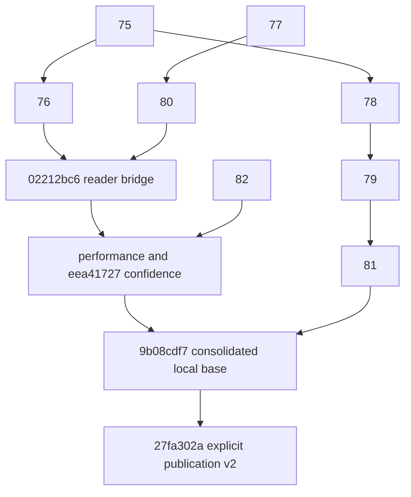

# Durable scientific v2 generation publication

Local implementation and synthetic validation, 2026-10-21. No production option,
CLI, experiment, remote branch or existing PR has been activated or changed.

## Scope and exact base

The new isolated worktree is `/tmp/chipiron-durable-scientific-v2`, branch
`feat/morpion-durable-scientific-v2`. Its base is exactly
`9b08cdf77202cca07f41c1ade4aad9e737e647e6`; implementation commit is
`27fa302a7768d55776a6b58d025d1cc1ae518e8b`. It contains only the new adapter,
version-aware capsule boundaries, explicit initialization, and regression tests.
No pre-existing implementation was replayed.

[Exact ancestry and containment](durable_scientific_v2/evidence/ancestry.json),
[production file fingerprints](durable_scientific_v2/evidence/source_manifest.json),
and [unchanged scientific policy blobs](durable_scientific_v2/evidence/unchanged_policies.json)
accompany this report. The original consolidation report and boundary patch were
read before editing. All eight pinned PR heads and both earlier local scientific
commits were verified as ancestors of the base.

| Source | Exact SHA | Dependency |
| --- | --- | --- |
| #75 bounded reader | `79693ce2dc59c6d6ccb951951c9ba75fa69057f3` | main `50fb67a4` |
| #76 Dataset streaming | `5c8906ba0d520c63d821e14a2d52530f8bed2307` | #75 |
| #77 export optimization | `67a7cfd1955f43d5947af01dbb324fb5efd93a0d` | main `50fb67a4` |
| #80 scientific v2 | `bfd8f2ab05f017ffda5e14af5dbf6e1f1afa3fde` | #77 |
| #78 patch publication | `b0980ab41cb1ebf178d4ef26d49e82dd5d57ca76` | #75 |
| #79 checkpoint receipts | `7313ecfad36667ab2a8dd1bbd4b894aa682a7e9b` | #78 |
| #81 immutable capsules | `8c883a95bdc308195384e9202c1f56ab9ebe2b48` | #79 |
| #82 neural certainty | `cae9ec523edaaed277c8f953fafae5d9ac766701` | main `50fb67a4` |
| Local bounded scientific reader | `02212bc6130205b7d2ef898c7b1eb0f7d384f7aa` | union of #76/#80 |
| Local Dataset confidence | `eea417271a822311e08dd8b88ee938ccb32ef2f4` | reader/performance plus #82 |
| Local consolidated base | `9b08cdf77202cca07f41c1ade4aad9e737e647e6` | confidence plus #81, guards and evidence |



## Version and scientific contract

Publication v2 has namespace `generation_publications_v2`, seal
`.generation_publication_v2.json`, and publication version 2 in every committed
root and seal. The existing run-state key `durable_generation_publication_v1`
is intentionally retained with **schema_version 2** as an older-binary fence.
An unrecognized new key alone would allow older code to ignore the protocol.
The existing attempt marker and Growth/pin lock design are reused; there is no
second journal or transaction authority.

The scientific source remains exactly kind `morpion_scientific_training_export`,
schema 2, contract `anemone-values-canonical-morpion-1`, with the existing canonical
state-reference contract. Constants moved into a small shared module; their
public names and values remain available from the original writer module.
No direct, tree, effective, selected-target, certainty, provenance, DAG,
terminal/exactness, ordering or null/missing interpretation is changed.

This first adapter deliberately requires:

* Explicit initialization in a new isolated workspace: no existing run state,
  receipt/publication ledger, v1 capsule namespace, historical discovery manifests
  or pending patch. A quiescent v2 generation-1/checkpoint pair is supplied inside
  that workspace. Historical v1 adoption is rejected.
* **Growth generation G = scientific generation G**, starting at 1 and consecutive.
  Every saved generation must export scientific v2 in `sharded` mode. Skipped
  exports and `flat`/`both` modes are rejected. A no-save cycle retains its old G.
* A fixed complete scientific producer identity, including package/API fingerprints,
  canonical codec contract and accepted config hash. The original model identity
  and pinned bytes also remain in one fixed epoch. Model or producer transitions
  require a separately reviewed lineage design; they are rejected here.

The caller must produce the initial checkpoint and export from the same frozen
runtime. Initialization binds their exact byte identities; it cannot infer a
mathematical certificate or repair a historically false FORCED value. Actual
runtime roundtrip tests verify this pairing on new legal fixtures.

## Exact transaction sequence

The existing PR #81 transaction executes with a scientific-v2 adapter:

1. Take the same stable exclusive Growth lease. Read the authoritative committed
   run state; validate its checkpoint receipt ledger and entire current capsule.
   Resume only that checkpoint. Discovery files and orphan attempts are not sources.
2. Allocate a fresh UUID attempt under the v2 `staging` directory. Freeze accepted
   config and selected model bytes before the runtime loads them.
3. Seed only the selected committed v2 prefix. Hard-link immutable generation
   directories (record shards, historical updates and descriptors). Copy the root
   catalog to a separate inode. Never use an abandoned catalog or creation map.
4. The unchanged scientific writer writes new records, all current updates, its
   descriptor and consecutive catalog privately. The real runner exposes an
   explicit v2 method using the same frozen live tree as the checkpoint.
5. Validate catalog closure and immutable prefix identities. Build a temporary
   index with the **existing** `ShardedTrainingGenerationView`: canonical refs,
   creation keys, ordered updates, full Value payloads, certainty/source associations
   and reciprocal acyclic DAG links undergo its normal strict validation. Recheck
   source identities and the committed parent inventory. No full scientific
   snapshot/reference loader is used by the publisher or bounded consumers.
6. Delete the private validation index before sealing. It lives in its owned
   attempt, so process death leaves only an orphan that the existing collector
   can remove. It is never published or reused as a consumer cache.
7. Seal the exact file size/hash inventory. Bind full scientific provenance,
   producer digest, scientific/Growth generation mapping, descriptor/catalog hashes
   and checkpoint digest into both the seal and the run-state root record.
   Fsync every payload and directory entry through the workspace root.
8. Publish with existing Linux `renameat2(RENAME_NOREPLACE)`. Fsync source and
   destination namespaces. An object at its final name is still uncommitted.
9. Durably replace **run_state.json** with the capsule/checkpoint pointers,
   cumulative committed roots and checkpoint-bound patch receipts. The parent
   directory fsync is the commit barrier.
10. Publish or repair discovery metadata from that committed state. Then verify
    the committed capsule/checkpoint, exact retained patch bytes, original model
    identity and durable producer cursor before acknowledgement/unlink and directory
    fsync. A retry cannot apply the same alpha-0.5 patch twice.
11. Retain every committed capsule. Under the same Growth lease and exclusive
    stable capsule pin, quarantine and remove only proven owned orphans. Never
    retire committed dependencies as part of this feature.

Genesis uses the same seal/rename/run-state sequence. Before state replacement,
retry initialization from the original explicit quiescent inputs. After replacement,
restart through normal v2 recovery, which verifies and syncs the observed state
before repairing discovery or acknowledging anything. Do not retry by copying a
visible orphan into the source history.

## Readers and downstream source identity

Both the full reference entrypoint and the bounded view hold existing lifetime
read pins. Managed v2 staging/trash paths and moved objects without committed
run-state roots are refused. A pinned reader validates the exact sealed inventory,
scientific/checkpoint identity and observed state durability. Current source
hashing and SQLite payload verification still run; corrupt sources cannot be
hidden by an existing cache.

A committed immutable hard link changes inode ctime without changing bytes. The
v2 metadata-preparation check now follows the existing v1 rule: retain size/mtime
checks, and permit that ctime change only when an independently validated sealed
hash is available and the newly read bytes match it. Unmanaged sources retain
strict ctime checking. Canonical reconstruction validation is not removed.
Consumer caches are refused inside sealed v2 capsules. Same-capsule repeated opens
reuse the existing index; a new capsule has a different path/source identity and
rebuilds its index. Validation indexes are never promoted across that boundary.

Managed-v2 Reevaluation patches additionally carry `metadata.scientific_publication`
with their capsule ID and complete sealed scientific identity. Both reference and
indexed routes produce identical contents. Growth requires that binding to match
the committed root for the declared tree generation **before application**.
The existing receipt hashes bind those exact patch bytes. A generation number alone
is insufficient for this new protocol. Unmanaged and v1 patch envelopes are unchanged.

## Crash matrix and recovery evidence

Before this change, the consolidated v1 publisher explicitly rejected scientific
v2. It had no v2 durability contract. Existing v1 recovery assertions remain intact;
this is new versioned support, not a reinterpretation of their evidence.

| New v2 interruption/failure | Authoritative state and recovery |
| --- | --- |
| Record/update/descriptor write, catalog before/after publication | Old committed generation; a new attempt restores it and recreates all needed records |
| Source hashing or temporary bounded validation | Old committed generation; temporary index and source attempt cannot enter consumer cache discovery |
| Creation/update/catalog/descriptor/seal/model/checkpoint fsync | Old committed generation; failed attempt never becomes a restore source |
| Before/after capsule rename; final capsule-directory fsync | Final name alone gives no authority; readers refuse the orphan |
| Before run-state replacement | Old committed generation and retained patch |
| After replacement, before/after state-directory fsync | Adopt only the complete observed state after validating dependencies and syncing it; do not reapply its receipt |
| Before/during/after discovery publication; second crash during repair | Committed checkpoint/receipt survives; discovery is reconstructed from run state |
| Before/after acknowledgement and patch unlink; acknowledgement-directory fsync | Verify committed receipt and durable cursor; never double-blend or acknowledge provisional work |
| During orphan quarantine/removal and restart | Committed roots retained; interrupted owned orphan cleanup is retryable |
| Genesis before/after rename, before/after state replacement, discovery failure | Fresh-input retry before commit, committed-state recovery afterward; no orphan seeding |

The new suite contains 22 `os._exit` publication boundaries, ten injected fsync
failures, a second discovery-repair crash, and five genesis interruption/retry
cases. It checks exact alpha-0.5 checkpoint values, one receipt, current late DAG
parents, complete certainty payloads, immutable baseline digests and removal of
owned orphans. Read tests observe a source before move, after move/before commit,
and after commit, while an older view remains pinned.

These are process-death and injected filesystem-error tests on the local filesystem,
not a storage-controller power-cut experiment. Linux no-replace rename and fsync
support remain mandatory; errors are propagated rather than downgraded.

## Scientific parity and CI

The unchanged consolidated audit ran against exact base `9b08cdf7` and the new
implementation on freshly generated fixtures. It retained **3,780 decisions**:
1,890 across all nine legacy policies, 1,050 across five supported v2 policies,
and 840 matching four-policy gates. These include both source preferences, three
blend settings and seven filtering/limit combinations. All full snapshots, per-value
contracts, source provenance and comparison outputs are identical between revisions.

All **8,820 supervised JSONL pairs are byte-identical**, with three-way parity
between flat plus explicit v2 sidecar, full scientific oracle and bounded extraction.
All ten source JSONL pairs and all 24 flat/export source fingerprints also match.
The separately generated fixture patch differs only in its two retained scratch
model-path fields; it is not claimed byte-identical. Managed worker tests above
compare literal full patch/cursor bytes for the same source/model identity.
[Exact comparison report](durable_scientific_v2/evidence/parity.json) and compressed
complete [before](durable_scientific_v2/evidence/confidence-before.json.gz)/
[after](durable_scientific_v2/evidence/confidence-after.json.gz) outputs are retained.
The unchanged fixture retains its fixed producer revision label; actual executing
source SHAs and fingerprints are recorded separately.

Full installed-wheel CI passes **2,130 tests, two CUDA skips, zero failures** in
671.24 seconds. The normal marker selection excludes the same four integration
cases; no test exclusion was added. This includes all 101 new v2 publication tests
and the existing scientific reader/writer, nine-policy streaming, confidence,
neural-certainty, checkpoint/selector, receipt and v1 durability suites.
[Exact CI selection and artifacts](durable_scientific_v2/evidence/validation.json).
All 25 pre-existing worktrees retain their captured HEAD, status and tracked-diff
fingerprints ([verification](durable_scientific_v2/evidence/protected_after.json)).

Ruff lint/format and toolchain coherence pass. Wheel/sdist build and installed
package guards pass; all **470 production Python files** match the installed wheel.
Strict mypy/Pyright/Pylint report **zero new diagnostics** (209 baseline, 206 current,
three removed), without baseline growth or suppression. The focused publication
batch passes 169 cases, plus five subsequent genesis retry cases. A development
batch was invalidated by five child imports during a refactor; its failed log is
retained and the batch was rerun against fixed source. Earlier local test mistakes
and type/import-layering diagnostics are retained as development history, not
counted as successful validation.

The actual reachable Morpion endgame is preserved through a committed capsule:
node direct ESTIMATE(42), tree/effective FORCED(35), terminal child TERMINAL(35).
All 36 combinations of nine policies, two source preferences and exact-only on/off
are checked. Five supported policies match full-reference rows, metadata and literal
JSONL. Four exact-family policies explicitly reject. Direct preference never
certifies 42; selected-source exact-only filtering removes that estimate; the
certified terminal 35 is never overwritten. Different exact values in different
family states are not declared contradictory.

Actual Anemone runner tests compare complete scientific exports before publication,
after publication and after cold restore in both JSON-zst and sharded checkpoint
formats. Continued selection reports, RNG state and tree sizes match an uninterrupted
runner. Six managed Reevaluation comparisons cover reference/indexed complete patch
and cursor bytes, fallback and model inference, cursor starts and wrap.

Exact #81 source was archived read-only and executed against a new v2 workspace:
its publisher rejects unsupported publication schema 2; its bounded reader rejects
the scientific format; its old full v1 loader also fails (missing v1 root field).
That old full-loader failure is not advertised as a good diagnostic. This tests
the immediate #81 predecessor, not every historical binary. Code predating the
publication fence must remain quiesced; unknown metadata is not a universal
old-binary safeguard. No old code is allowed to continue this v2 workspace.

## Publication and reader resources

All compared source files, final scientific exports, checkpoints and Dataset JSONL
hashes match. Measurements ran in fresh processes, serially after CI and the parity
audit. These are single controlled samples on a shared host, not a speedup claim.

| Nodes | Genesis sealing (s) | Durable G2 / G3 cycle (s) | Unmanaged checkpoint + writer G2 / G3 (s) | Durable G2 / G3 CPU (s) | Publication process peak (MiB) |
| ---: | ---: | --- | --- | --- | ---: |
| 1,000 | 3.466 | 3.780 / 3.894 | 0.103 / 0.102 | 3.317 / 3.438 | 290.27 |
| 5,000 | 26.836 | 28.493 / 28.612 | 0.457 / 0.457 | 27.268 / 27.448 | 311.82 |

Genesis sealing starts with the explicitly prepared input pair. Initial source
writer costs, reported separately, were 1.575 / 1.589 s for control/durable 1k and
12.348 / 13.833 s for 5k; input graph construction is excluded. The durable cycle
includes cold scalar-checkpoint restore, receipt handling, validation, publication
and acknowledgement. Its difference from the unmanaged checkpoint/writer control
is not attributed solely to fsync. Writer/control process peaks were 286.54 / 307.56
MiB at 1k/5k; those processes own the O(N) input graph and per-node metadata.

Every genesis and repeated publication decodes all N immutable states again during
temporary index validation. In G2/G3, the writer itself accesses **zero** old states.
At 5k, canonical decoding accounts for 12.64 / 12.57 s of the measured cycles;
canonical redumping is additional. Total fsync time is 0.179 / 0.169 s, with
30/33 file and 67/68 directory fsync calls. Logical bytes read rise from
157 / 238 MB at 1k G2/G3 to 788 / 1192 MB at 5k; complete historical dependency hashes are deliberately still checked.

A separate standard-cProfile 1k sample preserves exactly the same source hashes.
For G2, total profiled wall time is 7.901 s: `validate_scientific_export` is 7.099 s,
its `_build_index` 7.071 s, canonical `load_state_ref` 3.214 s and `dump_state_ref`
3.153 s (1,000 calls each). Fourteen capsule validations total 0.166 s, and all
`hashlib.file_digest` calls total 0.097 s. These cumulative timings overlap; they
must not be added together. Profiler overhead is excluded from the primary table.
This demonstrates repeated canonical verification as the dominant cost. It does
not authorize skipping that verification without a versioned integrity contract.

| Nodes | Same unmanaged source: cold before / after (s) | Reuse before / after (s) | Dataset before / after (rows/s) | Dataset RSS before / after (MiB) |
| ---: | --- | --- | --- | --- |
| 1,000 | 3.254 / 3.306 | 0.0313 / 0.0304 | 1,749 / 1,774 | 284.65 / 284.61 |
| 5,000 | 26.196 / 25.736 | 0.1506 / 0.1417 | 1,684 / 1,761 | 286.81 / 286.45 |

| Nodes | Managed v2 cold / reuse (s) | Managed Dataset (rows/s) | Managed Dataset / cold peak RSS (MiB) | One source index (bytes) |
| ---: | --- | ---: | --- | ---: |
| 1,000 | 3.473 / 0.0583 | 1,745 | 285.05 / 285.26 | 5,857,280 |
| 5,000 | 25.759 / 0.2128 | 1,811 | 286.37 / 286.95 | 29,433,856 |

These RSS values include this probe's imported publication/fixture helpers even
in its fresh reader processes. Compare the matched before/after columns, not their
absolute import footprint against the earlier lighter ~256 MiB reader probe.
The managed path additionally verifies capsule/checkpoint inventory on reuse.
No full reference snapshot or input graph is constructed in the reader processes.

At G3, workspace allocated bytes counting each hard-linked inode once are
15,556,608 / 21,168,128 for 1k control/durable and 77,623,296 / 104,718,336 for 5k.
These include the original genesis inputs and all retained capsules, but exclude
external consumer caches/output files; their exact allocated sizes are separately
recorded. The temporary publication index is deleted before commit. Current-prefix
scientific JSON metadata grows from 42,260 to 63,110 bytes at 1k G2→G3 and from
194,260 to 291,110 at 5k. All capsule seal/catalog/run-state sizes are retained.
Hard links prevent duplicate payload allocation, not cumulative metadata growth.

[Complete resource measurements, source hashes and cache allocation](durable_scientific_v2/evidence/resources.json)
and [separate profiler sample](durable_scientific_v2/evidence/profile-1000.json).

[Reproducer](durable_scientific_v2/measure.py) uses existing `StageMeasurement`,
CPU/I/O helpers, unique-inode disk accounting and standard cProfile. Inputs are
new 1k/5k balanced synthetic populations following real legal replay histories,
with 4 KiB per-node metadata and explicit estimated values. Repeated generations
have zero new records and updated direct values. The unmanaged pinned-base control
and durable path use the same states, producer, field payloads and checkpoint
values. Whole export and checkpoint hashes must match at each compared generation.

Preparation/writer costs are distinguished from initial sealing and repeated
publication. Bounded reader measurements run in separate fresh processes without
the writer graph. Cold means a fresh SQLite cache, not a flushed OS page cache.
The same exact unmanaged source is measured with base and new reader code, with
separate caches; managed-v2 extraction is also compared. Publication costs are
reported separately from Dataset rows/second. No v1-versus-v2 throughput claim,
real gen38 estimate, distributed worker or historical experiment is involved.

## Remaining limits and activation prerequisites

Scientific working data in the bounded validator/reader uses parser buffers,
selected windows and the existing SQLite page/TEMP storage. The live writer still
owns its O(N) graph, creation map and topology; the full oracle remains O(N).
Individual record/proof size, source manifests, capsule inventories and cumulative
run-state metadata are separate bounds. Historical prefix metadata grows with G,
with cumulative descriptor/retained-capsule metadata potentially O(G²). Committed
capsules are all retained: total disk is not bounded. Each new capsule currently
revalidates canonical immutable records and builds a new generation index; safe
cross-capsule validation/index reuse is future performance work.

Defaults stay off. Activation still requires qualified filesystem durability,
cooperative-writer fencing and old-binary quiescence, trustworthy initial
checkpoint/producer lineage, supported Dataset-v2 training consumers, downstream
Dataset/Training/model-pointer durability, producer-cursor recovery and a reviewed
retirement strategy. This restricted protocol does not handle arbitrary Growth
starting numbers, skipped exports, producer/model epoch changes or historical v1
migration. Those are explicit future contracts, not automatic fallback cases.

The selected-source confidence gate remains part of activation: do not train v2
through legacy node-exact interpretation. All four `pv_exact_then_*` policies stay
disabled until a mathematical proof contract justifies transfers between states.
Historically false FORCED payloads cannot be repaired merely by inspecting their
enum. New reader/publication parity does not prove scientific readiness of old data.

## Review and reproduction strategy

Keep this branch local while the scientific and durability stacks remain siblings.
A PR against #80 or #81 would duplicate the other unmerged stack. Review the
`9b08cdf7..27fa302a` implementation delta now; its only prerequisite is the exact
local consolidated base. Review the existing PR chains independently, then the
bounded scientific-reader/performance bridge and confidence correction described
in the consolidation report. Once an approved shared base contains those changes,
apply only this publication delta, revalidate the actual base SHA, and open a small
opt-in publication-v2 PR. A future approved base SHA is not invented here.

The evidence archive includes the incremental patch, a bundle carrying the local
stack above its four public prerequisite heads, complete logs (including failed
development runs), exact source manifests, raw parity files and resource results.
The original 25 worktrees were fingerprinted before starting and checked afterward.
No original worktree, historical artifact, PR history or remote branch is modified.

Representative local checks, with Python 3.13 and pinned dependencies:

```bash
PYTHONDONTWRITEBYTECODE=1 PYTHONPATH=src:. python -m pytest --no-cov \
  tests/environments/test_morpion_durable_scientific_v2.py \
  tests/environments/test_morpion_durable_scientific_v2_crashes.py \
  -p docs.research.benchmarks.morpion_training_export_20261020.validation_safety

PYTHONDONTWRITEBYTECODE=1 PYTHONPATH=src:. python \
  docs/research/dataset_confidence_v2/audit.py --root /tmp/NEW-v2-parity

PYTHONDONTWRITEBYTECODE=1 PYTHONPATH=src:. python \
  docs/research/durable_scientific_v2/measure.py \
  --mode durable --nodes 1000 --root /tmp/NEW-v2-resource
```

Use a new root for every publication experiment; never point these fixtures at an
existing workspace. The raw controller preserves exact serial before/after commands.
The CI safety plugin redirects optional leaderboard output to pytest scratch;
it does not weaken any scientific or recovery assertion.
