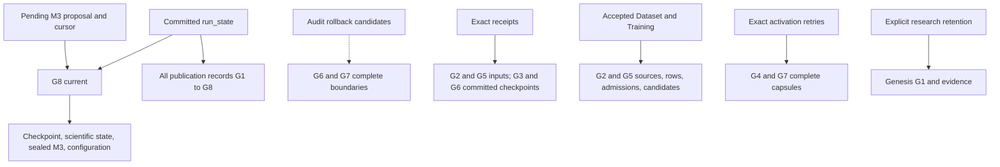

# Morpion: end-to-end learning and explicit model activation

The existing pipeline completed two genuine learning-and-activation cycles without
production changes. A second opening run reproduced the scientific state and model
weights exactly, and an independent solved endgame preserved terminal/FORCED proofs
through both activations. All runs used nonempty training data and separate worker
processes. This establishes the tested integration, not playing-strength improvement
or permission to activate production. Full bundle identities retain per-run execution
provenance; no historical capsule is yet safely reclaimable in this experiment.

## Scope and foundation

This investigation exercises the existing four worker APIs in fresh processes,
with two real Dataset/Training/activation cycles and cold Growth continuation.
All experiment directories, environments and evidence are on the secondary ext4
filesystem. No production implementation, ordinary test, runtime configuration,
scientific policy or historical experiment is changed. The executable recipe is
[`e2e_bootstrap/reproduce.py`](e2e_bootstrap/reproduce.py); it contains an explicit
serial list of calls and assertions, with no scheduler or new persistent authority.

Exact foundation:

- Chipiron reviewed base `4ada24712dca95d1114d3e838a13c3447af998ac`.
- Inherited FULL-tested executable `331413412317d7b58691936718f0852e22d39e4e`.
  Its production, ordinary tests and runtime configuration are unchanged at the base.
- Anemone `90c7ef4454edf52459d7f7051b6c904ddf7f7a35`, wheel SHA-256
  `5f3015c1a07d7a838a729896a388fad2b31f666f9abea7e82eb6f3381cb52890`.
  The shared package version string `0.2.26` is not the identity check.
- Fresh independent environment copied from the validated wheel environment;
  all 477 Chipiron and 289 Anemone installed Python files match the exact source
  manifests. No dependency was upgraded. See
  [`sources.json`](e2e_bootstrap/evidence/sources.json).
- New branch `test/morpion-e2e-model-eras`, isolated worktree
  `/home/pompote/oldata/victor/morpion-scratch/e2e-bootstrap-validation-20261024/worktree`.
- Final research executable `46430a0fafa81909c8e3d9e57016fd816dd4866a`;
  subsequent report/evidence commits do not change its behavior.

The final wheel was built locally, then installed with `--no-deps` into this new
environment. All 477 Chipiron and 289 Anemone source hashes still matched afterward.
The wheel and sdist fingerprints are in [`package.json`](e2e_bootstrap/evidence/package.json);
Python and exact dependency versions are in
[`environment.json`](e2e_bootstrap/evidence/environment.json).

## Actual workflow

The opening fixture uses legal Morpion 5T, default max/Linoo, checkpoint format 3,
closed scientific publication, atomic Reevaluation schema 2 with
`anemone_depth_scaled_nonterminal_v1`, fenced Dataset, durable Training,
selected-value-v2 confidence and family policy `none`. Both RNGs are exercised:
search seed 4; bounded rollout seed 23 with two extra steps. Each Growth call has
one step and a 100,000 branch bound. The actual control file expresses the step
budget. Dataset accepts at most 16 rows, including estimates and unknown visit counts
(`min_visit_count=None`), using direct-value preference. Validation split seed is 17 and fraction 0.25.

M1 is a real linear bundle with zero weights and bias 42. Each Training stage fits
two real linear candidates in declared order `linear_a`, `linear_b`, with learning
rates 0.001 and 0.003, one epoch and batch size four. Torch uses one CPU thread,
deterministic algorithms and seed `101 + training_generation`; Python/NumPy seed
19 and `PYTHONHASHSEED=0` are recorded. Accepted descriptors retain the complete
configuration, Torch RNG and candidate results. Tiny-model training is a pipeline
correctness fixture, not evidence of better playing performance.

Each of 40 calls starts a separate interpreter and exits. Training uses the
existing launcher. Growth and Reevaluation use their existing explicit durable
APIs because the launcher does not expose all required scientific flags. Activation
uses the existing prepare/activate API in distinct processes, with its request
written to research evidence. Training acceptance alone never changes the model.
No new launcher route or implicit promotion was necessary.

| Boundary | Committed work | Model | Nodes / linked edges |
| --- | --- | --- | --- |
| G1 | Seed search and validated genesis | M1 | 123 / 123 |
| G2 | Cold Growth; first Dataset/Training input | M1 | 194 / 195 |
| G3 | Pending M1 patch and exact cursor/receipt | M1 | 194 / 195 |
| G4 | Explicit accepted M2 activation | M2 | 194 / 195 |
| G5 | Cold Growth; second Dataset/Training input | M2 | 208 / 212 |
| G6 | Pending M2 patch and exact cursor/receipt | M2 | 208 / 212 |
| G7 | Explicit accepted M3 activation | M3 | 208 / 212 |
| G8 | Cold Growth; subsequent actual M3 Reevaluation | M3 | 277 / 281 |

The opening run accepted 16 rows at G2 and another 16 at G5. Each candidate
trained on 12 rows and validated on four. In both cycles, `linear_b` won through
the existing validation-loss rule, despite being the second declared candidate.
The first run’s complete M1/M2/M3 bundle digests are:

```
fa030564a592bbc10ec4eb9ea432b924b4007d43149905e9d1b85aa12ac75123
febfadb3982330ef28b1161af444b5bd582d1b758b81a5a7021b096cdfc236dd
382d95ece18f71f3e3d1f1e6e24fa7eb8dc15654467ab92712524c0c807d2e82
```

Exact accepted descriptors, configurations, original Dataset identities and source
provenance are in [`opening.json`](e2e_bootstrap/evidence/opening.json),
[`repeat.json`](e2e_bootstrap/evidence/repeat.json), and
[`endgame.json`](e2e_bootstrap/evidence/endgame.json). The endgame accepts two rows
at G1 and two at G3; both candidates train on both rows, with no held-out validation
rows, so selection correctly uses final loss. Its final head is G5: solved Growth
creates no additional generations.


## Scientific and continuation assertions

The validation process uses full objects only for these small independent oracles.
Actual Dataset and Reevaluation workers use the existing bounded reader. Each
cold restore validates the committed capsule and sealed model; its format,
evaluator version, selector and both RNG states equal the stored checkpoint
metadata. All direct estimates after M2/M3 activation have the new evaluator
version. The initial seed root is stamped version 0 while its fresh runtime is
version 1 because fresh construction attaches the same M1 evaluator twice; its
actual estimate is 42. This is not a model-era transition and is not relabeled.

Before each real Growth call, a separate disposable process cold-restores the
same head and computes one expected continuation. The complete resulting
checkpoint payload and every scientific file must match actual Growth exactly.
This includes representative-parent data, expansion state, selector ordering,
both RNGs, canonical states and all evaluation/provenance fields. A solved tree
correctly publishes no new Growth generation, which the oracle also checks.

After each activation, the preceding immutable drained M1/M2 checkpoint is
validated and loaded by the existing checkpoint loader in the research oracle.
An independent max-value calculation checks the refresh; its complete checkpoint
must equal the actual committed M2/M3 checkpoint. This historical read is an
oracle, not an intentional rollback: the production Growth API correctly refuses
to restore a historical head. All current parent/child links, canonical state
references and original creation records survive activation exactly.

Full scientific reference nodes and value contracts equal the indexed reader in
export order. Re-exported scientific files match byte for byte, preserving the
original producer's JSON key order; no scientific fields are normalized away.
Each accepted Dataset's entire JSONL, including its metadata header, equals full
reference extraction. The original Dataset identity remains bound to the accepted
Training descriptor, ordered configuration, candidate bundles and selection.
Accepted proposal files are rehashed on later checks rather than regenerated.

Every real pending Reevaluation patch is checked against the full-reference
adapter using the committed sealed bundle. Complete rows, scalar depth scaling,
terminal flags and provenance match. Full-reference cursor selection, wrap and
model-change reset match the indexed path. Patch UUID/raw-byte hash, receipt
checkpoint generation and accepted next cursor are checked across each drain.
M3 Reevaluation runs after the last cold Growth; adoption is demonstrated through
actual model-bound outputs, not advisory filenames.

The opening graph has no exact terminals: its frontier estimates are not claimed
as certified records. A separate real PR #82 endgame fixture makes certificate
coverage non-vacuous: direct ESTIMATE(42), tree/effective FORCED(35), terminal 35.
Its final fixture explicitly disables visit-count filtering (`min_visit_count=None`),
because these solved nodes have unknown visit counts. It runs both learning/activation
cycles on two nonempty rows, preserves the same-state proofs and retains terminal 35. The five enabled v2 policies and four gated policies also
remain covered by the existing independent scientific matrix. Legacy scientific
interpretation is unchanged. No known checkpoint or scientific discrepancy is
hidden by dropping a field; the inherited representative-parent witness is rerun.

The endgame's original Dataset row for the nonterminal root has `node_is_exact=True`
but selected direct target 42 remains ESTIMATE. Its terminal row remains 35 with
TERMINAL certainty. Complete original rows are retained in
[`endgame-rows-g1.jsonl`](e2e_bootstrap/evidence/endgame-rows-g1.jsonl), and the
post-M2 rows in [`endgame-rows-g3.jsonl`](e2e_bootstrap/evidence/endgame-rows-g3.jsonl).
The actual leaderboard is absent for both opening runs; every endgame record is a
certified terminal leaf with 35 moves. See
[`certified-records.json`](e2e_bootstrap/evidence/certified-records.json).

Exploratory opening and endgame runs with `min_visit_count=0` produced zero rows,
as the existing filter excludes unknown counts. The current Training implementation can
accept initialized bundles with zero training samples. Those exploratory runs are
retained but **excluded from learning evidence**. The final recipe asserts positive
Dataset rows and positive training samples for every candidate. A nonempty-input
precondition is therefore required before using this recipe for genuine learning;
a general production policy for empty Training input is not introduced here.

## Repeatability: exact equality and retained differences

The two opening runs have byte-identical complete checkpoint payloads at all
13 full-check boundaries, and identical checkpoint artifact digests for all eight
generations. Every complete scientific `records.jsonl` and `updates.jsonl` is
byte-identical across runs, including canonical references, values, certainties,
creation identities and topology. All four trained candidate `param.pt`,
`param.json` and regressor-configuration files are byte-identical.

Entire supervised row bodies are byte-identical at G2 and G5. G2's complete JSONL
also matches across runs. G5's header has exactly two different fields: the actual
M2 bundle identity in scientific provenance, and the consequent extraction-identity
hash. **Complete bundle and generation-manifest bytes are not claimed equal.**
Training embeds per-attempt paths and measured timings in `morpion_manifest.json`,
so full bundle digests legitimately differ even when weights/configuration match.
Those digests propagate to later scientific producer identities. Accepted proposal
UUIDs, epochs, paths, timestamps and resource observations are likewise per-run.

[`compare.py`](e2e_bootstrap/compare.py) checks exact files and rejects unexpected
JSON differences; it retains every differing leaf and both values in
[`repeat-comparison.json`](e2e_bootstrap/evidence/repeat-comparison.json). No source
artifact is normalized, rewritten or assigned another run's identity. Inference
loads the equal weights and model arguments; the differing execution timing/path
fields do not configure inference. All full-reference/indexed JSONL comparisons
**within each workspace** remain byte-for-byte exact, including complete headers.

Across the three runs there are 120 separate recipe subprocesses, including 30
actual four-worker stage calls, six genuine activations, nine exact retries and
39 full scientific checks. There are 32, 32 and four accepted rows respectively;
repeated checks perform 240, 240 and 30 row comparisons. These repeated comparisons
are not independent training examples.

## Focused process boundaries

The recipe cold-restores after Growth, Dataset acceptance, Training acceptance,
and both activations. Both prior-era proposals are drained before switching.
Exact activation retry leaves authority unchanged, including retrying M2 after
M3. Invalid pending data and stale expected-head activation refuse explicitly.
A separate M1 producer pauses after computing its proposal, while another
process commits M2. On resumption its existing final fence refuses with
`Model changed during proposal computation.` The current model and run-state
bytes remain unchanged. A stale M1 active-model projection is also tested against
a real cold M2 restore. Only generated copies are used for these fault scenarios.

The existing complete activation process-death matrix remains inherited and is
included by the required PR suite; it is not duplicated in a new E2E fault framework.

## Measured resources

All measurements below are from fresh, serial interpreters. `worker` wall time
covers the stage plus authority checks after imports; `process` includes interpreter
startup and shutdown. CPU and peak RSS cover the whole child process, including
imports. The driver holds no search tree. Full-oracle validation processes are
reported separately from production worker costs in
[`resources.json`](e2e_bootstrap/evidence/resources.json).

| Opening call | G | Worker s | Process s | CPU s | Peak RSS MiB |
| --- | ---: | ---: | ---: | ---: | ---: |
| growth | 2 | 2.400 | 7.669 | 9.099 | 374.41 |
| reevaluation | 2 | 0.467 | 5.802 | 7.770 | 373.58 |
| dataset | 2 | 0.242 | 5.632 | 7.762 | 367.05 |
| training | 2 | 0.889 | 6.276 | 8.270 | 378.64 |
| activate + pending drain | 4 | 4.856 | 10.143 | 10.679 | 384.10 |
| growth | 5 | 1.917 | 7.370 | 8.812 | 382.63 |
| reevaluation | 5 | 0.485 | 5.715 | 7.756 | 373.29 |
| dataset | 5 | 0.251 | 5.588 | 7.671 | 367.20 |
| training | 5 | 0.892 | 6.169 | 8.181 | 379.80 |
| activate + pending drain | 7 | 5.120 | 10.737 | 11.209 | 384.68 |
| growth | 8 | 2.674 | 7.937 | 9.283 | 383.06 |
| reevaluation | 8 | 0.583 | 6.216 | 8.176 | 372.63 |

The complete recipes, including all restart/oracle checks, took 274.52 s, 274.14 s
and 244.63 s. Maximum process RSS was 384.68, 384.33 and 380.85 MiB respectively.
Both activation measurements include the pending previous-model commit, checkpoint,
snapshot, complete refresh and subsequent new-model commit. They are not comparable
to the earlier 1,003-node activation-only measurement or to gen38.

| Opening head | Checkpoint KiB | Scientific KiB | Active bundle KiB | Workspace allocated MiB |
| --- | ---: | ---: | ---: | ---: |
| G1 | 22.24 | 130.85 | 5.87 | 0.426 |
| G2 | 28.88 | 207.58 | 5.87 | 0.754 |
| G4 | 31.79 | 208.22 | 21.17 | 1.594 |
| G5 | 33.17 | 222.88 | 21.17 | 1.922 |
| G7 | 33.00 | 224.31 | 21.84 | 2.789 |
| G8 | 42.00 | 301.40 | 21.84 | 3.195 |

The final opening workspace occupies 3,366,912 allocated file bytes (3.211 MiB),
counting each inode once. Its three rebuildable default reader indices outside the
workspace allocate another 1,089,536 bytes. Per-call workspace allocation, model/
checkpoint/scientific sizes, node/edge/row counts, CPU, RSS and OS I/O counters are
retained in the resource evidence. Research oracle dumps, logs, copied fault fixtures
and the environment are separate validation storage. Temporary peak disk usage was
not sampled; retained file blocks are not filesystem-wide free-space changes.
No scalability or playing-strength claim is inferred from these small graphs.

## Retention findings

This is a read-only inventory, not a collector. Existing Growth ownership and
stable capsule pins protect the quiescent audit. Every capsule and accepted result
is validated. Allocation uses `(st_dev, st_ino)` and `st_blocks * 512`; hard links
are counted once. External hard links, unknown ownership and claims are retained.
The complete generation-to-file/model graph, reasons and inode allocation are in
[`retention.json`](e2e_bootstrap/evidence/retention.json).



Rollback candidates are audit annotations, not a second authority or an executable
rollback command. The current protocol also retains every listed historical capsule.

At the opening run's final boundary:

- Current: G8, M3, checkpoint, scientific snapshot, frozen configuration/model.
- Two rollback candidates: G6 and G7. They contain complete checkpoint/scientific
  data, but there is no validated in-place intentional rollback protocol.
- Exact patch receipts: their M1/G3 and M2/G6 committed checkpoints, original
  G2/G5 source identities, exact UUID/digest evidence and accepted cursor.
- Accepted Dataset/Training: G2/G5 sources, rows, admissions, proposals, candidate
  ordering/configuration, all candidate model bundles and selected-model identities.
- Exact activation retries: G4 and G7 complete capsules. Current retry validation
  calls `validate_capsule` before recognizing the original activation request.
- Pending M3 Reevaluation: G8 source, committed M3 bundle, expected cursor and
  proposed next cursor. No worker remains alive at final audit.
- Explicit research retention: genesis G1 and the experiment/evidence directory.

Consequently **none of G1–G8 is presently removable**, even independently of the
protocol's cumulative ancestry requirement. Current authorized reclaimability is
zero; conditional unrooted generations are also empty in this experiment.
Reconstructible discovery projections are classified separately, not deleted.
The existing general rolling analyzer fails closed with `Unknown model ownership`
because it predates active-model projection metadata. Its refusal is retained in
the evidence; the inputs are not altered to obtain a success result.

The simplest next retention contract must first separate lightweight exact
activation/patch recovery evidence from validators that currently require entire
historical capsules. It must also define deliberate rollback epochs and resolve
retained accepted-result source dependencies. Keep current plus two complete
chosen recovery boundaries, active reader/work pins, pending work, required models
and exact evidence. Do not retire by age, timeout or generation watermark. No
such format/protocol change, deletion, quarantine or receipt compaction is made here.

## Validation and code-size delta

The serial lean CI runs and their exact selected test identities are retained in
[`validation.json`](e2e_bootstrap/evidence/validation.json) and the adjacent JUnit
and selection manifests. Counts overlap between suites; they are not a sum of
distinct tests.

| Validation | Result | Wall seconds |
| --- | --- | ---: |
| FAST | 147 passed | 85.08 |
| Independent scientific research matrix | 109 passed | 114.30 |
| PR | 2,610 passed, 2 CUDA skips | 871.50 |
| Remaining affected exhaustive matrix | 55 passed | 291.61 |
| Inherited FULL at `33141341` | 2,757 passed, 2 skips | 1,438.19 |

PR includes the complete existing 22-case activation process-death matrix. The
additional exhaustive selection completes the atomic Reevaluation, fenced Dataset,
durable Training, scientific reader and streaming Dataset components beyond PR.
The independent matrix checks value refresh, checkpoint gates and the known
representative-parent discrepancy. The three new 40-process recipes, exact repeated
run comparison and focused stale-worker scenarios are additional research validation.

FULL was not rerun: production, normal tests and runtime configuration did not change.
Both the inherited executable and this branch have production tree
`73c4e69788ff599ce78ae66f08d1a23757a2753c` and normal-test tree
`ca9db89329b90340c4250d66f32f587f5685cdd0`. The inherited result is retained at
[`atomic_activation/evidence/full.xml`](atomic_activation/evidence/full.xml).

Ruff and formatting pass (744 files checked), toolchain checks pass, and the strict
static ratchet reports 206 existing diagnostics against 209 baseline diagnostics,
zero new and three removed. The first static invocation omitted `--mypy-strict` and
was correctly refused for policy mismatch; the corrected CI invocation passed
without changing the baseline. The built wheel passes the installed-distribution
evaluator/checkpoint smoke checks. No dependency upgrades were used to obtain these
results.

Production lines added/removed: **0 / 0**. Normal tests and runtime configuration:
**unchanged**. There are 1,480 new research Python lines across six small-purpose
files: one stage-process wrapper, independent scientific assertions, the explicit
serial recipe, focused interruption scenarios, a read-only dependency inventory
and exact repeat comparison. These call existing production APIs and I/O utilities;
none is an application coordinator, storage format, reader, registry or cache.
The larger line count is test/oracle and evidence instrumentation, not a production
architecture expansion. [`code-delta.json`](e2e_bootstrap/evidence/code-delta.json)
records per-file counts.

All 44 pre-existing Chipiron and 13 Anemone worktree registrations, heads, dirty
status and tracked diff fingerprints match their initial audit. See
[`protected.json`](e2e_bootstrap/evidence/protected.json). Existing experiments and
models remain untouched; exploratory fixture failures are retained separately and
excluded from successful learning evidence.

## Remaining integration work

No production API change was needed for this supported configuration. Three explicit
limits should guide the next small tasks:

1. A learning run must require positive accepted rows and positive training samples.
   This recipe enforces that invariant. The existing production Training acceptance
   can still accept zero-sample initialized bundles; an explicit empty-input refusal
   or non-learning result classification deserves a narrow separate policy decision.
2. Identical weights do not imply identical full bundle digests because the bundle
   manifest includes job paths and timing. A future simplification could retain that
   execution metadata in the existing accepted Training result while keeping the
   model bundle inference-specific. No identity contract is changed here.
3. Safe historical retirement requires a validated recovery/rollback and lightweight
   receipt contract before any deletion. Today's exact retry and accepted-result
   validators still require historical capsules. The read-only audit does not grant
   deletion authority or implement an epoch fork.

The launcher does not expose every opt-in scientific flag, but the existing explicit
APIs already provide the required workflow. Adding a new coordinator would not fix
any demonstrated problem. The validation does not establish large-tree scalability,
general intentional rollback, model quality improvement or production readiness.

## Reproduction and review

Use the exact verified environment and a new secondary-disk destination:

```bash
export PYTHONDONTWRITEBYTECODE=1 PYTHONHASHSEED=0 PYTHONPATH=.
export CHIPIRON_TEST_INSTALLED=1 QT_QPA_PLATFORM=offscreen
export TMPDIR=/home/pompote/oldata/victor/me24
export XDG_CACHE_HOME="$(realpath ../cache)" MPLCONFIGDIR="$(realpath ../cache/matplotlib)"
export CHIPIRON_OUTPUT_DIR="$TMPDIR/output"
export ML_FLOW_URI_PATH="sqlite:///$TMPDIR/mlruns.db"
export ML_FLOW_URI_PATH_TEST="sqlite:///$TMPDIR/mlruns-test.db"
../venv/bin/python -m docs.research.e2e_bootstrap.reproduce ../experiments/new-opening
../venv/bin/python -m docs.research.e2e_bootstrap.reproduce ../experiments/new-repeat
../venv/bin/python -m docs.research.e2e_bootstrap.reproduce ../experiments/new-endgame --endgame
../venv/bin/python -m docs.research.e2e_bootstrap.scenarios ../experiments/new-opening ../experiments/new-focused
../venv/bin/python -m docs.research.e2e_bootstrap.retention ../experiments/new-opening/workspace ../experiments/new-opening/retention.json
../venv/bin/python -m docs.research.e2e_bootstrap.compare ../experiments/new-opening ../experiments/new-repeat ../experiments/new-comparison.json
```

Each stage records its command, process exit, independent PID, authority, resource
measurements and outputs. Directory creation refuses to reuse an existing run.
Optional leaderboard output is directed to the new experiment; scientific and
publication code is unchanged. Cache, Matplotlib, output and MLflow paths in the
recorded validation environment also point to new secondary-disk scratch space.

Open this isolated worktree with `code /home/pompote/oldata/victor/morpion-scratch/e2e-bootstrap-validation-20261024/worktree`.
In VS Code's Source Control Graph, compare the current branch with `4ada2471` and
open each changed file in the graphical diff. `git diff --stat 4ada2471..HEAD`
provides the file inventory; `git diff 4ada2471..HEAD -- src tests pyproject.toml Makefile`
is empty. No existing PR branch was rewritten and no PR/merge/deployment is created.
For a direct graphical view of any newly added file, use
`code --diff /dev/null docs/research/e2e_bootstrap/checks.py`, or replace the path
with the report, recipe or other research module. Raw local stdout, process outputs
and experiment sources remain under the sibling `experiments/` and `logs/`
directories; committed `*-files.json` inventories bind their exact contents.
