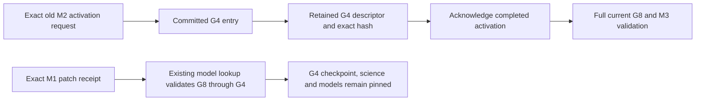

# Historical activation acknowledgement without historical tree payloads

> Historical generated outputs are available through the [evidence archive](evidence-archive.md); original paths in reproduction commands refer to restored or newly generated outputs.

## Scope and exact foundation

This change separates the evidence that an explicit model activation committed
from the checkpoint and scientific tree produced by that activation. It introduces
no new persistent fields, publication format, journal, receipt ledger or authority.
No committed-artifact collector or deletion route is added.

- Base: `640de9b98d0fb7f950904ef48acc65f750486b8c`, the completed E2E report.
- Validated activation foundation: `4ada24712dca95d1114d3e838a13c3447af998ac`.
- Inherited FULL-tested executable: `331413412317d7b58691936718f0852e22d39e4e`.
- These are a verified ancestor chain. Between the inherited executable and the
  E2E head, production, normal tests and runtime configuration did not change.
- Anemone: `90c7ef4454edf52459d7f7051b6c904ddf7f7a35`, exact wheel SHA-256
  `5f3015c1a07d7a838a729896a388fad2b31f666f9abea7e82eb6f3381cb52890`.
  The independently copied environment initially matched all 289 Anemone and 477
  Chipiron source hashes from the base manifest; no dependency was upgraded.
- Implementation: `7796226b166f4ea41ae7dbf772144cd24fa88815`.
- Schema-check idiom: `7d92e889`; valid serialized version-1 requests are unchanged.
- Final activation implementation: `de8fc014f5c41686ac47c22677694b98145ec6ca`, which
  additionally binds historical checkpoint/scientific pointers to sealed metadata.
- Final retention dependency correction: `11b82d5cb08dfdb0678c4ae0f3558a0e56f193a4`.
- The initial measurements used harness head `99f701760f5c01bf79bb8995758d715af4b0260e`.
- Local branch: `fix/morpion-historical-activation-evidence`.
- New secondary-ext4 worktree:
  `/home/pompote/oldata/victor/morpion-scratch/activation-evidence-20261025/worktree`.

The original E2E artifacts are read-only references. All tests and measurements use
new generated workspaces and disposable copies. The selected test's deliberate
unavailability experiment moves only generated old payloads into another directory;
it retains their bytes and the original workspace. No historical source is migrated.

## Existing completion contract is sufficient

The explicit contract is the existing **publication version 3, evaluator contract 1,
activation request schema 1** combination. It already records:

| Location | Commitment |
| --- | --- |
| Authoritative generation entry | Generation/capsule ID, parent, descriptor path and exact SHA-256, checkpoint/scientific identities, activation request digest |
| Sealed descriptor | Exact original request, actual previous head and producer, complete refresh outcome, new active evaluator and frozen model binding, scientific/configuration identities, dependency inventory |
| Exact original request | Workspace/epoch, expected head, previous model, accepted Training descriptor, selected candidate/full bundle digest, configuration, policy, cursor digest and exact receipt-ledger digest |

The descriptor is already hashed and fsynced before the single atomic `run_state`
replacement. A precommit orphan can have all these bytes and still is not a completed
operation: only its presence in the authoritative committed ancestry grants that
meaning. New activations retain all normal candidate, checkpoint, scientific,
certificate, hashing and fsync validation before that commit.

Historical acknowledgement now verifies the **actual retained descriptor bytes**
against their authoritative digest. It checks the complete request digest, workspace/
epoch/configuration/policy, accepted Training reference, actual parent, before/after
producer and selected model. Historical checkpoint/scientific pointers must also
match the sealed inventory and scientific path; they cannot be redirected in the
authority merely because payload bytes are no longer needed for acknowledgement.
It accepts the existing one-step transition or the
existing extra pending-patch drain boundary. Multiple committed occurrences of the
same request digest refuse. The request digest itself is the operation identity;
there is no second mutable identifier or new UUID ledger.

The descriptor is not synthesized from a model name, generation counter or parent
hash. It is retained immutable evidence. Its dependency inventory is a commitment
to bytes validated at publication, not a claim that absent historical payloads have
been revalidated today. Current scientific consumers, current model recovery and
new activation execution still call the complete capsule validator.

The trust assumption is unchanged: `run_state` is the sole writer-owned atomic
commit authority. SHA-256 checks detect changed descriptor bytes and mismatched
bindings. They are not a signature defending against an attacker who can coherently
rewrite the authority and all commitments. There is no newly claimed trust in a
parent hash instead of file verification.

## Minimal implementation

`generation_publication_io.read_committed_descriptor` extracts the existing shared
hash/header validation. `validate_capsule` calls it, then performs the same complete
inventory/content/scientific checks. Parent identity is now explicitly compared too.
The shared evaluator binding checks remain in that validation path.

`model_activation.activation_completion` recognizes the existing sealed commitment.
The exact-retry branch uses it instead of validating every old payload. It then uses
the unchanged receipt-session recovery path to validate the **current** head, repair
advisory projections and acknowledge only already committed exact pending receipts.
It does not refresh nodes, load the old model, append a generation, change the
accepted cursor or rewrite authority. A pending new M3 proposal remains pending.

A descriptor that is absent, changed, uncommitted or inconsistent refuses. The
actual request must match in full. An old request with altered content cannot regain
its previous head and is rejected. A corrupt current checkpoint/scientific/model
also refuses; the retry cannot select a historical recovery fallback.

Existing descriptors need no backfill or historical write. Future retirement must
retain their existing paths and exact bytes unless a separately validated protocol
changes that representation. Descriptors still contain inventories, so their size
can grow with model/file dependencies. This is a separation of lifetimes, not a
claim of constant total historical metadata.

## Read-only dependency analysis

The existing rolling recovery script now understands the explicit format-3 model
binding. It verifies the current sealed evaluator and compares any active-model
projection with the exact derived projection. Unknown ownership is still rejected.
It understands the authoritative atomic cursor and proposal envelope instead of
requiring the obsolete independently advanced producer cursor. It reuses the
existing accepted Dataset and Training validators, including all candidate bundles.
The known Linoo diagnostic table is parsed with its existing loader and retained as
a diagnostic artifact, without treating it as a search snapshot authority.

Historical activation descriptors are listed as retained commitment files. They
are excluded from conditional reclaimable inode totals, even where the associated
scientific payload has no independent root. The genesis descriptor remains required
by existing publication code. Current capsules, two selected complete rollback
candidates, observed reader pins, pending work, exact receipt evidence, accepted
results, models and explicit scientific pins remain separate reasons.

No ownership timeout becomes proof that a worker stopped. Missing stable pins,
changed controls, unknown ownership, malformed inputs and external hard links fail
closed or suppress the conditional set. Hard links are counted by device/inode and
allocated `st_blocks * 512`, not by summing duplicate filenames. Files outside the
capsule namespace are retained and are not deletion candidates.

The existing publication protocol still lists every committed capsule as a root.
Therefore **current-contract reclaimability remains zero**. Conditional candidates
mean payload retirement under a future contract, with all listed commitments and
other dependencies retained; they do not mean whole-capsule deletion permission.
A workspace with intentionally unavailable old payloads still fails the general
retention audit even when exact retry and current-head restoration succeed.

## Scientific and recovery validation

The focused tests use actual durable publication and exactly accepted models. They
compare the entire cold-restored checkpoint payload, including graph/topology,
direct/tree/effective Values, provenance, selector, search RNG and rollout RNG.
They test old M2 acknowledgement after M3, conflict/corruption/missing commitments,
uncommitted evidence, current scientific/model damage, independent reader/pin roots,
and accepted-result or advisory-model corruption. Real process death during retry
repair leaves the existing M3 authority unchanged.

The genuine nonempty E2E recipe is reused separately. It checks both learning cycles,
full-reference/indexed Dataset JSONL and Reevaluation rows, exact receipts/cursors,
real M3 Growth and Reevaluation, and the independent scientific/continuation oracles.
A separate receipt-free fixture first passes the complete dependency audit; a
disposable copy then makes its independently unpinned M2 checkpoint/scientific
payload unavailable.
The retained descriptor suffices for old-request acknowledgement. M3 cold state and
its next complete Growth checkpoint/scientific output must equal the untouched
oracle, with original authority and pending patch bytes unchanged.

The existing activation process-death matrix covers interrupted precommit and
postcommit publication. Existing scientific tests preserve the FORCED(35) /
ESTIMATE(42) distinction, five enabled confidence policies and four gated policies.
No representative-parent discrepancy is hidden or altered by this change.

The final E2E run uses 40 separate processes and reaches 277 nodes/281 edges in G8.
Both learning cycles use 16 actual Dataset rows, split into 12 training and four
validation examples for each of two candidates. Each cycle accepts `linear_b`.
The repeat-run comparison preserves all 13 complete checkpoint oracle payloads,
all eight generations' checkpoint digests and scientific records/updates, and all
four candidate weights/configurations. Row bodies match across independent runs;
bundle manifests contain run-specific paths/timings, so full bundle identities and
associated provenance legitimately differ. Those differences are enumerated, not
normalized into a claim of byte-identical models. Within each workspace, full-reference
and indexed Dataset JSONL and Reevaluation patch parity include complete metadata.

## Complete dependency findings: no E2E payload becomes reclaimable

The corrected analyzer validates the genuine G1–G8 workspace. The old analyzer
refuses the same current-format workspace with `Unknown model ownership`; that
refusal remains in the evidence. The activation retry edge is removed, but the
complete E2E graph has **no conditional payload candidates and zero reclaimable
bytes**.

The additional dependency is concrete: `GenerationPublicationSession.model_pin`
validates each capsule, newest first, before checking whether it contains the exact
receipt model. M1's newest holder is G4. Thus an exact M1 patch retry validates
G8→G7→G6→G5→G4 even though another M1 bundle survives in G3. G4 must stay complete
for that operation. The new regression traces these real validator calls while
acknowledging the original patch bytes and preserving authority/cursor continuity.
No model-selection or receipt-verification shortcut is introduced here.

| Generation | Independent payload roots after this change |
| --- | --- |
| G1 | Explicit scientific retention; publication also needs its descriptor |
| G2 | Original accepted Dataset/Training source; M1 receipt source retained conservatively |
| G3 | M1 receipt checkpoint retained conservatively |
| G4 | Actual exact-receipt model lookup requires complete capsule validation |
| G5 | Accepted Dataset/Training source, accepted cursor, M2 receipt source, receipt-model lookup |
| G6 | Complete rollback candidate, M2 receipt checkpoint, receipt-model lookup |
| G7 | Complete rollback candidate and receipt-model lookup |
| G8 | Current M3 recovery, pending M3 input and receipt-model lookup |

G4 and G7 additionally retain their exact activation descriptors, without needing
historical payloads **for activation completion evidence itself**.



The initial projection incorrectly omitted this lookup dependency and reported
286,720 conditionally reclaimable allocated G4 file bytes. **That estimate is
superseded.** All payloads
moved in the earlier exploratory disposable copy were restored; the original E2E
workspace was never altered. All 20 sealed G4 payload hashes in that copy were
[verified after restoration](https://github.com/victorgabillon/chipiron/blob/d8c94d6c07dd072e6e25620ea194861644fa42e5/docs/research/activation_completion/evidence/superseded/exploratory-restoration.json).
The corrected analyzer refuses the G4-unavailability
experiment before moving anything. Initial raw observations remain separate from
the final dependency conclusion.

The lifetime distinction is demonstrated instead on a fresh real M1→M2→M3 fixture
with no patch receipts: G1 source, G2 M2 activation, G3 Growth and second Training,
G4 M3 activation, G5 current Growth. Its two Training candidates have positive sample
counts. The original unit-test fixture and its retained research copy remain intact.
Only a disposable copy makes the independently unpinned G2 checkpoint/science
unavailable after a successful complete graph audit. Its descriptor stays present.
The baseline refuses; the new implementation acknowledges M2, preserves M3 and the
entire cold checkpoint, and produces byte-identical next-Growth checkpoint/scientific
oracle output. The general retention analyzer still refuses that incomplete copy.
The full E2E case separately preserves actual UUID receipts and pending work.

All byte accounting uses device/inode identities and allocated `st_blocks * 512`.
The detailed inventory distinguishes current G8, complete rollback candidates
G6/G7, all historical capsules, compact descriptors, accepted results/models and
outside-capsule files. Shared model links are counted once. Directory overhead,
filesystem metadata, open-file delays and filesystem block sharing are excluded.
No bytes were reclaimed in either fixture. A future partial-retirement protocol is
still required even in the receipt-free case.

| Final full E2E allocation | Paths / distinct inodes | Logical unique bytes | Allocated file bytes |
| --- | ---: | ---: | ---: |
| Current G8 | 17 / 17 | 388,505 | 430,080 |
| Rollback candidates G6/G7 | 38 / 34 | 602,715 | 696,320 |
| Current plus rollback union | 55 / 47 | 968,898 | 1,093,632 |
| All eight capsules | 144 / 116 | 2,199,714 | 2,519,040 |
| Entire workspace | 235 / 207 | 2,863,119 | 3,366,912 |
| Retained genesis and activation descriptors (included above) | 3 / 3 | 33,926 | 45,056 |
| G4 activation descriptor alone (included above) | 1 / 1 | 12,609 | 16,384 |

The union is smaller than the sum because some frozen model files are hard-linked.
The separate receipt-free fixture has 53,248 conditionally unpinned allocated file bytes
(17,589 logical bytes) under G2, excluding its retained descriptor. This is a
dependency observation under explicit future-retirement assumptions, not storage
savings: permitted reclaimability remains zero in both fixtures.

## Cost and scope of the improvement

The old retry hashes complete historical payloads with streaming I/O; it does not
deserialize a second search tree. The improvement removes that I/O and lifetime
dependency. Import-dominated process RSS remains approximately 293 MiB. Authority
size is unchanged at 31,540 bytes: zero new persistent fields or duplicated evidence.

For history/receipt metadata sizes G/P, current payload bytes H, old payload bytes S
and retained descriptor bytes D, retry cost changes from O(G + P + H + S) to
O(G + P + H + D), with the existing bounded hash buffers. The authority and descriptor
metadata still consume memory proportional to their size. This is not constant-time
history lookup or bounded total history; no extra cache is introduced. The read-only
inventory itself still validates all retained capsule files and tracks their inodes.

Final matched-input measurements use the same generated G1–G8 workspace in
independent copies, the exact base implementation and the final implementation.
Each operation starts in a fresh interpreter, takes five uninstrumented samples,
then records a separate cProfile/hash trace. OS caches are not dropped:

| Operation | Median ms | File hash calls | File bytes hashed |
| --- | ---: | ---: | ---: |
| Baseline old M2 retry | 48.199 | 226 | 3,253,570 |
| New old M2 retry | 45.130 | 190 | 2,912,688 |
| Baseline current-head validation | 4.139 | 29 | 455,385 |
| New current-head validation | 4.160 | 29 | 455,385 |

Historical payload hash calls fall from 36 to zero. Both retry implementations read
one historical descriptor; that actual hash verification is deliberately preserved.
Current-head verification hash work is identical. The small timing difference is
not a scalability claim or the motivation for adding the completion check.
Peak retry RSS is 293.434 MiB before and 293.340 MiB after. Current-head timing
measures actual capsule/model validation, not a complete tree restore; cold restore
and continuation are proved separately. The smaller receipt-free unavailability
fixture is not used for a misleading cross-population timing comparison.

## Code-size and verification

Against `640de9b9`, production package code adds 132 lines and removes 32 (**+100 net**).
The existing operational read-only analyzer adds 133 and removes 27 (**+106 net**).
Combined operational delta: **+206 net**. Normal regressions add 366 lines; the two
research probes add 248. The source changes are a shared descriptor read/check and
one completion verifier; the analyzer adds support for already-existing evaluator,
atomic cursor and accepted-result contracts. There is no new persistence abstraction.

Development validation passed: 148 FAST cases, 19 final new completion/retention cases,
24 existing activation/fencing cases and 24 existing rolling-analysis cases. The final
completion-plus-analyzer run passes all 43 cases. Two historical pointer-corruption
tests fail on the earlier implementation and pass after the sealed pointer binding;
the full 20-case pointer/layout rerun passes. The independent scientific matrix passes
109 cases. These sets overlap and must not be summed as distinct tests.

Ruff, all 747 formatting checks, toolchain and built-wheel installed-distribution
checks pass. All 477 installed Chipiron and 289 Anemone source hashes match the
recorded final implementation/dependency. Strict static analysis passes with
206 existing diagnostics against a baseline of 209, zero new and three removed.
The initial style diagnostic was corrected without altering the reviewed baseline.

PR CI on the installed final wheel passes **2,629 tests**, with two CUDA-unavailable
skips, in 874.59 seconds. The selection/execution identity check reports no errors.
The initial PR run was deliberately interrupted to add the historical pointer
corruption regression; its partial result is preserved and is not counted as a
complete pass. The complete final PR run includes those added cases.

One complete FULL run on `11b82d5c` passes **2,776 tests**, with the same two
CUDA-unavailable skips, in 1,434.13 seconds. It selects 2,778 tests; both workers
report identical selection fingerprints and the execution identity check has zero
errors. The existing four integration/external-data exclusions are unchanged.
Coverage is 80%. This is a local execution of the existing CI gates using the
installed wheel, not a claim that a remote GitHub workflow was launched.

Affected matrices included in that completed FULL run include:

| Matrix | Passed cases |
| --- | ---: |
| New historical completion and dependency regressions | 19 |
| Existing activation process-death/restart cases | 22 |
| Existing activation edge cases | 22 |
| Checkpoint-bound exact patch receipts | 51 |
| Durable closed snapshots | 48 |
| Generation publication process-death cases | 30 |
| Generation publication | 25 |
| Rolling recovery analysis | 24 |
| Generation ownership/concurrency | 6 |
| Exact patch receipt concurrency | 3 |
| Atomic Reevaluation science / publication / crashes | 38 / 31 / 32 |
| Fenced Dataset science / publication / crashes | 45 / 25 / 15 |
| Durable Training publication / crashes / edges | 25 / 17 / 3 |

The full JUnit and compact validation summary are committed with this report. Raw
per-phase execution manifests remain in task scratch with exact paths and hashes
recorded in the summary.
The final protected-worktree audit again passes all 45 Chipiron and 13 Anemone
worktrees. The final report/evidence commit changes no executable source or tests,
so FULL is not repeated for that documentation-only commit.

## Remaining retention and rollback work

The next narrow lifetime dependency is the exact receipt model lookup. Its current
validation scan must stay protected until a separate change can prove the exact
model binding and verify the actual required bundle without unrelated historical
trees. Keeping another bundle copy alone does not justify skipping validation.
This task deliberately leaves that production path unchanged.


This slice removes only the historical retry-to-tree dependency. Receipt identities,
original accepted Dataset rows, all Training candidate bundles/configuration,
source commitments, current/rollback state and active-reader dependencies remain.
No accepted-result meaning or exact UUID/content deduplication is changed.

The distinction is narrower than saying every accepted-result read requires its
old tree. `accepted_dataset_identity` verifies the retained row bytes, original
admission and source commitment; `accepted_selected_model` additionally verifies
the selection and all model bundles. Those read-only paths do not themselves open
the complete old source tree. Dataset acceptance/retry and source consumers still
use its complete capsule. This report conservatively keeps G2/G5 source payloads
and G3/G6 receipt checkpoints; it does not release these additional dependencies
without a separately reviewed retirement contract. The current receipt validator
always checks the current checkpoint, and historical receipt identity remains in
the exact ledger. Conservative historical checkpoint pins are reported as such.

The two retained rollback candidates are complete snapshots, not executable rollback
operations. They do not yet provide validated, sealed boundary-specific accepted
cursor and receipt recovery context. The smallest next design must establish that
context and bind the boundary's exact model, checkpoint/science, selector/RNG and
configuration to a new explicit recovery epoch,
while retaining original exact receipts and fencing old-epoch producers/pending work.
It must explicitly distinguish acknowledgement of an old receipt from applying its
patch to the fork, and define the fate of each pending proposal. A generation number
or a snapshot alone cannot supply those semantics.
Crash recovery must continue choosing the current authority; an intentional fork
must be a distinct authorized transition. That protocol is not implemented here.

The next retention implementation must also define what makes historical dependency
records eligible for retirement and how to hold all worker lifetime fences. It must
preserve lightweight commitments before any heavyweight payload retirement. This
report authorizes no deletion, receipt compaction, epoch reset or production rollout.

## Reproduction and graphical review

Run from this isolated worktree using its exact environment. All new output paths
must be fresh secondary-disk destinations. Use the pinned environment recorded in
the evidence, with `PYTHONDONTWRITEBYTECODE=1`, `PYTHONHASHSEED=0`,
`QT_QPA_PLATFORM=offscreen` and new secondary-disk `TMPDIR`, `XDG_CACHE_HOME`,
`MPLCONFIGDIR` and `CHIPIRON_OUTPUT_DIR`. Both MLflow URI variables must point to
fresh scratch SQLite files. No default historical experiment destination is used.
The existing E2E recipe is:

```bash
PYTHONPATH=src:. ../venv/bin/python -m docs.research.e2e_bootstrap.reproduce ../experiments/new-opening
```

Make independent `cp -a --reflink=auto` copies of that new workspace for baseline
and final measurements. The baseline source is the verified `640de9b9` worktree;
it is read only. For example, with those fresh copies already created:

```bash
PYTHONPATH=/home/pompote/oldata/victor/morpion-scratch/e2e-bootstrap-validation-20261024/worktree/src:. \
  ../venv/bin/python -m docs.research.activation_completion.measure retry \
  ../experiments/new-before/workspace ../experiments/new-before-retry.json \
  --request ../experiments/new-opening/M2-request.json
PYTHONPATH=src:. ../venv/bin/python -m docs.research.activation_completion.measure retry \
  ../experiments/new-after/workspace ../experiments/new-after-retry.json \
  --request ../experiments/new-opening/M2-request.json
```

Repeat with operation `head` and omit `--request` for current-head verification.
The benchmark records five uninstrumented observations followed by a separate
cProfile/hash trace; it does not claim cold-disk latency. Do not run the unavailability
probe on this full E2E G4: the corrected analyzer refuses because its receipt-model
lookup still needs the payload.

The regression fixture supplies a separate genuine receipt-free M1→M2→M3 case:

```bash
PYTHONPATH=src:. ../venv/bin/python -m pytest -q --no-cov \
  -p docs.research.benchmarks.morpion_training_export_20261020.validation_safety \
  tests/environments/test_morpion_activation_completion.py \
  --basetemp=/home/pompote/oldata/victor/mh25/new-completion
```

Copy its new `activation-completion0/work` fixture into a fresh disposable workspace,
preserving the original fixture. Then run `docs.research.activation_completion.separate`
with that copy, the original fixture's `request.json`, and a new output JSON. The
probe rechecks the complete graph, retains the sealed descriptor, moves only the
independently unpinned old checkpoint/science aside, compares full cold state and
next Growth, and confirms the general retention audit still refuses the incomplete
copy. It does not delete the moved bytes.

CI uses the built installed wheel, `PYTHONPATH=.`, `CHIPIRON_TEST_INSTALLED=1`,
the same validation-safety plugin and fresh short secondary-disk basetemps. The
existing `make test-fast`, `make test-pr` and `make test-full` targets use two pytest
processes; no bootstrap worker service or distributed experiment is launched.

## Evidence map

All paths below are relative to this report's directory:

- [Exact sources and installed source hashes](https://github.com/victorgabillon/chipiron/blob/d8c94d6c07dd072e6e25620ea194861644fa42e5/docs/research/activation_completion/evidence/sources.json).
- [Final genuine E2E process results](https://github.com/victorgabillon/chipiron/blob/d8c94d6c07dd072e6e25620ea194861644fa42e5/docs/research/activation_completion/evidence/final-e2e-summary.json),
  [cross-run scientific comparison](https://github.com/victorgabillon/chipiron/blob/d8c94d6c07dd072e6e25620ea194861644fa42e5/docs/research/activation_completion/evidence/final-scientific-comparison.json)
  and [stale-producer/conflict checks](https://github.com/victorgabillon/chipiron/blob/d8c94d6c07dd072e6e25620ea194861644fa42e5/docs/research/activation_completion/evidence/final-focused.json).
- [Final dependency graph](https://github.com/victorgabillon/chipiron/blob/d8c94d6c07dd072e6e25620ea194861644fa42e5/docs/research/activation_completion/evidence/final-reachability.json) and
  [allocated inode inventory](https://github.com/victorgabillon/chipiron/blob/d8c94d6c07dd072e6e25620ea194861644fa42e5/docs/research/activation_completion/evidence/final-allocation.json).
- [Independent lifetime experiment](https://github.com/victorgabillon/chipiron/blob/d8c94d6c07dd072e6e25620ea194861644fa42e5/docs/research/activation_completion/evidence/lifetime-separation.json)
  and [baseline refusal](https://github.com/victorgabillon/chipiron/blob/d8c94d6c07dd072e6e25620ea194861644fa42e5/docs/research/activation_completion/evidence/lifetime-baseline-refusal.json).
- [Before retry](https://github.com/victorgabillon/chipiron/blob/d8c94d6c07dd072e6e25620ea194861644fa42e5/docs/research/activation_completion/evidence/final-before-retry.json),
  [after retry](https://github.com/victorgabillon/chipiron/blob/d8c94d6c07dd072e6e25620ea194861644fa42e5/docs/research/activation_completion/evidence/final-after-retry.json),
  [before head validation](https://github.com/victorgabillon/chipiron/blob/d8c94d6c07dd072e6e25620ea194861644fa42e5/docs/research/activation_completion/evidence/final-before-head.json) and
  [after head validation](https://github.com/victorgabillon/chipiron/blob/d8c94d6c07dd072e6e25620ea194861644fa42e5/docs/research/activation_completion/evidence/final-after-head.json), with
  adjacent `.profile.txt` reports and retained raw profiles in scratch.
- [Code-size delta](https://github.com/victorgabillon/chipiron/blob/d8c94d6c07dd072e6e25620ea194861644fa42e5/docs/research/activation_completion/evidence/code-delta.json),
  [19 new plus 24 existing tests](https://github.com/victorgabillon/chipiron/blob/d8c94d6c07dd072e6e25620ea194861644fa42e5/docs/research/activation_completion/evidence/lookup-final.xml),
  [failing-before pointer corruption](https://github.com/victorgabillon/chipiron/blob/d8c94d6c07dd072e6e25620ea194861644fa42e5/docs/research/activation_completion/evidence/pointer-before.xml),
  [passing-after pointer/layout matrix](https://github.com/victorgabillon/chipiron/blob/d8c94d6c07dd072e6e25620ea194861644fa42e5/docs/research/activation_completion/evidence/pointer-after.xml),
  and [independent scientific matrix](https://github.com/victorgabillon/chipiron/blob/d8c94d6c07dd072e6e25620ea194861644fa42e5/docs/research/activation_completion/evidence/scientific.xml).
- [Final validation summary, environment and execution fingerprints](https://github.com/victorgabillon/chipiron/blob/d8c94d6c07dd072e6e25620ea194861644fa42e5/docs/research/activation_completion/evidence/validation.json),
  [PR JUnit](https://github.com/victorgabillon/chipiron/blob/d8c94d6c07dd072e6e25620ea194861644fa42e5/docs/research/activation_completion/evidence/pr.xml) and
  [FULL JUnit including exhaustive matrices](https://github.com/victorgabillon/chipiron/blob/d8c94d6c07dd072e6e25620ea194861644fa42e5/docs/research/activation_completion/evidence/full.xml).
- [Protected-worktree audit](https://github.com/victorgabillon/chipiron/blob/d8c94d6c07dd072e6e25620ea194861644fa42e5/docs/research/activation_completion/evidence/protected.json): all 45
  prior Chipiron and 13 prior Anemone registrations, HEADs, statuses and tracked-diff
  fingerprints are unchanged.

The initial observations are retained for transparency. The
[superseded dependency estimate](https://github.com/victorgabillon/chipiron/blob/d8c94d6c07dd072e6e25620ea194861644fa42e5/docs/research/activation_completion/evidence/superseded/README.txt)
is explicitly not the final reachability conclusion. Final claims use `final-*` and
the separately audited `lifetime-*` evidence. Raw test/build logs and all original
generated workspaces remain under the new task scratch root.

## Graphical review

Open this worktree in VS Code, compare the branch with `640de9b9` in Source Control
Graph, and open the file diffs. For a direct file comparison:

```bash
git show 640de9b9:src/chipiron/environments/morpion/bootstrap/model_activation.py > ../model_activation.before.py
code --diff ../model_activation.before.py src/chipiron/environments/morpion/bootstrap/model_activation.py
```

The comparison file stays in new secondary-disk scratch. No protected branch is
rebased or modified, and no PR, merge, package publication or production activation
is performed.
