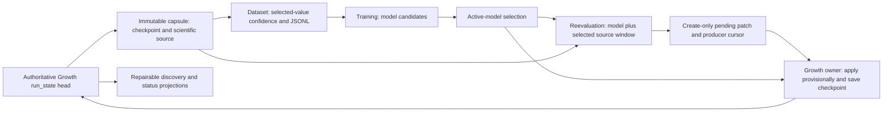

# Lean durable scientific v2 pipeline: architecture review

Review date: 2026-10-21. **The current stack is not a bounded-history pipeline.**
It has a useful bounded node reader and a sound, restricted Growth commit protocol,
but ordinary worker discovery materializes quadratic historical metadata and
verifies overlapping historical capsules. All committed artifacts are retained.
Removing repeated canonical replay did not remove those costs.

This review changes no production code or scientific policy. Exact base:
`1f335acfa362469dae3636329fa1054365caeb0b`; implementation:
`c1c737ca0d9fb76f9a9d2ad68d0f999a4c9f0be1`. New local branch:
`review/morpion-durable-pipeline-architecture`, under
`/home/pompote/oldata/victor/morpion-scratch/durable-v2-architecture-review-20261021/worktree`.
All 471 production Python file hashes match the prior implementation manifest;
all 27 pre-existing worktrees retain their HEAD, status and tracked-diff fingerprint.
No original worktree or historical evidence was changed. All new scratch is on the
secondary disk. Nothing was pushed, merged or activated.

## Prioritized findings

| Priority | Finding and evidence | Smallest useful correction | Benefit and boundary |
| --- | --- | --- | --- |
| P0 | Worker discovery loads **all** manifests, each containing a cumulative publication/receipt ledger, then validates every capsule. [pipeline_orchestrator.py:425](../../src/chipiron/environments/morpion/bootstrap/pipeline_orchestrator.py#L425), [checkpoint_patch_receipts.py:718](../../src/chipiron/environments/morpion/bootstrap/checkpoint_patch_receipts.py#L718), [generation_publication_io.py:423](../../src/chipiron/environments/morpion/bootstrap/generation_publication_io.py#L423). | Write a small, explicitly versioned discovery projection; select candidates from lightweight headers; bind the chosen candidate to authoritative state and validate its complete dependency closure under a read pin. | Removes quadratic retained discovery data and redundant validation of unrelated historical checkpoints. Current selected capsules still contain history, so this alone does not make validation independent of G. |
| P0 | Every capsule clones the entire scientific catalog, including old mutable updates and generation descriptors. Each descriptor repeats all creation keys and prior record descriptors. [scientific_generation_publication.py:34](../../src/chipiron/environments/morpion/bootstrap/scientific_generation_publication.py#L34), `sharded_training_v2.py:329`. | Separately version the storage/publication layout: current updates plus immutable record dependencies, with inventories stored once or in bounded immutable pages. Historical updates belong to their historical generation. | Removes historical updates/descriptors from the current scientific dependency closure; eliminates cumulative prefix copies. Requires a format contract, not a reinterpretation of v2 files. |
| P0 | No retirement of committed capsules, checkpoints, receipt roots, models, Dataset outputs or successful reader indexes. [generation_publication.py:671](../../src/chipiron/environments/morpion/bootstrap/generation_publication.py#L671). | Define semantic liveness and archive obligations before adding deletion. Start with capacity accounting/backpressure and a dry-run reachability inventory. | Prevents disk exhaustion without sacrificing recovery. Finite disk, unlimited growing trees and permanent local retention of every generation are mutually incompatible. |
| P1 | Nested callers repeatedly verify the same capsule, checkpoint, model and source within one operation. E.g. `committed_canonical_validation` calls `generation_read_pin`, which validates, then calls `validate_capsule` again. | Let the existing pin expose its validated descriptor/hashes within its lifetime. Remove duplicate verification inside the same protected boundary; retain fresh verification at independent opens and required output/commit boundaries. | Constant-factor reduction with less code and no persistent cache. Does not solve historical closure size. |
| P1 | Dataset/Training results, TTL claims, model pointer and producer cursor are outside the complete Growth transaction. Scientific publication also intentionally fixes the producer/model epoch. | Specify immutable downstream results, exclusive owner/fencing and explicit model-epoch acceptance, using existing publication primitives. Keep production disabled meanwhile. | Makes the advertised pipeline recoverable end to end; avoids adding another journal or silently broadening the current protocol. |
| P1 | Growth builds a complete checkpoint payload; optional training caches build/load whole tensors and O(rows) schedules. | State these budgets explicitly. Prefer the existing uncached chunked training path when bounded RAM is required. Any checkpoint streaming or exact shuffle replacement is separate work. | Avoids falsely advertising bounded end-to-end RAM. No training order or sampling change is authorized by this review. |
| P2 | Writer topology validation uses linear list membership for every reciprocal edge; several serialization/fsync/digest utilities duplicate code. | Measure high-degree fixtures; reuse a proven graph-validation routine or a transient membership index if justified. Consolidate identical I/O helpers without changing errors or wire bytes. | Removes potential degree-squared work and redundant maintenance. Neither needs a general graph/persistence framework. |

## Resource model

Let `N_g` be the number of nodes created by generation g, `E_g` the current branch
count, and `K_g = N_g - N_(g-1)`. The main formulas assume the normal append-only
Growth population. If an adapter removes nodes, replace N in immutable-record
terms by the number ever created; the reader deliberately indexes unused historical
records too. N and E without subscripts denote the current generation G.

Node counts alone do not determine bytes or time. Define:

* `S_g`: cumulative immutable record bytes, including canonical replay histories.
* `U_g`: current update bytes, including values, certainty, provenance and links;
  with bounded scalar/metadata sizes, `Θ(N_g + E_g)`.
* `D_g`: generation-descriptor bytes: `Θ(N_g + g)` fixed-width entries, from the
  full creation map and cumulative record descriptors. Actual variable ID lengths
  and generation digit widths are included in byte measurements.
* `A_g = S_g + Σ(i≤g)(U_i + D_i)`: historical export bytes inside capsule g,
  excluding its catalog/seal, checkpoint and model.
* `C_g`, `M_g`: checkpoint and pinned model bytes; `F_g`: capsule file count,
  including checkpoint/model files. With fixed file counts there, `F_g = Θ(g)`.
* `R_g`: cumulative receipts; in this restricted v2 protocol at most one new
  receipt is committed per generation, so `R_g ≤ g`. Retries/polls need a separate
  count P: they can continue even when G is unchanged.
* `I_g`: reader SQLite bytes; `L`: largest individual decoded row/state including
  adjacency lists; `W`: selected window; `Q`: parser/SQLite buffers; `T_g`: training
  tensor bytes; `J_g`: supervised JSONL bytes. Let `V_g` denote canonical replay /
  redump CPU for all records, and `V(K_g)` that CPU for newly created records.

For default SQLite B-tree lookup costs, write `B_g = O((N_g+E_g) log(N_g+E_g))`.
The [SQL plans](durable_pipeline_architecture/evidence/sqlite-plans.json) were inspected: topology indegree construction uses an automatic covering
index on child, and traversal uses the parent/child primary key and node-ID index.
There is no demonstrated repeated full-edge scan in that loop with the tested
SQLite configuration. Do not claim a linear disk-index build independent of B-tree,
sort, record-size or filesystem costs.

| Operation at generation g | Time / logical I/O | Python working RAM | Persistent / transient disk |
| --- | --- | --- | --- |
| Scientific writer | Reads prior `D_(g-1)`; writes `U_g + D_g + new-record bytes`; `V(K_g)`; visits all N/E, plus reciprocal membership work below | `O(N_g+E_g+g+L)` in addition to live graph | Adds `U_g + D_g + new-record bytes`; rewrites O(g) catalog |
| Catalog clone | `Θ(g)` generation directories / links, plus checkpoint/model handling elsewhere; root catalog O(g) copy | O(g) catalog and path list | O(g) new directory entries; existing payload inodes shared |
| Scientific ancestry validation | Parses `Σ D_i`, including skipped creation maps; compares `g(g-1)/2` prior record descriptors; parser adds a surrogate-detection scan | O(g) retained descriptors, bounded one manifest at a time; not O(ΣN_i) | Fresh validation index `O(I_g+E_g)` and journals/TEMP; deleted afterward |
| Publication validation/sealing | Several complete `A_g+C_g+M_g` scans, O(F_g log F_g) sorted inventory operations and O(F_g) fsync calls; fresh B_g index plus `V(K_g)` when canonical evidence matches | O(g+R_g+F_g+L+Q), **plus writer/live graph/checkpoint payload** | Current checkpoint/model, new export payloads, O(F_g+g) seal/evidence/catalog; no committed capsule retirement |
| Run-state commit | Read/validate/serialize `Θ(g+R_g)` metadata; head dependency verification separately | `Θ(g+R_g)` | One current `Θ(g+R_g)` JSON file, not g files; cumulative rewrite traffic `Σ(g+R_g)` |
| Discovery projection copies | Writes `Θ(g+R_g)` for each manifest; Dataset/Training status copies repeat it | Per-file `Θ(g+R_g)` | `Θ(Σ(g+R_g))`, quadratic when receipts/generations accumulate |
| One **all-history discovery** | `Θ(Σ(i≤g)(A_i+C_i+M_i))` dependency bytes; g rereads of current run state, `Θ(g(g+R_g))`; all manifest parsing | `Θ(Σ(i≤g)(i+R_i))`, plus one capsule inventory; already quadratic before any nodes are selected | No new index; reads all retained capsule namespaces |
| Managed reader cold open | Full capsule verification `A_g+C_g+M_g`, selected source scans `S_g+U_g+D_g`, canonical `V_g`, B_g index build | `O(g+R_g+F_g+L+Q)` incl. pin/run-state/inventory; selected nodes add `O(WL)` | `I_g` successful cache plus bounded-page disk TEMP/journal; a new capsule/path identity creates a new index |
| Managed reader reused open | Full capsule and selected-source hashes, `PRAGMA quick_check`, full indexed-payload digest O(I_g); **not O(1)** | Same metadata/row bounds | Same index, no rebuild |
| Bounded Dataset after open | Fixed multi-pass node/row scans; O(N+E) keyed operations, B-tree costs, child sorting `Σ d_out log d_out`, source rechecks and JSONL bytes | O(g+R_g+F_g+L+Q); family data stays on disk | O(N) scalar family tables/deltas plus index and J_g output |
| Bounded Reevaluation after open | Cursor selection O(log N+W), keyed reconstruction O(W log N) plus inference/state cost; source recheck before patch publication | O(WL+Q) plus model and the above metadata; patch serialization duplicates a bounded W-row payload | One create-only pending patch/cursor; consumed patch bytes unlinked only after receipt/identity checks |
| Growth checkpoint save/restore | At least C_g serialization/read plus runtime construction; complete payload built even for sharded output | Live O(N+E+state storage), plus complete checkpoint payload and selector state | New C_g each generation; current capsules do not reuse old checkpoint bytes as incremental export shards |
| Training | Depends on rows, architecture and epochs; uncached streaming scans J_g per pass, cached paths load/materialize T_g | Uncached bounded chunk/batch plus model; cached O(T_g+rows) and O(rows) shuffled schedules | Retained rows, per-generation models, per-source/config tensor caches; no global bounded budget |

Dataset family context is built before row filtering and `max_rows`, including
for policy `none` because family metadata/counters are still part of the output.
Small output limits therefore do not bound its global scan or disk work.

The bounded reader's scientific manifest metadata has a **4 MiB event-size guard**
([sharded_training_reader.py:238](../../src/chipiron/environments/morpion/bootstrap/sharded_training_reader.py#L238)). Creation keys are streamed separately, but
cumulative `record_shards` and catalog entries eventually hit this guard. This is
an explicit capacity failure, not proof of indefinite constant history memory.
The publication seal and `run_state.json` are read using ordinary full JSON and
have no corresponding bound. Individual rows/state histories also have no fixed
population-independent size cap. A node with many incoming links can itself be
large. A metadata-only probe accepts 1k/5k/10k shard declarations and rejects 20k
with this guard. Those artificial headers are not valid published generations;
the result tests header capacity only, not a scientific source. See
[capacity evidence](durable_pipeline_architecture/evidence/metadata-capacity.json). Keep these qualifications in any bounded-memory claim.

### Historical growth, with time and storage distinguished

The following structures are independently history-growing:

1. Each descriptor stores g immutable-shard references, including empty shards
   when K=0. The unique descriptors contain `G(G+1)/2` references in total. The
   validator reparses that triangular prefix at **every** publication: Θ(G²)
   reference work for one late generation, Θ(G³) over the run.
2. Each descriptor also stores N_g creation keys: `Σ N_g` unique metadata entries.
   This is Θ(NG) for fixed N, and Θ(KG²) when N_g grows as gK. Rechecking all these
   historical maps each publication repeats that accumulated work.
3. Capsule g hard-links every earlier generation directory. There are Θ(G²)
   directory/file names after G commits. Hard links make immutable export payload
   allocation `S_G + Σ(U_g+D_g)`, **not** a separate full copy per capsule. They do
   not remove those directory entries, traversal/fsync costs or repeated hash reads.
4. Per-capsule catalogs, full inventories and canonical-validation record lists
   each retain Θ(G²) entries across G capsules (assuming fixed checkpoint/model
   file counts). `reused_from` itself is constant-sized and is not the problem.
5. The current run state is Θ(G+R_G), but rewrites total Θ(G²) in the usual run.
   Copying that state into every discovery manifest makes both disk and discovery
   RAM Θ(G²); status files copy those ledgers again after Dataset/Training.
6. All-history discovery hashes overlapping histories. For fixed node/state size,
   one poll costs `Θ((N+E)G² + G³)` export-byte work: the G³ term comes from hashing
   all the repeated descriptor prefixes across capsules. G growth-triggered polls
   sum to `Θ((N+E)G³ + G⁴)`. These are asymptotic byte/entry models, not wall-clock
   forecasts. P repeated idle polls multiply the current discovery cost by P.
7. When N_g≈gK and E_g grows comparably, publication history scans grow as
   Θ(Kg²) per generation, Θ(KG³) over the run, before replay complexity; discovery
   can be Θ(KG³) per poll. Use the byte sums above when state histories grow too.
8. Full mutable updates, checkpoints, Dataset rows, model bundles and successful
   reader/training caches remain retained. Their size is `Σ U_g`, `Σ C_g`,
   `Σ J_g`, etc.; these become quadratic with linear population growth even
   without the duplicated metadata. Necessary historical information is different
   from avoidable duplication, but both consume capacity.
9. `latest_prior_dataset_status_artifact` searches backward up to g paths when
   predecessors are sparse/missing. Selecting/diagnosing work sorts/scans generation
   lists. Model lookup can scan all historical capsules in the general v1 path;
   v2's fixed model epoch normally finds the head pin, so charge the v2 hot path
   for one capsule plus cumulative-ledger parsing, not g capsule validations.
10. History/diagnostic logs grow with events. `load_bootstrap_history` reads the
    entire JSONL text and constructs every event; repeated dashboard refreshes can
    accumulate quadratic read work. This is ancillary to the worker discovery
    problem, not a hidden operation of the bounded node iterator.

There is also a node/edge risk independent of G. `_validate_topology` in the writer
checks `node_id in topology[parent][1]` and `node_id in topology[child][0]` using
lists. Reciprocal membership work is bounded by
`O(Σ d_out² + Σ d_in²)`, and a star already gives quadratic work in its degree.
For a simple dense DAG it can reach Θ(N³). The subsequent queue traversal is
linear in nodes/edges. The indexed validator's disk-based traversal does not have
this same list-membership issue. Do not replace either scientific topology check
with a count-only check.

## Demonstration with fixed states and increasing history

The [probe](durable_pipeline_architecture/probe.py) reuses the existing synthetic
publication driver, changing only its fixture loop from G2/G3 to G2..G64. All
production validators, hashes, checkpoint/receipt commits and filesystem barriers
run unchanged. N=4, K=0 after genesis, the same balanced legal replay population,
4 KiB per-node metadata, fixed producer/model, two-node synthetic patches. There
are no bootstrap processes or distributed workers; these are serial fixture calls.

Each selected discovery measurement runs in a fresh child process. Its wall time
includes **cProfile and hash counters**. A second discovery call measures retained
allocations with tracemalloc. The existing `StageMeasurement`, CPU/I/O helpers and
unique-inode disk accounting supply the other observations. OS caches were warm;
these single samples demonstrate call/structure growth, not production throughput.

| G | Hash calls in one discovery | Bytes hashed | Profiled discovery s | Retained traced bytes | Publication records across manifests | Capsule file paths / unique file inodes |
| ---: | ---: | ---: | ---: | ---: | ---: | ---: |
| 8 | 180 | 949,743 | 0.132 | 238,331 | 36 | 156 / 65 |
| 16 | 552 | 3,445,143 | 0.396 | 795,679 | 136 | 504 / 129 |
| 32 | 1,872 | 13,376,151 | 1.396 | 2,848,593 | 528 | 1,776 / 257 |
| 64 | 6,816 | 55,070,410 | 5.013 | 18,395,601 | 2,080 | 6,624 / 513 |

Exactly g calls to `validate_capsule` and g rereads of authoritative run state occur
per discovery. With this fixture there are exactly `1.5g² + 10.5g` hash calls and
`1.5g² + 7.5g` capsule file names. These exact counts, together with the source
loops, establish growth independently of noisy timings or allocator behavior.

Pipeline manifest bytes grow 137,564 → 496,880 → 1,876,607 → 7,280,272.
Whole synthetic workspace allocation, counting each hard-linked inode once, grows
1,306,624 → 3,035,136 → 8,142,848 → 24,821,760 bytes. This includes retained inputs,
all capsules and discovery artifacts; excludes the later external reader cache.
Publication at those generations takes 0.556 / 0.693 / 0.981 / 1.567 seconds with
existing lightweight counters. These are tiny synthetic checkpoint costs.
Discovery process peak RSS before the tracemalloc pass is 284.56 / 284.69 /
292.31 / 298.68 MiB, dominated initially by imports; it is not a claim that the
history dictionary is bounded. Raw RSS, CPU, physical/logical I/O, counts and
metadata sizes are in [evidence](durable_pipeline_architecture/evidence/).

The prior matched 1k/5k publication measurements remain valid for their three-
generation scope: 5k G2/G3 fell from 27.418/26.794 s to 3.221/3.447 s by avoiding
repeated canonical replay. Logical reads still increased to about 844/1298 MB.
Those results do not establish G scalability. See the
[existing report](morpion_durable_scientific_v2_validation_reuse.md), rather than
extrapolating a 5k timing into a thousand-generation capacity claim.

## Ownership and dependency map



The model arrow back into Growth is a **future epoch transition**, not permission
to change models in the current scientific publication lineage. `publish` compares
model pins with genesis and rejects a changed epoch. A fixed producer identity also
remains mandatory. Training can produce a candidate today; that does not prove
this opt-in lineage can safely adopt it.

| Owner | Authoritative or transient state | Dependencies / recovery boundary |
| --- | --- | --- |
| Growth | Stable kernel ownership lock; one durable `run_state.json` replacement commits capsule pointer and cumulative exact patch receipts | Private attempt → validate → seal/fsync → no-replace rename → durable run state → repair discovery → verify exact pending identity/model/cursor → acknowledge. A visible but uncommitted capsule is not a generation. |
| Reader | Stable per-capsule shared pin; disposable SQLite cache | Verify authoritative membership and complete capsule, then exact selected-source identity. Cache contents, path identity or a parent hash cannot grant source authority. |
| Dataset | Per-generation TTL claim, rows file, mutable manifest and dataset status | Rows use temporary-file replacement; no file/directory fsync in that writer. Manifest can be durable while rows/status are not. The full state copied into metadata is a projection, not a second valid recovery authority. |
| Training | TTL claim, started/completed cursor, model files, training status and active-model pointer | Sequential updates are not one atomic durable result. Recovery inspects overlapping status/claim/manifest/cursor information and retains stale backups. Global model guard is read then write, not a fenced compare-and-publish transaction. |
| Reevaluation | Create-only single pending patch; separate producer cursor | Patch bytes are durably published before the cursor save. Growth only acknowledges matching committed receipts after checking and syncing the cursor. A producer crash before cursor advancement still needs deterministic producer recovery; exact-once Growth application alone does not supply it. |

A TTL is an eligibility hint, not proof the previous process stopped writing.
`claim_pipeline_stage` replaces an expired claim without fencing the old owner.
Dataset and Training also reuse fixed `.tmp` names in several writers. These
boundaries should be fixed before multi-worker activation, not hidden by a larger
scheduler abstraction. No concurrent workers were launched for this review.

## Minimal correction strategy and integrity conditions

**First shrink discovery, not scientific payloads.** Stop serializing the entire
run-state ledger into every generation/status projection. Keep the exact generation,
source/capsule/checkpoint identity, stage-specific metadata and necessary diagnostic
fields. Keep legacy artifacts readable; make new projection semantics explicit.
Historical receipt data remains available through the authoritative committed
history. The all-history loader should not be the mandatory hot path for selecting
one item: read small eligibility records, inspect the selected generation against
a single authoritative state observation, acquire its pin and verify its complete
actual dependency closure. Keep a deliberate full audit operation for historical
artifacts. Report historical corruption there; do not claim that unselected
historical checkpoints were verified by a successful current task. Current shared
record corruption must still prevent every consumer that depends on those records.

**Next remove redundant work within an existing ownership scope.** A read pin can
return the validated seal and exact file hashes it already computed. Pass that
small scoped result to canonical evidence and reader setup instead of rereading
and revalidating it immediately. This is not a process-global validity cache.
Keep fresh checks across distinct attempts, source changes and before output
publication as required by the contract. Directory fsync and no-replace publication
must not be removed because a previous caller happened to sync another path.

**Then review a compact physical layout as a versioned format change.** A current
scientific snapshot needs all its immutable node records and current mutable
updates; it does not need every old mutable update file or every old creation map.
Store each immutable record inventory segment once; create a new segment only for
new records. The existing reader can stream inventory segments and build the same
SQLite creation/topology tables. Its disk creation-key check can verify unique IDs
and creation generation from the immutable records themselves. Delete the duplicate
cumulative JSON creation map in the new format only after equivalent rejection of
missing/duplicate/contradictory creation declarations is specified and tested.

Generation commit records can carry a parent identity and local changes once,
with a compact current head and bounded inventory pages/segments. A naive parent
chain still requires O(G) traversal for old membership and cannot be called a
constant-time history index. Specify cold recovery and historical lookup separately;
use bounded verified segments or the existing disposable SQLite machinery only if
lookup measurements justify it. Do not add another authoritative journal, Merkle
service or generic storage framework. A hot path must not rebuild all ancestry to
open the latest generation. An inventory scheme that rewrites every prior entry
at each generation merely moves the quadratic problem.

This layout can reduce current validation from `A_g` to actual current dependencies
`S_g + U_g + C_g + M_g`, plus compact inventory traversal; retained historical
updates still cost `Σ U_g` until explicit retirement/archive. It cannot make writing
all current updates O(K). Old nodes can change value, certainty, selected child or
incoming parents without any new node. Incremental mutable updates require a
separate exact dirty set `Δ_g` and complete checkpoint/selector replay semantics.
No reliable dirty contract was established here; defer it rather than infer Δ=K.

**Integrity proof required for any reuse.** A trusted, durably committed parent
seal authenticates expected digests and prior scientific validation. It does not
prove that the backing bytes still have those digests. On the present cooperative
local filesystem, a pin prevents collection, not external writes or bit rot.
Retain fresh byte verification for the actual dependency set, no-symlink/path
containment checks and source rechecks. Reuse canonical validation only when exact
record bytes, producer, contract and validator/runtime identity match, as the
existing evidence contract requires. Cross-process byte-hash reuse would require a
separately qualified immutable storage guarantee, e.g. enforced verified storage
with explicitly trusted metadata and failure semantics. No such guarantee was
established by this review. `mtime`, a parent hash, or an existing SQLite file is
insufficient. The SHA-256 collision assumption and trusted installed code remain
explicit; this is not an adversarial signed provenance system.

## Retention without losing recovery or science

The current `retention_roots` conservatively retains every committed capsule,
legacy directory, model directory and receipt dependency. `prune_uncommitted`
collects only identified owned orphan attempts under the Growth lock and capsule
lease. Preserve that safe default. Even deleting old capsule directories would
not free historical export payloads still hard-linked into the latest capsule.

A bounded *active* store requires a reviewed root set:

* Current committed checkpoint, its selector/RNG/model/config state and complete
  scientific dependency closure.
* Pending patch source and exact model, committed receipt and producer-cursor
  recovery dependencies; in-flight Dataset/Training attempts and reader pins.
* Explicitly retained reproducibility/audit/experiment references and immutable
  trained model/rows relationships, including external references the store owns.
* A committed archival/retirement boundary with validated recovery semantics.

Receipt IDs are arbitrary UUIDs today, not a proven contiguous sequence. Replacing
all receipts by a high-water generation would permit replay/conflicting IDs unless
an explicit producer epoch, sequence/digest and acknowledgement proof contract is
added. Keep exact receipts authoritative; first remove their duplicated projections.
If hot receipt lookup eventually needs compaction, store exact immutable receipt
segments committed by the same head, with existing SQLite only as a rebuildable
index. An uncommitted auxiliary ledger must never decide whether to reapply a patch.

Deletion must be reachability-based, under stable ownership, with exclusive pins,
durable quarantine/tombstone transitions and restart tests. Archiving needs verified
copies and explicit local-versus-archived reproducibility guarantees **before**
retirement. Never delete because a generation is old or exceeds a count. Unowned
files and external references make the collector fail closed. A request to retain
all experiments indefinitely implies growing archive storage; no local algorithm
can avoid that information requirement.

Successful reader indexes are derived and can be removed when unused, but require
owner/pin protection during builds/opens, a configured byte budget and deterministic
rebuild on miss. Do not treat their presence as a source receipt. Training caches,
models, rows, stale-training backups, abandoned patch temporaries and stable lock
files have different lifetimes: do not collect them with one age-based glob.
Capacity checks must include transient validation SQLite, journal/TEMP space,
new checkpoint/rows/model publication and directory metadata, not only unique
payload bytes. Stop before publication when the safety reserve cannot be met.

One additional boundary gap merits a small guard test: [bootstrap_paths.py:246](../../src/chipiron/environments/morpion/bootstrap/bootstrap_paths.py#L246)
checks the v1 namespace before refusing count-based legacy pruning. V2 capsules
are protected by seals and normal receipt routing bypasses legacy pruning, but a
direct call on a legacy top-level directory in a v2 workspace is not covered by
that v1-only namespace check. This review did not invoke deletion. Make the guard
recognize every supported managed publication version before any retention work.

## Code to remove or simplify

These are specific deletion candidates, not permission for a broad cleanup:

| Candidate | Evidence / proposed removal | Conditions |
| --- | --- | --- |
| Cumulative metadata in discovery/status | Delete copying `dict(state.metadata)` at [checkpoint_patch_receipts.py:723](../../src/chipiron/environments/morpion/bootstrap/checkpoint_patch_receipts.py#L723) in the new projection contract, and stop echoing ledger fields into Dataset/Training statuses. | Preserve needed stage/scientific fields and compatibility of existing files; exact historical receipts stay authoritative elsewhere. Largest benefit per deleted line. |
| Repeated nested capsule validation | `scientific_validation_evidence.py:122-123` verifies through the pin and immediately again; reader setup rereads the seal for hashes. | Existing pin yields validated data; same lifetime and identity; no skipped integrity boundary. |
| Duplicate artifact digest | [checkpoint_patch_receipts.py:84](../../src/chipiron/environments/morpion/bootstrap/checkpoint_patch_receipts.py#L84) and [generation_publication_io.py:107](../../src/chipiron/environments/morpion/bootstrap/generation_publication_io.py#L107) implement the same sorted path/size/hash representation. | One shared implementation; retain public error/API behavior with a small wrapper if needed; exact digest regression vectors. |
| Duplicate directory/artifact sync | Receipt `sync_directory` / session `sync_artifact` repeat publication-I/O routines; Reevaluation has another small directory helper. | Keep operation-specific ordering and partial-publication errors. Consolidate primitive code, not semantics. |
| Duplicate cumulative creation map | Writer stores it; immutable rows already carry node ID and creation generation; bounded validator cross-checks via SQLite. | Delete only in a newly declared format with equivalent validation and reference-oracle tests. Do not alter saved v2. |
| Full historical catalog clone / prefix comparison | Can disappear from new publication adapter once immutable dependencies are referenced once and old updates are outside the current closure. | Versioned inventories, complete source verification, crash tests and independent old-format reads. |
| Multiple stage status authorities | Manifest/status/cursor/active-model copies drive reconciliation in `pipeline/training_recovery.py`. | After one immutable stage-result contract is authoritative and others are repairable projections, remove overlapping recovery branches. Do not delete recovery first. |
| Optional whole-tensor cache path in bounded mode | Current uncached chunked training path already exists. | Select it explicitly under a reviewed bounded-memory configuration; retain exact order/split/seed contract. Do not silently change optimizer input order. |

Keep the single indexed reader, lossless parser, scientific reference oracle,
selected-value confidence helper, current SQLite family workspace, canonical evidence
and no-replace patch publication. These have distinct, necessary contracts. V1
interpretation and all nine legacy policies remain required compatibility behavior;
they are not redundant code to delete just to shrink line counts. The two small
wrapper modules named `training_recovery` should be assessed by their actual roles,
not merged merely because their names overlap. Do not add persistent caches for
validator code hashes: that fixed-size repeated cost is not the G bottleneck.

## Scientific and durability invariants

Every proposed PR must preserve exact ordered nodes/rows, canonical state references,
current reciprocal parent/child links, direct/tree/effective/selected values,
missing versus null, source declarations, per-value certainty, terminal flags,
producer and generation identity. Physical format changes may intentionally change
source bytes/hashes; they must declare the new version and retain the old source
identity and semantic equivalence evidence rather than normalize differences away.

Dataset v1 remains byte/metadata compatible for all nine policies. Dataset v2 keeps
its five permitted policies; all four `pv_exact_then_*` remain gated. FORCED(35)
remains exact for its own state; neural ESTIMATE(42) stays estimated even when the
node's effective value is exact. Exact-only filtering uses selected-source certainty;
uncertified family predictions cannot replace certified same-state terminal values.
Different certified scalars on different PV-family states are not automatically
contradictory. No new cross-state proof rule is proposed.

The durable Growth head remains the sole commit authority for its checkpoint,
scientific source and exact patch application receipts. Publication visibility alone
is insufficient. Dependencies remain immutable, pins protect readers, no-replace
publication preserves identity, and recovery chooses the committed head without
falling back to older checkpoints while keeping newer receipts. Selector/RNG and
model bytes are part of reproducible continuation. Neither new indexes nor status
files become independent recovery authorities.

## Sequence of small reviewable PRs

All suggested deltas start from this exact reviewed code locally. The existing
public scientific/durability stacks are still represented by local merge ancestry;
this review has not checked or invented a new remote merge base. Follow the
[existing dependency report](morpion_scientific_durable_consolidation.md) and
[publication dependency strategy](morpion_durable_scientific_v2_publication.md).
Wait for an approved common base, verify its exact SHA, then transplant only each
new delta. Do not open a duplicate-code PR against one sibling stack.

| Order | Independent review unit | Required evidence / expected benefit |
| --- | --- | --- |
| 1 | Thin versioned discovery projection | Golden old/new projections, scientific metadata unchanged, exact stage eligibility and recovery; fixed-N G scaling. Removes Θ(G²) copied ledgers and discovery RAM. |
| 2 | Candidate selection plus selected-closure validation | Depends on 1 for full RAM benefit. Preserve latest-claimable ordering, missing/stale/corrupt candidate failures, old referenced-shard corruption rejection, pin races and explicit historical audit behavior. Removes g overlapping capsule validations per ordinary poll. |
| 3 | Shared I/O primitives and scoped validated-pin result | Can be reviewed independently in small commits. Exact digest/error vectors; symlink/substitution, source-change, fsync/no-replace failure tests. Deletes redundant code and duplicate scans without a new cache. Include the v2 legacy-pruning guard as a separate tiny fix. |
| 4 | Versioned compact inventory/local-generation layout | A contract/design PR first, followed by writer/reference then existing-reader adapter. Fixed-N K=0 G=1k/10k metadata-count tests, growing-K tests, no repeated creation maps or old update closure. Preserve exact scientific outputs and fresh byte verification. |
| 5 | Durable Dataset/Training results and model-epoch handoff | Separate result publication, ownership/fencing, cursor recovery and epoch acceptance reviews. Inject failure after every output/pointer/barrier and compare complete rows, model hashes, patches, checkpoint values and selector state. No producer/model transition enabled until proven. |
| 6 | Reachability/retirement and derived-cache budgets | After 4 and downstream lifetime contracts: dry-run roots, archive verification, crash-safe quarantine, active-reader/build protection, replayed receipt/conflicting-ID tests, external references and disk-full restart tests. Keep exact receipts until a separately reviewed compaction proof exists. |

Full immutable-index sharing across generations, mutable-update deltas and tensor
cache redesign are deferred. They add state and invalidation rules; the demonstrated
history duplication and discovery work should be removed first. If later justified,
reuse the existing reader/index schema and measure at the same states, graph,
certainty policy and histories. Do not build another parser/indexing framework.

## Validation and reproduction

This is a source review plus newly generated history probe, not a new scientific
implementation. No new parity claim is inferred from the four-node probe. The pinned
implementation's existing 2,152-pass / 2-CUDA-skip CI and exact scientific/JSONL
parity evidence remain in its prior report; the full CI was not rerun for this
documentation-only review. The finalized probe passes Ruff check/format and a
separate fresh three-generation smoke run. Production sources and existing test sources are unchanged.

The probe exercises 64 real serial publication transactions through the existing
synthetic driver, verifies source fingerprints, and records exact structure counts.
Raw fixtures, profile files and the driver log remain under the new scratch root;
compact measurements and source/protected-worktree evidence are committed beside
this report. A supplemental G64 bounded-reader open/reopen checks the existing
window API and records its measurements; these two opens share one process and
are not used as fresh-process throughput evidence. An exploratory invocation used
an incorrect method name after index construction; its cache was retained and the
corrected observation used a separate cache.

To reproduce with the pinned Python/dependency environment and a **new secondary-
disk output directory**, from this worktree:

```bash
PYTHONDONTWRITEBYTECODE=1 PYTHONPATH=src:. \
  python docs/research/durable_pipeline_architecture/probe.py \
  --root /SECONDARY_DISK/NEW-synthetic-history --last 64
```

Before production, add long-history structural assertions (not just timing
thresholds), high-degree/long-replay inputs, sparse Dataset progress, many repeated
polls at fixed G, disk-capacity boundaries, concurrent ownership/pin races and
archived-history recovery. For every implementation change rerun exact nine-policy
v1 parity, five-policy v2 reference/indexed parity and four-policy gate failures,
full JSONL/metadata, Reevaluation patch/cursor parity, checkpoint/selector
continuation, source corruption and interrupted publication tests. Keep the actual
FORCED(35)/ESTIMATE(42) regression and same-state certificate checks. Long-history
resource validation supplements scientific parity; it never replaces it.
