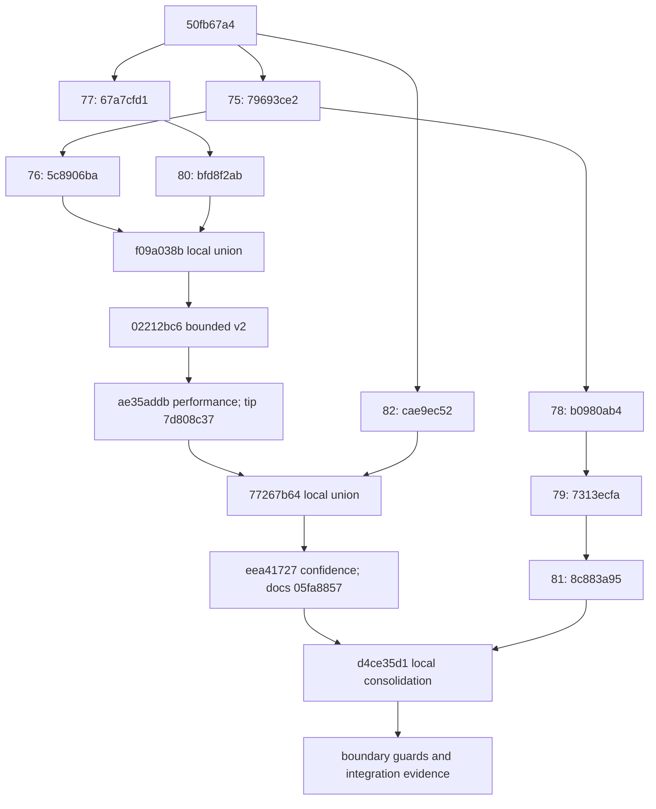

# Scientific v2 and durable pipeline consolidation

Local investigation, 2026-10-21. This combines the reviewed source *identities*,
not approvals to merge or activate them. All source PRs were still open drafts
at their requested heads when checked. No remote branch was changed or PR opened.

## Result and scope

The isolated branch `integrate/morpion-scientific-durable-v2`, in
`/tmp/chipiron-scientific-durable-v2`, combines the existing scientific writer,
bounded reader, Dataset confidence contract, neural certainty correction and
the three durability PRs. Scientific v2 extraction remains explicitly opt-in;
v1 capsule publication remains a separate, disabled-by-default protocol.
**Durable publication of scientific v2 is unsupported and rejected.**

The combination introduces no target policy, proof rule, parser or SQLite
framework. It retains the five supported confidence-v2 policies and the four
exact-family policy gates. An estimated direct 42 remains estimated even when
the same node has tree/effective FORCED(35). A certified terminal 35 is protected.
Different certified values on different family states are not contradictions.

The only new behavioral changes are two rejection guards at the integration
boundary: verify the actual selected export before sealing a v1 capsule, and
prevent the scientific-v2 writer from writing beneath a sealed capsule. The
reader merge retains lifetime pins and explicit format opt-in together.

## Exact ancestry: no implementation applied twice

| Source | Exact head | Pinned parent/base dependency |
| --- | --- | --- |
| #75 | `79693ce2dc59c6d6ccb951951c9ba75fa69057f3` | `50fb67a42577e195bc565f4d03e38d919640d08a` |
| #76 | `5c8906ba0d520c63d821e14a2d52530f8bed2307` | #75 |
| #77 | `67a7cfd1955f43d5947af01dbb324fb5efd93a0d` | main `50fb67a4` |
| #80 | `bfd8f2ab05f017ffda5e14af5dbf6e1f1afa3fde` | #77 |
| #82 | `cae9ec523edaaed277c8f953fafae5d9ac766701` | main `50fb67a4` |
| #78 | `b0980ab41cb1ebf178d4ef26d49e82dd5d57ca76` | #75 |
| #79 | `7313ecfad36667ab2a8dd1bbd4b894aa682a7e9b` | #78 |
| #81 | `8c883a95bdc308195384e9202c1f56ab9ebe2b48` | #79 |

`02212bc6130205b7d2ef898c7b1eb0f7d384f7aa` contains #75, #76, #77 and #80.
Its parent `f09a038b2589e124ffbb96a0d9936081692b3195` is exactly the merge of
#76 and #80. It does **not** contain #78, #79, #81 or #82.

`eea417271a822311e08dd8b88ee938ccb32ef2f4` already contains `02212bc6`,
performance implementation `ae35addb85ce75bd2438214fbadfe22ad677c307`, its
report tip `7d808c37113b5ea127bd473bc8c5b8e774492b8a`, and #82, through
merge `77267b64a675602f9567920be74555999792cc68`. Its documentation-only
child is `05fa885796aa66441926ed300fda269ede89cc5f`, used here so the local
scientific report and complete source evidence travel with the integration.
Neither confidence commit contains the durability stack.

#81 already contains #78 and #79, as well as #75. The common ancestor of #81
and the confidence tip is exactly #75. The local consolidation is therefore
one two-parent merge, **`d4ce35d1ce40cf45e93db866e39323fa6499c4d0`**, whose
parents are exactly `05fa8857` and `8c883a95`. No cherry-pick of a contained
implementation was performed. Its single conflict is the reader initializer:
pass `allow_scientific_v2` through the new pin-owning initialization wrapper,
retain both instrumentation fields, release the pin on initialization failure.
The follow-up declares helper-populated reader fields for the static analyzers;
it does not change their values or source interpretation.

[Machine-readable containment and protected-worktree baseline](scientific_durable_integration/ancestry.json),
[full reader ancestry](scientific_durable_integration/reader_ancestry.txt),
[full confidence ancestry](scientific_durable_integration/confidence_ancestry.txt),
[full durability ancestry](scientific_durable_integration/81_ancestry.txt), and
[GitHub PR metadata](scientific_durable_integration/prs.json) are retained.
These are complete `rev-list --parents` histories, not guessed relationships
from branch names or similar code.



## Scientific and legacy parity

The existing confidence audit was run twice with newly generated inputs:
untouched `05fa8857` production source from `git archive`, then consolidated
source. Both runs use the existing audit driver and scientific full oracle.
Its fixed synthetic producer label is retained verbatim for identical test
inputs; actual implementation identities come from the pinned source archives
and [complete source fingerprints](scientific_durable_integration/source_manifest.json),
not from that fixture label. [Reused harness identities](scientific_durable_integration/reused_harnesses.json)
verify that all six original audit/measurement helpers are unchanged.

* 1,890 legacy decisions cover **all nine policies**, both value preferences,
  three blends and seven filter/limit combinations across five case-generations.
* 1,050 supported confidence-v2 decisions cover the five enabled policies.
* 840 decisions reject the four gated policies on flat-with-v2-sidecar, full
  scientific reference and bounded paths.
* All 3,780 decisions are identical between revisions. Complete snapshots,
  value contracts, source provenance and the legal unequal-family witness match.
* The 2,940 successful decisions each compare three complete representations,
  with **8,820 literal JSONL pairs identical between revisions**, as well as
  exact parity among the three paths within each revision. Serialization
  roundtrips retain all fields. No targets, metadata or flags were normalized.

[Parity summary](scientific_durable_integration/parity.json),
[complete baseline outputs](scientific_durable_integration/before.json.gz), and
[complete integrated outputs](scientific_durable_integration/after.json.gz).
All 24 flat/export input files have matching fingerprints. The separately
generated patch files differ only in two explicitly retained scratch model-path
metadata fields; their full hashes and field differences are reported. They are
not claimed as byte-identical patches. The existing actual worker comparison
uses one source and one model identity and asserts **complete patch and cursor
byte equality**, including fallback, wrap and wrong-model cursor reset.

The generated real endgame from #82, not a mocked exactness flag, exercises
FORCED(35), neural ESTIMATE(42), TERMINAL(35), backup/direct preference,
exact-only filtering, same-state proof protection and ordinary estimates.
The independent four-node late-parent fixture covers current DAG links,
missing/null values, actual effective provenance and declared target source.
The same bounded reader continues to forbid full snapshots/oracle use in its
production path and to validate source and cache identities.

Nine additional integration cases compare full and indexed Dataset JSONL
through a **committed v1 capsule**, then reopen its existing cache. This is
parity relative to the historical v1 interpretation, not a claim that v1's
lossy fields have become scientifically equivalent to v2.

## Demonstrated boundary failures and corrections

Three regressions fail on the raw local merge and pass with the guards:

1. A future writer adapter returns an actual v2 `generation_000001/generation.json`
   under the conventional staging export directory. The v1 publisher's probe
   for `generation_000002.json` misses it and previously allowed a generic seal.
2. The same bypass works with a different private export directory name.
3. The new scientific-v2 writer could previously create files inside a sealed
   capsule, invalidating its inventory, because it did not participate in #81's
   cooperative writer protection.

The publisher now applies the existing explicit v1 classifier to the selected
non-baseline tree path **before sealing or moving**. The v2 writer calls the
existing `assert_artifact_writable` before creating its output directory. Rejected
attempts leave the committed run state, object set and sealed payload bytes intact.
The three cases plus nine managed-v1 policy cases pass. No v2 publication API
or format acceptance was added. These tests describe extension seams; they do
not claim that the old production dispatcher already invoked a v2 writer.

The new publication check recognizes the saved flat format's nested
`metadata.format_kind` / `metadata.format_version` only when no explicit
top-level format is declared. This preserves `flat` and `both` publication;
an explicit scientific-v2 envelope cannot be overridden by v1 snapshot metadata.
The existing baseline-adoption classifier keeps its prior default behavior.
All 37 boundary/publication regressions pass, including the pre-existing
flat/both cases that exposed this compatibility requirement during integration.

## Exactly what versioned v2 publication still requires

The existing capsule namespace/version refers to **publication v1**, whose
scientific adapter supports historical sharded v1. A successful reader parity
test does not extend that publication contract.

| Boundary | Existing #81 behavior | Required v2 publication work |
| --- | --- | --- |
| Format and commit identity | v1 path/header classification; generic capsule inventory | New publication version/namespace and seal binding source kind, schema 2, scientific contract, producer digest, export generation, generation descriptor hash and checkpoint identity |
| Prefix cloning | Rebuild `node_index.json` from v1 creation arrays | Clone only a committed v2 prefix; link immutable JSONL/generation files, create a private catalog inode, verify cumulative creation maps and descriptor hashes with the existing bounded reader |
| Generation identity | Growth G may skip export; later v1 catalog may have gaps | v2 root starts at 1 and is consecutive. Explicitly reject nonaligned baselines/gaps initially, or separately version a G-to-export-generation mapping. Never silently renumber source generations |
| Producer identity | Freeze changing model bytes each cycle, retain logical path/hash | v2 requires one producer per root. Define stable writer/codec/config identity separately from per-generation evaluator/model identity; any epoch transition must be explicit and preserve old lineage |
| Scientific validation | Full v1 merge verifies current export plus complete v1 history | Validate current values/contracts, current reciprocal DAG links, canonical refs, exact ordered updates and all referenced immutable records without a full scientific snapshot in the bounded consumer |
| Publication and recovery | Private capsule, fsync closure, no-replace rename, state commit, discovery, receipt ack | Reuse this ordering unchanged with the complete v2 dependency closure; orphan v2 catalogs/creation maps may never seed retries |
| Readers | Lifetime pins and inventory checks on v1 managed paths | Version-aware capsule locator/pin/manifest validation for both reference entrypoint and bounded v2 reader; uncommitted raw paths rejected; selected source and global generation mapping checked |
| Mutation heuristics | Hard-link ctime changes accepted only with committed hashes | Extend that protection to v2 metadata-preparation checks too; the present v2 pre-hash stat comparison still assumes unmanaged immutable source files |
| Receipts and downstream identity | Patch/checkpoint/model receipts, source tree generation | Bind export generation/producer/contract/hash to its global Growth generation, patch source and Dataset extraction identity; retain exact patch and cursor semantics |
| Retention | All committed capsules retained; only owned orphans collected | Preserve all committed v2 record dependencies, model/checkpoint provenance and reader pins. A bounded committed-generation collector remains separate |

The smallest first publication adapter can deliberately require an aligned,
new v2 history starting at Growth generation 1, reject skipped exports and
producer changes, and retain all committed capsules. That is a documented
restriction, not an implicit conversion of #81's broader v1 behavior. Supporting
adoption at G>1, export gaps or producer epochs requires an explicit versioned
mapping/lineage contract and additional review. No such mapping is implemented
here. In particular, generating filler snapshots or relabelling generation
numbers would fabricate provenance and is not an acceptable shortcut.

A new publication protocol must reject historical v1 scientific payloads as
v2; v1 readers and capsules retain their current meaning. Conversion should
create a new, explicit v2 artifact from an independently identified matching
checkpoint and retain its source hashes. Lost v1 certainty/provenance cannot
be reconstructed by trusting node flags. Rollback must leave new capsules
untouched and require an explicit compatible checkpoint; an old binary cannot
continue a new protocol by ignoring its metadata.

A new namespace/key alone does not guarantee that an older binary refuses the
workspace: older code may ignore an unknown metadata key. The compatibility
design must retain a fence it already recognizes, for example the existing
publication key with an explicitly unsupported schema version, or another
demonstrably fail-closed marker. Test old #81 and receipt-aware readers/writers
against this marker before claiming rollback or mixed-version safety.

Before enabling that adapter, port #81's process-death/fsync/rename/replace/unlink
matrix to actual v2 multi-generation fixtures. Include first generation,
zero-new-node generation, added DAG parent, explicit null target, producer
change, skipped export, interrupted catalog after directory rename, wrong
generation identity, modified creation map, incomplete inventory, double crash
during discovery repair, concurrent pinned reader/hard-link creation, abandoned
index and cache corruption, and alpha-0.5 receipt replay. Verify actual complete
Values, checkpoint RNG/selector state, patches, exact JSONL and every source
identity before and after cold restart. Existing v1 recovery tests cannot serve
as evidence that those v2 cases already pass.

## Validation and resources

Final installed-wheel CI passes **2,029 tests, two CUDA skips, zero failures**
in 526.73 seconds (controller 526.94 seconds). The standard marker selection
excludes the same four checkmate integration cases; no exclusions were added.
The installed wheel matches all **467 production Python files** at
`3c9ce1c2d45ccf686c34c8bf0d53ec908a1fdac1`. Wheel/sdist build, installed evaluator
and checkpoint contracts, repository Ruff lint/format (656 files), and toolchain
coherence pass. The strict mypy/Pyright/Pylint ratchet reports **zero new
identities**: 209 baseline, 206 current, three removed. No baseline was enlarged
and no diagnostic suppression was introduced.

The full suite includes 61 capsule tests (including 19 process-death boundaries
and 10 fsync failures), 54 checkpoint-receipt cases, 30 patch-publication cases,
71 scientific-reader cases, 61 scientific-writer cases, 96 certainty cases,
62 confidence cases, nine checkpoint-parity cases and 12 new boundary cases.
[Exact selected test identities, outcomes, skips, versions and artifact hashes](scientific_durable_integration/validation.json).
These are the repository's normal two pytest processes, not bootstrap workers.

The first sandboxed attempt exposed two flat-header guard regressions, corrected
above, plus five subprocess/IPC failures and a data-loader stall. Its outcomes
and interruption are retained. A subsequent run exhausted temporary filesystem
space while writing coverage. Only this task's disposable generated fixture
trees were removed. The successful final run used functioning subprocess IPC,
explicit temporary caches and the same assertions/selection. [Validation history](scientific_durable_integration/validation_history.json)
and all failed/successful logs remain in the evidence archive.

Full installed-package CI includes the existing #78 publication, #79 receipt and
#81 crash/recovery/concurrency cases; scientific v2 reader/writer/confidence
tests; actual neural certainty tests; and checkpoint/selector/RNG regressions.
The durability tests use generated scalar checkpoints and real v1 exports.
The actual runner tests use small newly generated legal states. Together they
cover the component contracts, without claiming an unimplemented v2 durable
checkpoint/export transaction. Process-exit tests do not simulate a storage
controller losing acknowledged writes.

Fresh serial comparisons show no material change at the measured sizes:

| V2 nodes | Cold init before / after (s) | Reused init before / after (s) | Dataset before / after (rows/s) | Dataset peak before / after (MiB) | Cold peak before / after (MiB) |
| ---: | --- | --- | --- | --- | --- |
| 1,000 | 3.0740 / 3.0861 | 0.0271 / 0.0273 | 1,967.8 / 1,976.6 | 254.10 / 254.08 | 254.33 / 254.41 |
| 5,000 | 24.0075 / 23.8513 | 0.1306 / 0.1293 | 1,941.7 / 1,951.9 | 255.56 / 255.69 | 256.52 / 256.82 |

Before is exact `05fa8857`; after is `3c9ce1c2`. Both use
`selected_value_v2`, direct preference, `pv_blend_mean_prediction`, balanced legal
synthetic replay states and 4 KiB per-node metadata. All declared values in these
resource fixtures are estimates, not optimality claims. The complete 1k and 5k
JSONL files, all source-file fingerprints and both reader source identities
match exactly. Each revision builds its own cold index and then reuses it in a
fresh Dataset process. Index sizes are 5,857,280 / 29,433,856 bytes; family TEMP
logical storage is 266,240 / 1,200,128 bytes. No shared cache interpretation was
relaxed to obtain these timings.

The independent v1 publication experiment repeats the existing driver with
baseline #81 source, then consolidated source. Each fresh process generates a
baseline and three saves, using identical scalar fixture populations, actual
v1 exports and tiny synthetic model bytes:

| V1 nodes | Mode | Three saves before / after (s) | Peak RSS before / after (MiB) | Allocated disk before / after (bytes) |
| ---: | --- | --- | --- | --- |
| 1,000 | Legacy control | 0.1439 / 0.1465 | 278.11 / 279.09 | 1,986,560 / 1,986,560 |
| 1,000 | Durable | 1.2036 / 1.2224 | 279.45 / 280.04 | 3,031,040 / 3,031,040 |
| 5,000 | Legacy control | 0.4500 / 0.4999 | 287.72 / 288.16 | 9,465,856 / 9,465,856 |
| 5,000 | Durable | 2.0057 / 2.0023 | 292.56 / 292.32 | 13,287,424 / 13,291,520 |

Every final checkpoint and scientific-export directory hash matches between
legacy/durable modes and between pinned/integrated revisions. Capsule UUIDs and
commit metadata are intentionally distinct per new run; no byte-equality claim
is made for those identities. Disk counts deduplicate hard-linked inodes; one
4 KiB allocation difference is not a payload difference. These v1 publication
numbers are **not v1-versus-v2 reader throughput comparisons**: they measure a
different operation with much smaller replay references. No v2 durable
publication cost or power-loss guarantee is inferred.

[Complete timings, RSS, CPU, I/O, disk and fingerprints](scientific_durable_integration/resources.json)
and the [existing-measurement probe](scientific_durable_integration/resource_probe.py)
are retained. These are single controlled samples on a shared host, not a
speedup claim. Generation-specific source indexes and capsule path identities
still cause rebuild/retention costs; no cross-capsule index sharing or repeated
immutable-validation optimization was added. No new 10k benchmark is claimed;
the prior integration/performance evidence remains separately fingerprinted.

Measurements use the existing `StageMeasurement`, process CPU/I/O helpers and
publication measurement driver, in fresh processes and serially after CI.
The scientific before/after uses the **same underlying v2 files**, graph, replay
complexity and confidence contract, with distinct disposable caches. Literal
JSONL hashes must match. “Cold” means a new SQLite index, not flushed OS caches.
RSS is actual process high water including imports; no Python allocation proxy
or throughput comparison against simpler historical v1 references is used.

The bounded reader still holds selected windows, parser buffers, bounded SQLite
page caches and disk-backed family state. Capsule inventory/source-manifest
metadata and individual record/proof-line size remain separate bounds. The
writer's input graph and the full oracle remain O(N); #81's validator still
materializes v1 snapshots. Capsule prefixes/inventories grow with generations,
and retaining all committed capsules is unbounded disk retention. None of these
limitations is removed by consolidation.

## Review sequence and exact bases

1. Review the existing PRs at the pinned heads: #75 → #76; #77 → #80;
   #75 → #78 → #79 → #81; and independent #82. These dependency edges are
   already clean. No existing branch needs rebasing, duplicated application or
   automatic merge. Defaults can stay off throughout review.
2. Once maintainers establish a shared approved base containing those heads,
   prepare a bounded scientific-reader integration PR containing only the
   `f09a038b..02212bc6` delta, the small measured performance delta
   `90360dd3..ae35addb`, and the pin/initializer reconciliation recorded here.
   This PR depends on #80 and #75/#76, and on #81 for capsule integration.
   Revalidate against its actual approved base SHA; that future SHA does not
   exist yet and is not invented in this report.
3. A Dataset confidence PR then contains only `77267b64..eea41727`, including
   its confidence tests and explicit five-policy/four-gate contract. Its base
   must contain the reader integration and #82. The current consolidated
   ancestry already contains it; do not apply it again to this local branch.
4. Review the small boundary-guard delta over exact local base `d4ce35d1`
   independently. It can accompany the future reader bridge once both writer
   and capsule dependencies exist. It rejects unsupported composition and does
   not activate v2 publication.
5. A **separate future publication-v2 PR**, based on the approved consolidated
   scientific and durability base, implements the versioned work above. It
   stays disabled until the v2 recovery matrix and identity contracts pass.

The present local merge is a reproducibility vehicle, not a proposed monolithic
PR. Opening it against #81 or #80 today would include the other unmerged stack.
No such PR was opened. Its exact-parent bundle and incremental review patch
allow inspection now without rewriting any source branch.

Two local review refs make that boundary concrete:
`integrate/morpion-scientific-durable-base` points to
`d4ce35d1ce40cf45e93db866e39323fa6499c4d0`;
`review/morpion-scientific-durable-boundaries` points to
`3c9ce1c2d45ccf686c34c8bf0d53ec908a1fdac1` (commits `993b57d1` and `3c9ce1c2`).
These refs name existing local commits; no implementation was replayed to
create them. [Exact review refs](scientific_durable_integration/review_refs.json).

Production activation additionally requires trustworthy producer/checkpoint
lineage, supported Dataset-v2 training consumers, filesystem qualification,
general writer fencing, producer cursor recovery, downstream Dataset/Training
and model-pointer durability, and a retirement strategy. The four exact-family
policies remain gated pending an independent mathematical proof contract.
Scientific parity, selected-source confidence and capsule v1 recovery each
establish their own contract; none alone authorizes production.
In particular, a historically false FORCED payload cannot generally be
distinguished from a genuine proof just by reading its certainty enum. #82
corrects new built-in predictions; this consolidation does not relabel old
checkpoints or manufacture certificates from historical v1 flags.

## Reproduction

Use Python 3.13 and the installed pinned dependencies (Anemone 0.2.26,
Atomheart 0.2.11, Valanga 0.2.5). Choose new scratch paths for every generated
fixture. Restore the local bundle only into an isolated repository/worktree.
The existing source objects are prerequisites of its incremental history.

```bash
PYTHONDONTWRITEBYTECODE=1 PYTHONPATH=src:. python \
  docs/research/dataset_confidence_v2/audit.py --root /tmp/NEW-consolidated-audit

# Extract exact 05fa8857 src with git archive into /tmp/BASELINE first.
PYTHONDONTWRITEBYTECODE=1 PYTHONPATH=/tmp/BASELINE/src:. python \
  docs/research/dataset_confidence_v2/audit.py --root /tmp/NEW-baseline-audit

PYTHONPATH=src:. python -m pytest --no-cov \
  tests/environments/test_morpion_scientific_durable_integration.py \
  -p docs.research.benchmarks.morpion_training_export_20261020.validation_safety
```

The evidence archive retains literal outputs, complete logs, source identities,
resource commands/results, wheel/sdist, the isolated branch and incremental
patches. The safety plugin directs optional default leaderboard writes to new
pytest temporary paths; it does not weaken scientific or recovery assertions.
No historical artifact, gen38 operation, distributed/bootstrap worker, remote
merge or production activation is part of this work.
