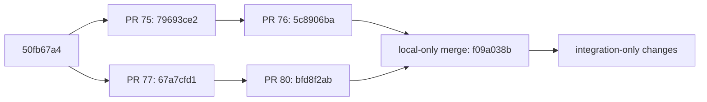

# Scientific v2 integration with the bounded sharded reader

Local integration evidence, 2026-10-20. This is experimental infrastructure with
both routing switches off by default. Reader parity does **not** resolve the
selected-value certainty question or authorize production activation.

## Pinned dependencies and review strategy

| Component | Exact commit |
| --- | --- |
| PR #75 bounded reader | `79693ce2dc59c6d6ccb951951c9ba75fa69057f3` |
| PR #76 streaming Dataset | `5c8906ba0d520c63d821e14a2d52530f8bed2307` |
| PR #77 investigation | `67a7cfd1955f43d5947af01dbb324fb5efd93a0d` |
| PR #80 scientific writer/reference | `bfd8f2ab05f017ffda5e14af5dbf6e1f1afa3fde` |
| Shared ancestor | `50fb67a42577e195bc565f4d03e38d919640d08a` |
| Local integration base merge | `f09a038b2589e124ffbb96a0d9936081692b3195` |

The worktree is `/tmp/chipiron-scientific-v2-reader`, branch
`integrate/morpion-scientific-v2-reader`. The base merge has exactly PR #76 and
PR #80 as its two parents. PR #76 descends directly from PR #75; PR #80 descends
from PR #77. Neither stack contains the other. The existing PRs were open and
unmerged when inspected. No existing PR branch or dirty research checkout was
modified.



A GitHub PR has one base branch. Opening this branch against either current
stack would include the other stack's implementation and obscure review. Per
the task's dependency rule, this delivery remains local; no duplicate-code PR
was opened or pushed. Safe order: review and integrate #75 then #76, and #77
then #80, keeping their defaults disabled; once both stacks exist in the shared
base, create a fresh integration branch and apply only the integration commit
following `f09a038b`. Re-run this evidence and CI against the resulting ancestry,
then open the separate integration draft. If upstream SHAs change, re-establish
both dependency identities and rerun parity; do not rewrite existing branches.

PRs #75 and #76 can be reviewed as disabled v1 infrastructure independently of this
integration. Their parity is relative to sharded v1, whose historical target,
provenance and stale-parent limitations remain. Neither that parity nor this
v2 oracle parity proves flat/v1 scientific equivalence or resolves activation.

## Contract and implementation

`ShardedTrainingGenerationView` remains the only indexed reader. It uses the
existing ijson backend selection, SQLite records/updates tables, deterministic
BINARY cursor order, selected-node loading, export-order iteration, source
fingerprints, and TEMP workspace. The v2 full reference reader is unchanged
from #80 and is used only by offline tests/parity processes.

The v2 kind is `morpion_scientific_training_export`, schema version `2`, contract
`anemone-values-canonical-morpion-1`. Both manifest roles and JSONL shard
headers must agree. Missing/unknown fields, unsupported contracts or versions,
ambiguous scientific manifests, mixed producers, shard hash/count mismatches,
missing updates, noncanonical references, incomplete creation indexes,
nonreciprocal edges, and cycles are rejected. V2 never enters a v1 value merge
or a full-reader fallback on the indexed consumer path.

| Information | Indexed v2 behavior |
| --- | --- |
| D, T, E and effective source | Saved independent values and source copied exactly; no tree/direct heuristic |
| Selected export target | Saved scalar plus declared source in `load_value_contracts(ids)` |
| Per-value certainty, events, lines, opening completeness | Complete detached value contracts for selected IDs |
| Missing versus null | Mandatory saved fields checked before reconstruction; explicit null remains null |
| Exact/terminal flags, visit count, depth, metadata | Saved node fields copied; no certainty reinterpretation |
| Current parents and children | Generation update fields, including incoming edges added after creation |
| Canonical references | Immutable creation records; one-at-a-time canonicality validation under pinned Atomheart 0.2.11 contract |
| Generation/producer | Exposed through `generation`, `provenance`, `scientific_contract`, `format_kind`, `format_version` |
| Snapshot header | `snapshot_metadata`, `created_at_unix_s`, `root_node_id`, `node_count()` without a snapshot |

Cache schema epoch is now 2; disposable older indexes rebuild. V1 saved source
semantics and valid output remain unchanged. V1 and v2 fingerprints include
format kind/version, contract, generation, producer and exact source hashes;
they cannot reuse one another's caches. V2 also hashes ordered SQLite payloads
on completion and reuse to detect valid-SQLite payload corruption. Cache reuse
still scans source contents and verifies this digest; it is intentionally not
an O(1) trust-by-stat operation. Publishing a later catalog conservatively
invalidates an older generation's cache identity without altering that older
generation's values.

The large v2 `creation_index` map is skipped during metadata materialization,
then streamed into a TEMP keyed table on the same SQLite connection. Topology
validation and Kahn traversal use disk tables rather than Python graph maps.
Transactions commit every 256 rows/vertices to bound rollback journals. Dataset
continues to use #76's disk-backed family computation and exact policy arithmetic.
V2 supports nullable family values with the same successful outputs or policy
errors as the full reference; v1 retains its legacy fallback behavior. A v2
Dataset context owns one active output iterator and closes it before a new pass
or cleanup, including interrupted serialization.

## Disabled routing and the hard activation prerequisite

The view and the Dataset/Reevaluation entry points add
`allow_scientific_v2=False`. Consumer entry points also require the existing
`use_streaming_sharded_reader=True`. There is no new launcher, dispatcher,
configuration, or CLI setting that turns this on. Dataset requires the supported
sharded/JSONL path; Reevaluation requires the existing bounded window protocol
when using a custom evaluator. Unsupported v2 requests fail explicitly.

The unresolved scientific prerequisite is **node exactness versus certainty of
the value selected for training**. A partially opened node can have forced
D=9, estimated T=3, effective D=9 and `is_exact=True`, while the declared tree
training target is the estimate 3. Existing Dataset exact-family anchoring and
exactness filtering can treat that selected estimate as certified. V2 exposes
`backup_exactness_compatible=False`; the integration deliberately does not
change the nine policies, silently reject these nodes, or label this invariant
as solved. Activation needs a separately reviewed producer invariant or an
explicit per-selected-value certainty policy, with filtering, anchoring,
blending, metadata, historical behavior and continuation tests. Reader parity
alone cannot establish scientific readiness.

Reevaluation retains existing terminal behavior: terminal nodes with a saved
tree/backup value bypass model inference; terminal nodes with null backup still
follow the existing model path. Model-owned cursors, wrap and patch metadata
are preserved. Source identity is rechecked before scientific patch publication.
This adds no new checkpoint/continuation or exactly-once publication guarantee.

## Parity and failure evidence

The dedicated integration tests compare every node field, selected value
contract, provenance, snapshot header and cursor result with the unchanged full
v2 reference. They forbid the full reader, `TrainingTreeSnapshot` construction,
and source `read_text()` in the indexed path. Coverage includes:

- All nine policies, both backup modes, blends 0/.25/1, seven filtering/limit
  combinations: 378 exact row, metadata and serialized JSONL comparisons.
- Policy-specific null-value successes and errors; all declared export target
  sources; signed zero, tagged value lines, actual legal terminal boards with
  present and absent tree values; current late DAG parents and generations.
- Actual Dataset pipeline row bytes, manifests, statuses and optional leaderboard
  presence/bytes, and actual Reevaluation patch/cursor bytes for snapshot/model
  evaluation with matching and mismatching model cursor ownership.
- Interrupted index creation and output, source mutation before atomic output
  replacement or patch publication, semantically corrupted cache payloads,
  producer changes, repeated-generation reuse and v1/v2 isolation.
- A creation map larger than 4 MiB (3k long IDs), below an 8 MiB Python allocation
  assertion; malformed envelopes, duplicate fields, malformed tails, incomplete
  creation maps, unsupported contracts, rehashed noncanonical references, stale
  edges and cycles.

Small fixture helpers use real checkpoint codecs and authoritative Value APIs.
Resource fixtures deliberately repeat valid boards at a depth across distinct
IDs to control node/edge counts. They are synthetic contract/resource tests,
not a claim of independently certified game results or historical experiments.

## Reproduction and resource evidence

Run from this isolated worktree with Python 3.13, the project's pinned runtime
and test dependencies, and `ijson`. Generate each source in a separate process
before measurements; generation may materialize the fixture, the production
reader must not. Use a fresh scratch root per size:

```bash
export PYTHONPATH=src:.
export QT_QPA_PLATFORM=offscreen
python scripts/benchmark_morpion_scientific_reader.py --action prepare --size 1000 --root /tmp/new-v2-reader-1k
python scripts/benchmark_morpion_scientific_reader.py --action cold --size 1000 --root /tmp/new-v2-reader-1k
python scripts/benchmark_morpion_scientific_reader.py --action reuse --size 1000 --root /tmp/new-v2-reader-1k
python scripts/benchmark_morpion_scientific_reader.py --action parity --size 1000 --root /tmp/new-v2-reader-1k
python scripts/benchmark_morpion_scientific_reader.py --action dataset --size 1000 --root /tmp/new-v2-reader-1k
```

Repeat serially for 5000 and 10000 nodes. Each resource process forbids calls
to the full oracle. Sources have two generations, an added incoming DAG parent,
a changed direct value, nullable tree targets, mixed certainty and 4 KiB of
metadata per node. The selected Reevaluation window has 64 nodes and wraps.
The deterministic evaluator double exercises real state decoding and patch
serialization; these are not neural model throughput measurements.

Existing `StageMeasurement` records actual Linux process peak RSS through
`resource.getrusage`, current RSS, wall time and memory observations. Raw evidence
also records user/system CPU, `/proc/self/io` logical/physical I/O, source/index
bytes, sampled main/journal bytes and SQLite TEMP logical pages. Logical TEMP
bytes are explicitly **not** a measured filesystem high-water mark. Cold means
no reader index; OS page caches were not flushed. RSS includes imported runtime
libraries and no trained model weights. Full-reference parity runs are separate
and excluded from bounded-process memory measurements.

Final successful samples, one fresh process per mode, run serially after the
full suite/static checks and reference runs finished:

| Nodes | Cold init s | Reuse init s | Cold CPU s | Reader peak MiB | Index MiB | Reused scan nodes/s |
| ---: | ---: | ---: | ---: | ---: | ---: | ---: |
| 1,000 | 3.114 | 0.028 | 2.720 | 253.76 | 5.59 | 11,199 |
| 5,000 | 23.683 | 0.130 | 22.282 | 255.80 | 28.07 | 11,363 |
| 10,000 | 55.332 | 0.264 | 52.691 | 257.21 | 56.28 | 11,140 |

Reader peak is the actual process high water over initialization, the selected
64-node window and the complete export-order scan. Reuse peaks were 252.91,
253.39 and 253.56 MiB. Cold initialization includes canonical state validation
and disk-backed DAG/index validation. Tree depth grows with fixture size, so
these are workload samples rather than a constant per-node cost claim.

The complete Dataset measurement uses
`pv_exact_then_blend_mean_prediction`, includes reuse validation, family context,
header calculation, atomic JSONL writing and the final source guard, and
forbids the full reference reader:

| Source nodes | Saved rows | Wall s | Rows/s | Process peak MiB | TEMP logical MiB |
| ---: | ---: | ---: | ---: | ---: | ---: |
| 1,000 | 816 | 2.526 | 323.0 | 252.79 | 0.25 |
| 5,000 | 4,077 | 19.491 | 209.2 | 254.81 | 1.13 |
| 10,000 | 8,154 | 44.870 | 181.7 | 255.84 | 2.22 |

The existing default value/filter rules explain why saved row counts differ
from source node counts. All nine policies produce exactly the same respective
row counts as the oracle. The 27 policy/size output pairs contain 117,423 rows
per format and pass an independent buffered byte comparison. Cold and reused
scan/window scientific digests also match the full oracle. The fixtures retain
41/214/435 nodes with incompatible backup certainty, respectively; passing
parity has not hidden or corrected that scientific gate.

Cold initialization physical read/write bytes were 5,304,320/6,828,032,
22,003,712/35,172,352 and 0/73,658,368. Reuse physical reads/writes were zero for
these warm-page-cache samples; logical reads and all Dataset/window/scan CPU,
I/O, RSS, source sizes, disk samples and digests remain in
[resources.json](benchmarks/morpion_scientific_reader_20261020/resources.json).
Zero physical reads do not mean validation skipped file contents. A benchmark
stats `Path` serialization error was fixed before the final Dataset samples;
the unsuccessful report and initial samples remain archived in scratch.

The full local installed-wheel CI suite passed **1,710 tests, 2 skipped** in
496.37 seconds; only the workflow's four marker exclusions were deselected.
The two skips require CUDA. The additional Unicode/NUL export-versus-cursor
order test, added after collection, passed separately and covers all nine
policies. Sdist/wheel build, installed-distribution smoke guard, toolchain,
Ruff formatting/check and the full mypy/pyright/pylint ratchet passed. Static
findings: baseline 209, current 206, **new 0**, removed 3. This is local CI-gate
evidence; no hosted integration PR workflow was started.

The full suite uses the inherited
[validation safety fixture](benchmarks/morpion_training_export_20261020/validation_safety.py)
to put default optional leaderboard writes in pytest temporary directories.
It retains record logic and assertions and changes no test selection, target
policy or HOME. The complete invocation, dependency versions, selected/skipped
identities and evidence hashes are retained in
[validation.json](benchmarks/morpion_scientific_reader_20261020/validation.json).
The exact dependency PR heads/states are in
[dependencies.json](benchmarks/morpion_scientific_reader_20261020/dependencies.json),
and every large output pair's row count, bytes and SHA256 is in
[byte-parity.json](benchmarks/morpion_scientific_reader_20261020/byte-parity.json).
Local `.ci-reports/` retains the full test identity/phase, JUnit and coverage
records. No historical generation, real gen38 operation, bootstrap/distributed
worker, automatic merge or production activation was used.

## Remaining limits

Python memory depends on the selected window, largest individual JSON row/state,
parser buffers, capped metadata and explicit SQLite caches, rather than total
nodes or families. An exceptionally large single row or replay reference still
costs its own size. Main/TEMP page caches are each 2 MiB, mmap is disabled, parser
buffers are 64 KiB (the existing lossless escaped-surrogate fallback is slower).
Non-creation manifest metadata has a 4 MiB logical event budget, including the
catalog's generation list and shard descriptors; extremely many generations
can be rejected. The full reference reader, writers, legacy snapshot fallbacks
and downstream training ingestion retain their existing global-memory costs;
this integration makes no bounded-memory claim for those paths. Historical v1
information loss cannot be repaired by the indexed reader.

Disk remains proportional to records, updates, edges and family context. Each
generation has a disposable index; no cache eviction policy is added. Full-file
source validation and v2 cache digest checks keep reuse I/O proportional to
source/index bytes. Validation decodes one state per immutable record on a cold
build. Large/deep replay histories and highly connected individual nodes require
separate workload profiling before production consideration.

## Required tests before any activation proposal

1. Resolve the certainty/selected-score invariant with Anemone's authoritative
   semantics, including partial/complete opening, opposing certainty ties,
   direct/tree disagreement, null selected values, terminal and forced values.
   Test exact filtering and every exact-family anchoring/blending policy against
   that reviewed contract. Keep historical policy behavior explicitly versioned.
2. Re-run all nine policies and actual Dataset/Reevaluation worker artifacts on
   the eventual merged ancestry; retain exact serialized reference bytes,
   counters, model identities, current DAG edges and source fingerprints.
3. Add real search/continuation fixtures under the accepted producer policy and
   real model bundles. Checkpoint reproducibility needs its own round-trip and
   patch-consumption evidence; an export reader is not a checkpoint loader.
4. Exercise source publication races, corrupted and crash-left caches, nullable
   values, interrupted publication, model changes and repeatable multi-pass
   extraction on every supported dependency version. Preserve v1 fixtures.
5. Profile bounded cold/reuse/Dataset behavior on additional synthetic deep,
   high-degree and many-generation shapes, including escaped-surrogate replay
   references, large individual states and disk limits. Set an explicit cache
   retention policy and operational resource budgets.
6. Obtain a separate reviewed activation change with explicit format/policy
   selection and rollback behavior. Keep current defaults and historical saved
   experiments unchanged until then.
